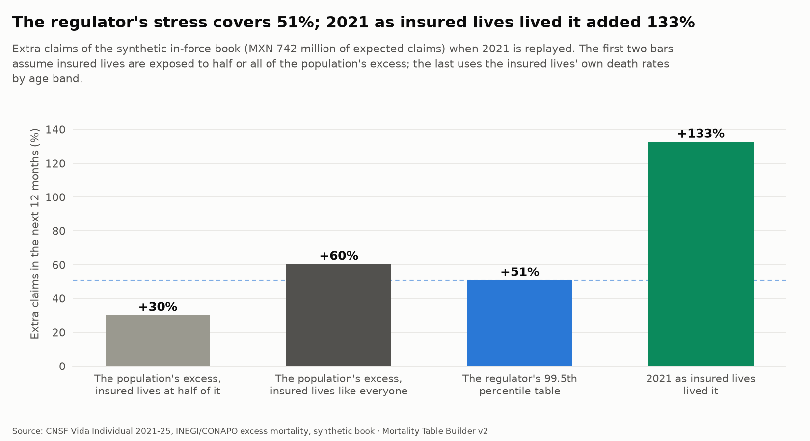
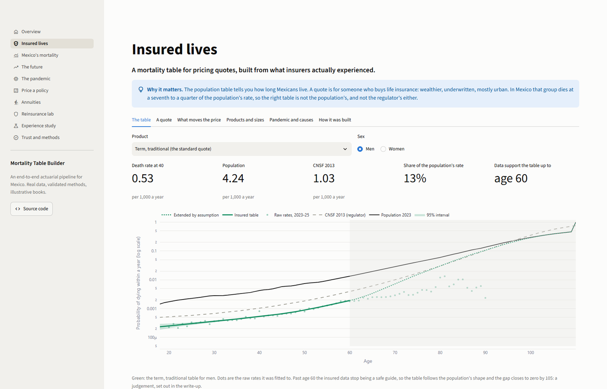
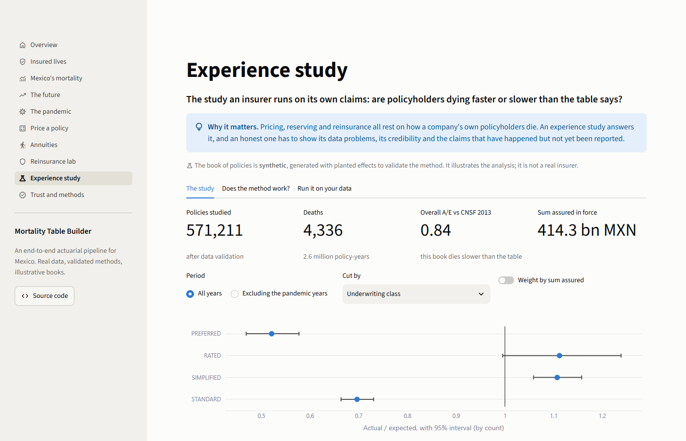

<div align="center">

# Mortality Table Builder

**From Mexican death records to the table a quote is priced on, then to reserves and reinsurance.**<br>
An end-to-end actuarial pipeline, validated at every step. **Version 2: the insured-lives table.**

[](https://mortality-table-builder.streamlit.app/)
[](https://github.com/deadmigue55/Mortality-Table-Builder/actions/workflows/ci.yml)


[**Live dashboard**](https://mortality-table-builder.streamlit.app/) ·
[**Insured-lives write-up**](docs/insured-lives.md) ·
[**Methodology report (PDF)**](reports/methodology.pdf) ·
[**Excel workbook**](reports/Mortality_Table_Builder.xlsx) ·
[**Write-ups**](docs/)

<br>


</div>

---

Mexico's regulatory mortality table (CNSF 2013) is more than a decade old and mixes both sexes. This project **rebuilds the table from the raw data** (INEGI registered deaths, CONAPO population) and then does with it what an insurer or a reinsurer does: graduates and projects it, runs an experience study, prices a policy, reserves it, stresses it with the pandemic and with longevity, structures a reinsurance treaty and prices a longevity swap.

> [!NOTE]
> The mortality is real or derived from real data. The **book of policies, the annuity block and the market assumptions** (expenses, commissions, lapses, cost of capital) are **synthetic or illustrative**, and labeled that way wherever they appear. The method is validated by planting known effects in the synthetic book and checking that it finds them.

## Version 2: the table a pricing actuary needs

**Version 1** rebuilt Mexico's mortality from the registered deaths of the whole population. That answers population questions (life expectancy, the pandemic, longevity) and is the wrong table for **pricing a quote**: the people who buy life insurance are wealthier, underwritten and mostly urban. **Version 2** builds the table from the industry's own statistics (the CNSF's *Sistema Estadístico de Vida Individual*, 2021 to 2025: 81,000 death claims and about 20 million insured lives a year in the three base years), compares it with the population, the regulator's CNSF 2013 table, the US insured table and nine national tables, and explains every choice and what it costs. Version 1 is tagged [`v1.0.0`](https://github.com/deadmigue55/Mortality-Table-Builder/releases/tag/v1.0.0) and stays the population reference.

<p align="center"></p>

| | |
|---|---|
| **How different** | Insured lives die at **14% to 25% of the population's rate** between ages 20 and 65. A US insured life dies at 44% to 79% of the US national rate: the Mexican gap is about **three times** the American one |
| **A quote** | A man of 40, 20-year term, net premium per 1,000: **0.85** on the insured traditional-term table, 1.74 on CNSF 2013, 2.52 on the US insured table, **6.62** on the population. A woman of 40: **0.38**, against 1.74 on the (unisex) regulator's table |
| **Who they die like** | Insured men of 40: **Sweden in 2021**. The population, at the same age: the **United States in 1966** |
| **One table is not enough** | Whole life and endowments die at **2 to 3.5 times** traditional term; credit life at 1.3 to 2. Quoting a traditional term policy on the market-wide table would overcharge by **40%** |
| **The pandemic** | Insured lives were **not shielded**: in 2021 their death rates were up to **2.7 times** their 2023 level (the population's: 1.7), so the stress test now replays 2021 as insured lives lived it |
| **Three traps in the data** | One death claim in five is an **accounting ledger**, not a death; **2,300 "sprained ankle" claims** are endowment maturities; deaths must be measured against lives holding the **death cover** |
| **Margin** | **15%** on mortality, sized from the adverse readings that cannot be ruled out (12.4% in quadrature) |
| **What it does to a price** | At the same 10% target return, a 20-year term priced on the insured table costs **20% to 34% less for men and 45% to 57% less for women** (ages 25 to 60) than the same policy priced on CNSF 2013: a man of 40 pays 1.57 per 1,000 against 2.32 (**-32%**). If mortality is as measured it earns **12% to 21%** a year against the 10% target |
| **Room in the market** | Traditional term wrote **MXN 43.2 billion** of premium in 2023 to 2025 and reported **MXN 9.5 billion** of death claims: **22%** of premium (premium also pays commissions and expenses, so this is room in a price, not profit) |
| **Why volume pays** | The one-year swing in a book's claims (men at 40, equal policies) falls from **43%** at 10,000 policies to **14%** at 100,000 and **4%** at 1,000,000: a lower price that wins quotes makes the book steadier. The 15% margin covers one standard deviation from about **83,000** policies. Winning more quotes is the mechanism, not a measured result |
| **Honest about its limits** | Above about 60 for term and 83 for whole life the data stop describing insured lives; the table follows the population there **by assumption**, flagged in every table and figure |

<table>
<tr>
<td width="50%"></td>
<td width="50%"></td>
</tr>
<tr>
<td width="50%"></td>
<td width="50%"></td>
</tr>
<tr>
<td width="50%"></td>
<td width="50%"></td>
</tr>
<tr>
<td width="50%"></td>
<td width="50%"></td>
</tr>
</table>

[**Read the full write-up**](docs/insured-lives.md): the data, the three traps, an 18-line decision log (what was chosen, why, and what the alternative does to a quote), the method, validation and limits. Or open the **Insured lives** page of the [live dashboard](https://mortality-table-builder.streamlit.app/).

---

## Explore it

| | |
|---|---|
| **Dashboard** | **[Open the live demo](https://mortality-table-builder.streamlit.app/)**. Ten pages, including **Insured lives**; four are live labs: price a policy, value a pension, design a reinsurance treaty, and run the experience study on **your own policy extract**. Locally: `uv run mortality app` |
| **Report** | A 13-page methodology report with a Spanish executive summary. Every number in the text is computed from the data when it is rendered: [`reports/methodology.pdf`](reports/methodology.pdf) |
| **Excel workbook** | Life tables with **live commutation formulas** (Dx, Nx, Mx driven by one interest cell) and a premium calculator, checked against the Python code by an independent formula engine: [`reports/Mortality_Table_Builder.xlsx`](reports/Mortality_Table_Builder.xlsx) |
| **Write-ups** | One document per step with method, results and limits: [`docs/`](docs/) |

<table>
<tr>
<td width="50%"></td>
<td width="50%"></td>
</tr>
<tr>
<td width="50%"></td>
<td width="50%"></td>
</tr>
<tr>
<td width="50%"></td>
<td width="50%"></td>
</tr>
</table>

## What the population study found (version 1)

| | |
|---|---|
| **Life expectancy at birth, 2023** | 78.9 years for women, 72.9 for men |
| **Against the regulatory table** | Mexican men aged 40 die at **4.1 times** the CNSF 2013 rate, women at 1.5 times |
| **The pandemic** | About **746,000 excess deaths** in 2020 to 2022 (range 676,000 to 791,000 over four baselines): 1.56 for each certified COVID-19 death |
| **A repeat of 2021 on an insured book** | **+60%** claims in a year; the regulator's own 99.5th percentile table adds only 51% |
| **An annuity book** | One point of interest (+8.1% reserve) matters more than doubling mortality improvement (+2.3%) |
| **Reinsurance** | The pandemic is **41%** of the claims capital; a stop loss relieves 60% of it at a price of 6% per peso, a quota share costs 20% |
| **Method validation** | The experience study recovers **15 of 15** effects planted in a synthetic portfolio |

## What this project demonstrates

- **Actuarial depth, end to end.** Graduation (P-spline, Whittaker-Henderson, Heligman-Pollard, Kannisto), life tables and commutation functions, Lee-Carter and CBD projection, an insurer-style experience study (A/E, credibility, GLM relativities, claims-lag completion), profit testing, reserves, excess mortality, stress testing, reinsurance structures and a longevity swap.
- **Validation instead of assertion.** Every method is checked against something independent: HMD's published life expectancy (to 0.007 years), an R implementation (StMoMo, to 0.00002 years), a **planted truth** in a synthetic portfolio, a backtest of past forecasts, and an Excel recomputation. The 122 data checks (4 documented warnings) and 410+ tests run on every commit.
- **Honesty about limits.** The four warnings in the data checks are documented, not hidden; the stress tests say which conclusion depends on which assumption.
- **Engineering.** A reproducible pipeline with a SHA-256 manifest of every input, a SQLite warehouse with 92 documented tables, a CLI, CI, pre-commit hooks, and a public demo bundle built from an **allow-list** so licensed data (the Human Mortality Database) can never leak into the repository.
- **Communication.** A dashboard for managers, an Excel workbook for actuaries, a report for reviewers, a Spanish summary for Mexican readers.

<details>
<summary><b>Resumen en español</b></summary>

<br>

**Mortality Table Builder** reconstruye las tablas de mortalidad de México a partir de los microdatos de defunciones del INEGI y de la población de CONAPO, y las utiliza como lo haría una aseguradora o una reaseguradora: graduación y proyección, estudio de experiencia, precio de un seguro temporal, reservas, pruebas de estrés de pandemia y longevidad, reaseguro y un swap de longevidad.

Los hombres de 40 años mueren a 4.1 veces la tasa de la tabla regulatoria CNSF 2013. Entre 2020 y 2022 murieron unas 746,000 personas más de lo esperado. Una repetición de 2021 elevaría los siniestros de una cartera asegurada en 60%, más que el escenario de estrés de la propia CNSF (51%). La cartera de pólizas es sintética y los supuestos de mercado son ilustrativos; la mortalidad es real o se deriva de datos reales. El informe completo, con resumen ejecutivo en español, está en [`reports/methodology.pdf`](reports/methodology.pdf).

**Versión 2: tabla de vida asegurada.** Con las estadísticas de la CNSF de Vida Individual (2021 a 2025) se construye la tabla que usa quien cotiza un seguro: los asegurados mexicanos mueren a entre 14% y 25% de la tasa de la población (un asegurado estadounidense, entre 44% y 79% de la nacional). Un hombre de 40 años en un temporal a 20 años paga una prima neta de 0.85 por millar con la nueva tabla, 1.74 con la tabla CNSF 2013 y 6.62 con la población. Los datos tienen tres trampas (un quinto de los siniestros por fallecimiento es un libro de ajustes, unos 2,300 "esguinces" son vencimientos de dotales y las defunciones deben medirse contra las vidas con cobertura de fallecimiento). La explicación completa, con cada decisión y su costo, está en [`docs/insured-lives.md`](docs/insured-lives.md).

</details>

## Quick start

No data download is needed to explore: the repository carries a small demo bundle of derived tables (no raw data, no licensed data).

```sh
git clone https://github.com/deadmigue55/Mortality-Table-Builder.git
cd Mortality-Table-Builder
uv sync --all-extras            # Python 3.12 and every dependency (uv installs Python for you)
uv run mortality app            # the dashboard at http://localhost:8501
uv run mortality export-excel   # the actuarial workbook
```

Prefer a browser? The repository includes a Codespaces configuration that installs everything and starts the dashboard. To rebuild everything from the sources (about 10 minutes), see [Rebuild from the sources](#rebuild-from-the-sources).

---

## Why this matters

Life insurers and reinsurers price and reserve with mortality tables. In Mexico the regulatory tables in force are deliberately conservative, rest on experience that is more than a decade old, and predate COVID-19; each insurer's own experience tables are private. This project builds a transparent, up-to-date alternative from official data and asks four questions:

- **How far is the population from the regulatory tables?** By age, sex, state and year.
- **What changes in pricing?** How term and annuity prices, and the reserves behind them, move with the table.
- **What is next?** How mortality will improve, and how much capital longevity risk needs.
- **What did COVID-19 do?** How large excess mortality was in 2020 to 2022, and what a pandemic does to an insured book and a reinsurer.

## How it works

| # | Step | What it does | Write-up |
|:-:|---|---|---|
| 1 | **Setup** | Package, environment, tests, linting, CI | |
| 2 | **Ingestion** | INEGI, CONAPO, CNSF, SOA, HMD into a SQLite warehouse with a SHA-256 manifest and automatic checks | [warehouse](docs/warehouse.md), [sources](docs/data-sources.md) |
| 3 | **Data quality** | Age heaping, unknown ages, late-registration completion, COVID flags | [data quality](docs/data-quality.md) |
| 4 | **Crude rates** | Exposure, rates with exact intervals, standardization, state SMRs, benchmarks | [crude rates](docs/crude-rates.md) |
| 5 | **Graduation** | P-spline, Whittaker-Henderson, Heligman-Pollard, Gompertz-Makeham, Kannisto closure | [graduation](docs/graduation.md) |
| 6 | **Life tables** | lx to ex, commutation functions, insurances, annuities, premiums | [life tables](docs/life-tables.md) |
| 7 | **Projection** | Lee-Carter and CBD in Python and R, backtest, fan charts, cohort tables | [projection](docs/projection.md) |
| 8 | **Experience study** | Insurer-style A/E, credibility, GLM, select period, claims lag, validated by planting | [experience study](docs/experience-study.md) |
| 9 | **Applications** | Excess mortality, pricing and reserves, stress tests, reinsurance and a longevity swap | [excess](docs/excess-mortality.md), [pricing](docs/pricing.md), [stress](docs/stress-tests.md), [reinsurance](docs/reinsurance.md) |
| 10 | **Dashboard, workbook, report** | Streamlit app, Excel with live formulas, Quarto report | [deploy](docs/deploy.md) |
| 11 | **Insured lives (version 2)** | The CNSF industry statistics into a table family for pricing: data traps, graduation, comparison with the population, CNSF 2013, the US and nine countries, sensitivity and margin | [insured lives](docs/insured-lives.md) |

## Results by step

Each step has its own write-up; these are the findings that matter most. Expand a step to read them.

<details>
<summary><b>3. Data quality</b>: no age heaping, late registrations completed</summary>

- Death certificates show no age heaping (Whipple 98 to 101), comparable to the HMD countries.
- Late registrations are completed with an actuarial chain-ladder triangle per age band: 2024 gains 2.3%, within 1% of CONAPO's independent projection.
- Unknown sex and age are allocated proportionally (0.45% to 0.61% of deaths); unspecified-residence deaths stay in the national count.
- COVID years are flagged from cause-of-death codes (2020 to 2022).

[Full write-up](docs/data-quality.md)
</details>

<details>
<summary><b>4. Crude rates</b>: Mexican men die 3 times as fast as the regulatory table says</summary>

- Mexican men die **3.0x** as fast as the CNSF 2013 table predicts at ages 25 to 84 (4.1x at 40 to 44); women 1.8x.
- Age-standardized male mortality rose **51%** in 2020 and was back at the 2019 level by 2023.
- Chihuahua and Colima run about 19% above their age mix, Sinaloa 19% below.
- Men aged 25 to 29 die at 6.7x the rate of Spanish men, 1.6x that of US men.

<table>
<tr>
<td width="50%"></td>
<td width="50%"></td>
</tr>
</table>

[Full write-up](docs/crude-rates.md)
</details>

<details>
<summary><b>5. Graduation</b>: four methods, digit preference found, old ages closed</summary>

- Four methods are compared on every year and sex; smoothing is chosen by a quasi-AIC whose dispersion is estimated from the crude rates themselves.
- Heligman-Pollard fits about 9x worse than the P-spline in 2023: Mexican men's young-adult plateau is not something a parametric law bends to.
- **Digit preference in men's death records:** +1.3% to +2.5% excess deaths at ages ending in 0 and 5, every year, invisible to the Whipple index.
- **Crude old-age data are not credible:** above about 88, women's rates overtake men's (a sign of age exaggeration), so ages 90 to 110 come from a Kannisto logistic fitted on 75 to 89, with men floored at women.
- Output: `graduated_qx`, a complete 0 to 110 table per year and sex.

<table>
<tr>
<td width="50%"></td>
<td width="50%"></td>
</tr>
</table>

[Full write-up](docs/graduation.md)
</details>

<details>
<summary><b>6. Life tables</b>: validated against HMD and CONAPO</summary>

- Life expectancy at birth 2023: men **72.9**, women **78.9**; within 0.7 years of CONAPO in 2022 to 2024, and the same code reproduces HMD's published life expectancy to 0.007 years.
- COVID cost men **5.9 to 6.9 years** of life expectancy, depending on whether INEGI or CONAPO death counts are used.
- A pension annuity at 65 costs 14.94 on CNSF 2013 and 12.21 for Mexican men: valuing the population on the regulatory table overstates it by **22%** (13% for women).
- A 20-year term at 40 has a net premium of **6.6 per 1,000** for men on population mortality, against 1.7 on CNSF 2013.
- Mexican men's lifespans are the least equal of any country compared (disparity 14.6 years against 9.9 in Japan).

<table>
<tr>
<td width="50%"></td>
<td width="50%"></td>
</tr>
</table>

[Full write-up](docs/life-tables.md)
</details>

<details>
<summary><b>7. Projection</b>: cross-checked in R, backtested, honest about uncertainty</summary>

- Lee-Carter and CBD are fitted to CONAPO 1970 to 2019 with process and drift uncertainty, back-tested over four origins and **cross-checked against StMoMo in R** (agreement to 0.00002 years).
- A forecast made in 1999 would have overshot men's 2019 life expectancy by **4.0 years**: men's improvement slowed to 15% of its earlier pace.
- Men's life expectancy reaches 77 by 2050 on the long trend, **74 if the last 20 years repeat**; CONAPO's official projection says 77.
- A pension annuity at 65 costs 6% more by 2050 on the long trend, 2% on the recent one. Pricing on a period table understates the cost by about **2.6%** against the cohort.
- INEGI and CONAPO disagree on who dies: INEGI shows **34% fewer deaths for men aged 15 to 39**, 10% to 16% more above 60.
- The model's own fan is too narrow (it covered 40% to 60% of backtests), so the projection carries an empirical band calibrated on the backtest errors.

<table>
<tr>
<td width="50%"></td>
<td width="50%"></td>
</tr>
</table>

[Full write-up](docs/projection.md)
</details>

<details>
<summary><b>8. Experience study</b>: validated by planting a known truth</summary>

- Works on any policy extract: `mortality experience run --policies my_extract.csv`. A synthetic portfolio of 573,000 policies with planted effects, lapses, expiries, a claims lag and injected data defects **validates the method** (every effect in it is an illustrative assumption, not an estimate for any company).
- Exact exposure from dates (Lexis split at anniversaries and calendar years); data validation with a record-and-death reconciliation that balances exactly.
- A/E by count and by amount with intervals; limited-fluctuation and Bühlmann-Straub credibility; a Poisson GLM that **recovers 15 of 15 planted effects** inside their 95% intervals.
- **Claims-lag (IBNR) correction:** the latest quarter reads 0.72 raw and 0.88 completed, within 2% of the truth.
- A derived company basis with a prudent margin: on this book, CNSF 2013 overprices women's 20-year term by 34% and the in-force claims run 12% lower.

<table>
<tr>
<td width="50%"></td>
<td width="50%"></td>
</tr>
</table>

[Full write-up](docs/experience-study.md)
</details>

<details>
<summary><b>9a. Excess mortality</b>: 746,000 excess deaths, four baselines</summary>

- About **746,000 excess deaths in 2020 to 2022** (range 676,000 to 791,000 over four independent baselines), 1.56 per certified COVID-19 death, 13.0 million years of life lost.
- Men aged 65 to 69 died at **1.70x** the expected rate in 2021. 64% of the excess was certified as COVID-19; the rest mostly as heart disease, diabetes and respiratory causes.
- Estado de México, Ciudad de México and Tlaxcala were highest (about 48%), Colima lowest (19%). The baselines predict 2023 to within 4%.

<table>
<tr>
<td width="50%"></td>
<td width="50%"></td>
</tr>
</table>

[Full write-up](docs/excess-mortality.md)
</details>

<details>
<summary><b>9b. Pricing and reserves</b>: a term policy priced for a 10% return</summary>

- A 40-year-old, 20-year term: **2.32 per 1,000** against a net premium of 1.74. It loses 87% of its first premium on day one and is in profit by year 9.
- On the CNSF premium, the population's mortality would cost a man of 40 171% of premium, while the synthetic company book's women earn 31% to 41%.
- Mortality of ±20% moves the margin by ±11.6%; a year of doubled mortality costs 6.5 points of IRR.
- The best-estimate liability is negative (-2,230) where the statutory reserve holds 776.

<table>
<tr>
<td width="50%"></td>
<td width="50%"></td>
</tr>
</table>

[Full write-up](docs/pricing.md)
</details>

<details>
<summary><b>9c. Stress tests</b>: the regulator's stress would not have covered 2021</summary>

- Replaying 2021 on the in-force book adds **60% to the next year's claims** (MXN 447 million on 742 million), 71% of it from policyholders aged 50 and over: more than the regulator's own 99.5th percentile table (+51%) if insureds die like the population.
- For an annuity book, one point less interest (+8.1%) matters more than doubling the projected improvement (+2.3%); the regulatory pensions table holds 16% more than the central projection.
- An annuity block 1.2 times the size of the life book would offset a repeat of 2021 exactly, while a 20% fall in mortality gains the life book more than it costs the annuities.

<table>
<tr>
<td width="50%"></td>
<td width="50%"></td>
</tr>
</table>

[Full write-up](docs/stress-tests.md)
</details>

<details>
<summary><b>9d. Reinsurance</b>: what each cover costs per peso of capital relieved</summary>

- On a simulated year of claims the **pandemic is 41% of the claims capital**, and policies of 2 million or more hold 49% of the sum at risk.
- Quota share and surplus treaties cost about 20% of the capital they relieve, a per-life excess of loss 9%, a stop loss 6%. A per-life cover stays worth buying only while the reinsurer asks under 6.9% on its own capital.
- YRT experience rating with credibility that allows for claim-size variability: full credibility takes about 3,000 deaths for amounts, not 1,082.
- A longevity swap on the annuity block needs capital of 3% of the reserve and a fee of about 18 basis points a year.

<table>
<tr>
<td width="50%"></td>
<td width="50%"></td>
</tr>
</table>

[Full write-up](docs/reinsurance.md)
</details>

<details>
<summary><b>10. Dashboard, workbook and report</b></summary>

- **Streamlit dashboard** (`uv run mortality app`): ten pages (the newest is **Insured lives**) over a shareable demo bundle built from an allow-list of derived tables; four live labs call the same engines the tests check; a Trust page lists all 122 data checks, the sources with checksums and the limits; the app is tested headlessly in CI.
- **Excel workbook** (`uv run mortality export-excel`): lx, dx, Dx, Nx, Cx and Mx as live formulas driven by one interest cell, a premium calculator, a rate card and the stress results; recomputed by an independent formula engine in the tests and matched to the Python functions to 1e-9.
- **Methodology report** ([PDF](reports/methodology.pdf), Quarto and Typst): 13 pages with a Spanish executive summary; every number in the text is computed from the data bundle when the report is rendered.

[Deployment guide](docs/deploy.md)
</details>

<details>
<summary><b>11. Insured lives</b>: the table for a quote, three traps, a 15% margin</summary>

- The CNSF's individual life statistics 2021 to 2025 give **81,000 deaths** and about **20 million insured lives a year** in the base years 2023 to 2025. Every column total is reconciled to the raw cells.
- **A table family**: traditional term, credit life, and whole life and endowments are graduated on their own (direct and relational P-splines, Gompertz-Makeham and Brass compared by one common dispersion and out-of-sample shape); other term modalities are an age-varying multiple of traditional term; the market-wide table is an exposure-weighted blend.
- **Three traps**: a fifth of death claims are a cancellation-heavy ledger (+11% to +25% on a quote if counted); 2,300 sprain-coded claims are endowment maturities (ages 60 to 69, 3.6 times a normal claim); deaths against the wrong cover would lower a quote by 11%.
- **A man of 40, 20-year term, per 1,000**: 0.85 insured traditional term, 1.20 market, 1.74 CNSF 2013, 2.52 US insured, 6.62 population.
- **The pandemic**: insured death rates up to 2.7 times their 2023 level in 2021 against 1.7 for the population.
- **Not used, and why**: the 2018 to 2020 format (women's share of lives goes 46%, 36%, 37% in three years); above the credible range the table is the population's shape by assumption.

<table>
<tr>
<td width="50%"></td>
<td width="50%"></td>
</tr>
</table>

[Full write-up](docs/insured-lives.md)
</details>

## Data sources

All data comes from official or academically recognized sources. Raw data is **not** committed to this repo. Download scripts fetch it, and each source keeps its own license and terms. See [`docs/data-sources.md`](docs/data-sources.md) for details and citations.

| Source | What we use | Access |
|---|---|---|
| **INEGI**: Estadísticas de Defunciones Registradas | Death microdata by age, sex, state, cause and year of occurrence | Open data |
| **CONAPO**: Conciliación Demográfica 1950-2019 and Proyecciones 2020-2070 | Mid-year population by age, sex and state (the exposure) | Open data |
| **CNSF**: Mexican regulatory tables (CNSF 2013 in force; CNSF 2000-I and EMSSA-09 for history) | Regulatory benchmark | Public documents |
| **CNSF**: Sistema Estadístico, Vida Individual (2018 to 2025) | Insured lives, sums assured and death claims by age, sex, plan, modality and state, with the cause of each claim (version 2) | Public statistics, one download a year |
| **SOA**: Mortality and Other Rate Tables (mort.soa.org) | US benchmarks (e.g. 2017 CSO, 2012 IAM, Pri-2012) | Free, XTbML/CSV |
| **Human Mortality Database** | International comparison countries (Mexico is not in HMD) | Free registration, scientific use; never redistributed here |

## Tech stack

- **Python:** pandas, NumPy, SciPy, statsmodels, SQLite, Plotly, Streamlit, pytest
- **R:** StMoMo (stochastic mortality models), used for projections and to cross-check the Python results
- **SQL:** SQLite for the warehouse, transformations and A/E queries
- **Excel:** a workbook with live commutation formulas for actuaries who live in spreadsheets
- **Tooling:** uv, GitHub Actions CI, ruff, pre-commit, Quarto and Typst for the report

## Rebuild from the sources

Requirements: [uv](https://docs.astral.sh/uv/) (installs Python 3.12 for you) and, for the projection models, [R](https://cran.r-project.org/) 4.3+.

```sh
git clone https://github.com/deadmigue55/Mortality-Table-Builder.git
cd Mortality-Table-Builder

uv sync --all-extras            # create the environment and install Python packages
Rscript r/install_packages.R    # install R packages (optional, for projections)
cp .env.example .env            # then add your Human Mortality Database login

uv run mortality doctor         # check that everything is ready
```

Load the data (about 10 minutes, mostly INEGI; every file is logged in `data/raw/MANIFEST.csv`):

```sh
uv run mortality ingest inegi --years 2020-2024   # registered deaths
uv run mortality ingest inegi-cube 2014-2019.zip  # hand-exported INEGI tables (optional)
uv run mortality ingest conapo                    # population 1950-2070
uv run mortality ingest hmd                       # needs the login in .env
uv run mortality ingest soa                       # SOA and Mexican tables
uv run mortality ingest cnsf                      # CNSF 2013 regulatory tables
uv run mortality ingest cnsf-vi <folder>          # CNSF individual life statistics (version 2)
uv run mortality db build                         # SQLite warehouse + data checks
```

Dashboard, workbook and report:

```sh
uv run mortality app-data               # rebuild the demo bundle from the warehouse
uv run mortality app                    # launch the dashboard
uv run mortality export-excel           # the actuarial workbook
quarto render reports/methodology.qmd   # the report (needs Quarto)
```

Development:

```sh
uv run pytest                                  # tests
uv run ruff check . && uv run ruff format .    # lint and format
uv run pre-commit install                      # run these checks before each commit
```

## Project structure

```
Mortality-Table-Builder/
├── app/             # Streamlit dashboard: pages in views/, shared helpers in ui.py,
│   └── data/        #   the shareable demo bundle (derived tables only; no HMD, no raw data)
├── data/            # raw/ and processed/ (git-ignored, filled by the download scripts)
├── docs/            # one write-up per step, data sources, warehouse catalog, figures
├── reports/         # Quarto methodology report (PDF) and the Excel workbook
├── r/               # R scripts: StMoMo projections and cross-checks
├── src/mortality/   # the package: ingest, quality, rates, graduation, lifetable, projection,
│                    #   lexis/portfolio/experience, excess, pricing, stress, reinsurance,
│                    #   insured (+ _compare, _analysis, _sensitivity, _causes), export, demo,
│                    #   validate, warehouse, figures, cli
└── tests/           # 410+ tests, including headless tests of every dashboard page
```

## Author

**Miguel Vilchis**: Actuarial Science, Facultad de Ciencias UNAM · Pricing & Risk Analytics at SCOR Reinsurance

[Portfolio](https://deadmigue.vercel.app/) · [GitHub](https://github.com/deadmigue55) · [LinkedIn](https://www.linkedin.com/in/deadmigue)

## Citation and license

If you use this work, see [`CITATION.cff`](CITATION.cff). Code is released under the [MIT License](LICENSE). Data belongs to its original publishers and is subject to their terms; see [`docs/data-sources.md`](docs/data-sources.md).
