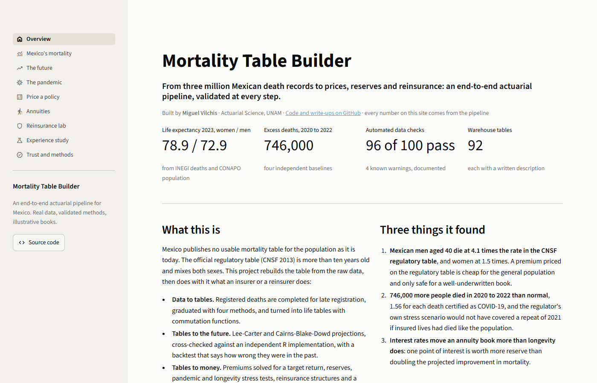
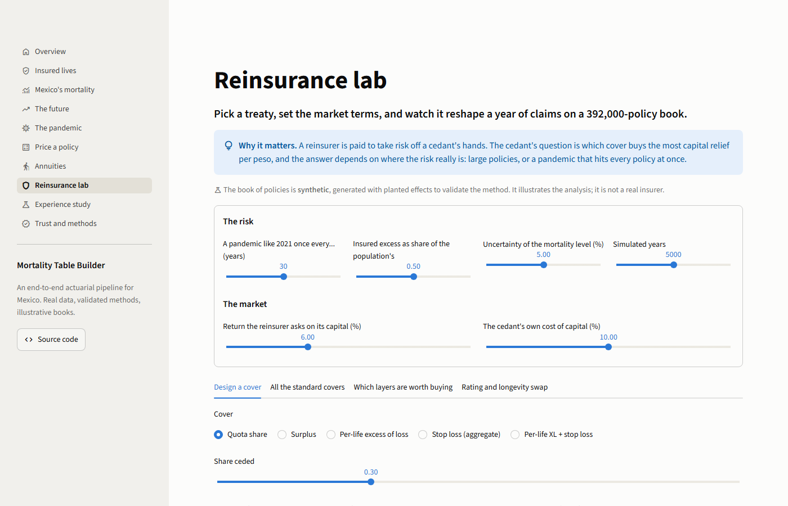
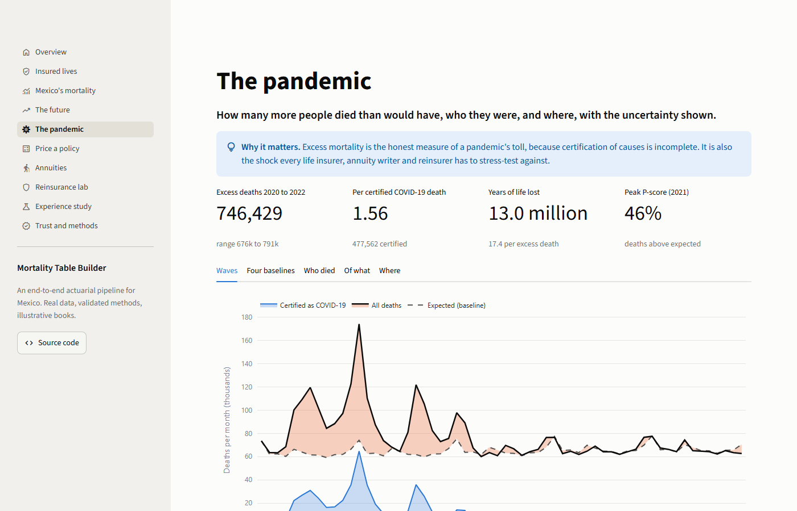
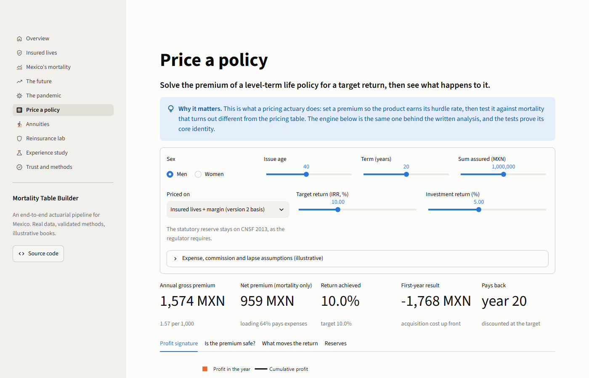
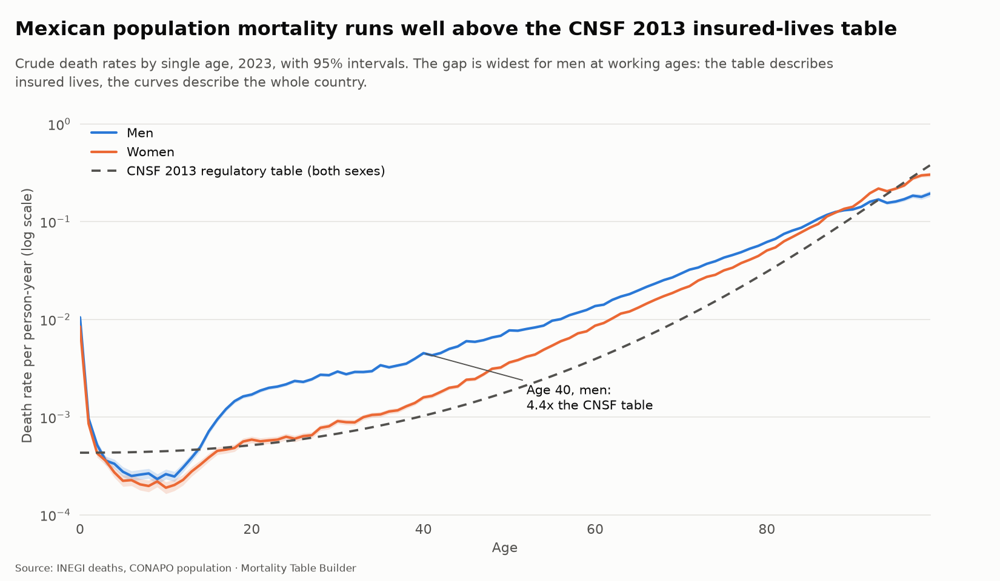
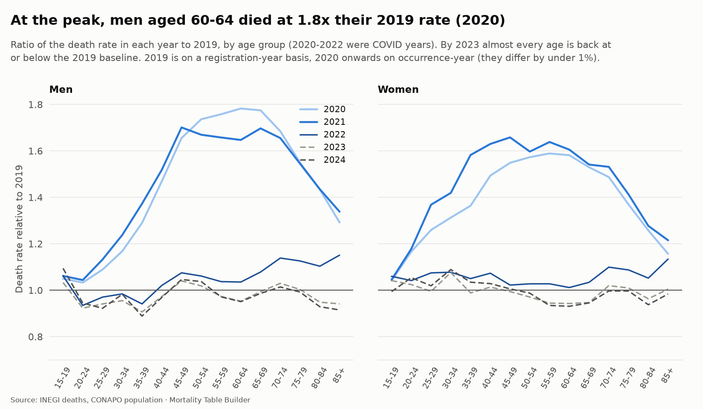
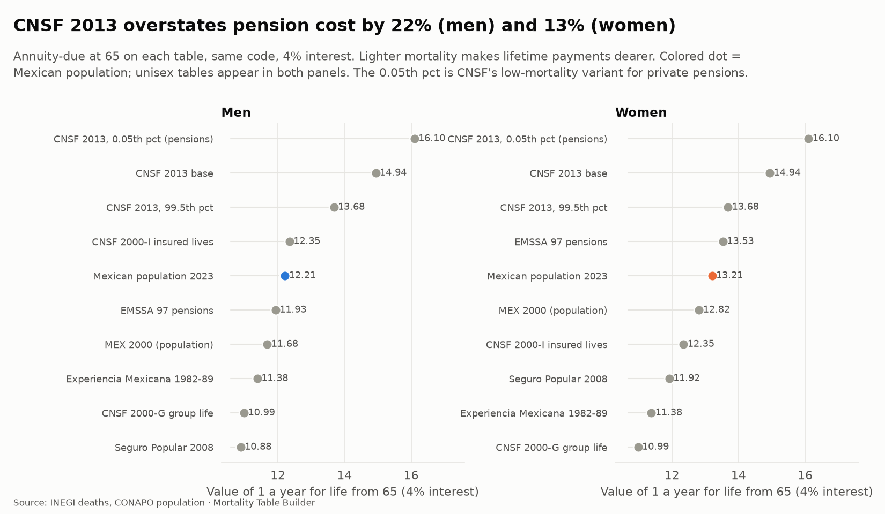
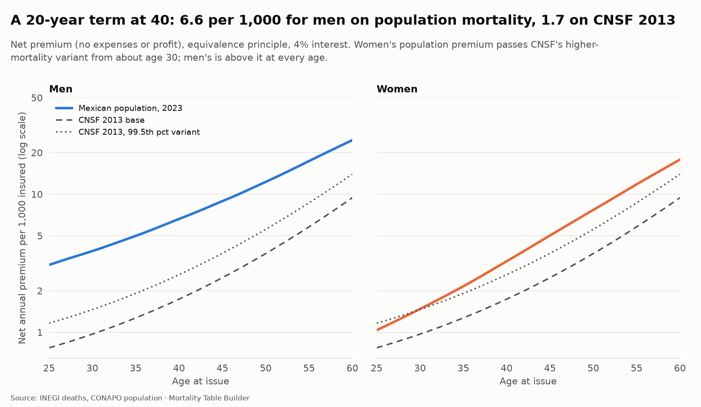
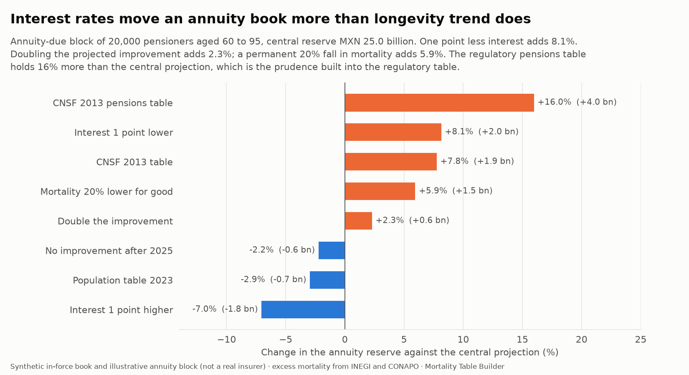

# Mortality Table Builder

**From three million Mexican death records to prices, reserves and reinsurance: an end-to-end actuarial pipeline, validated at every step.**

[](https://github.com/deadmigue55/Mortality-Table-Builder/actions/workflows/ci.yml)
[](https://mortality-table-builder.streamlit.app/)


Mexico's regulatory mortality table (CNSF 2013) is more than a decade old and mixes both sexes. This project **rebuilds the table from the raw data** (INEGI registered deaths, CONAPO population) and then does with it what an insurer or a reinsurer does: graduates and projects it, runs an experience study, prices a policy, reserves it, stresses it with the pandemic and with longevity, structures a reinsurance treaty and prices a longevity swap.

## Explore it

| | |
|---|---|
| :bar_chart: **Dashboard** | **[Open the live demo](https://mortality-table-builder.streamlit.app/)**. Nine interactive pages, four of them live labs (price a policy, value a pension, design a reinsurance treaty, run an experience study on **your own policy extract**). Or locally: `uv run mortality app` |
| :page_facing_up: **Report** | An 11-page methodology report with a Spanish executive summary, every number computed from the data when it is rendered: [`reports/methodology.pdf`](reports/methodology.pdf) |
| :clipboard: **Excel workbook** | Life tables with **live commutation formulas** (Dx, Nx, Mx driven by one interest cell) and a premium calculator, checked against the Python code by an independent formula engine: [`reports/Mortality_Table_Builder.xlsx`](reports/Mortality_Table_Builder.xlsx) |
| :books: **Write-ups** | One document per step with method, results and limits: [`docs/`](docs/) |

<table>
<tr>
<td></td>
<td></td>
</tr>
<tr>
<td></td>
<td></td>
</tr>
</table>

## What it found

| | |
|---|---|
| **Life expectancy at birth, 2023** | 78.9 years for women, 72.9 for men |
| **Against the regulatory table** | Mexican men aged 40 die at **4.1 times** the CNSF 2013 rate, women at 1.5 times |
| **The pandemic** | About **746,000 excess deaths** in 2020 to 2022 (range 676,000 to 791,000 over four baselines), 1.56 per certified COVID-19 death |
| **A repeat of 2021 on an insured book** | **+60%** claims in a year; the regulator's own 99.5th percentile table adds only 51% |
| **An annuity book** | One point of interest (+8.1% reserve) matters more than doubling mortality improvement (+2.3%) |
| **Reinsurance** | The pandemic is **41%** of the claims capital; a stop loss relieves 60% of it at a price of 6% per peso, a quota share costs 20% |
| **Method validation** | The experience study recovers **15 of 15** effects planted in a synthetic portfolio |

## What this project demonstrates

- **Actuarial depth, end to end.** Graduation (P-spline, Whittaker-Henderson, Heligman-Pollard, Kannisto), life tables and commutation functions, Lee-Carter and CBD projection, an insurer-style experience study (A/E, credibility, GLM relativities, claims-lag completion), profit testing, reserves, excess mortality, stress testing, reinsurance structures and a longevity swap.
- **Validation instead of assertion.** Every method is checked against something independent: HMD's published life expectancy (to 0.007 years), an R implementation (StMoMo, to 0.00002 years), a **planted truth** in a synthetic portfolio, a backtest of past forecasts, and an Excel recomputation. The 100 data checks and 320+ tests run on every commit.
- **Honesty about limits.** The books are synthetic and every market assumption is labelled illustrative; the four warnings in the data checks are documented, not hidden; the stress tests say which conclusions depend on which assumption.
- **Engineering.** A reproducible pipeline with a SHA-256 manifest of every input, a SQLite warehouse with 92 documented tables, a CLI, CI, pre-commit hooks, and a public demo bundle built from an **allow-list** so licensed data (the Human Mortality Database) can never leak into the repository.
- **Communication.** A dashboard for recruiters and managers, an Excel workbook for actuaries, a report for reviewers, a Spanish summary for Mexican readers.

<details>
<summary><b>Resumen en español</b></summary>

**Mortality Table Builder** reconstruye las tablas de mortalidad de México a partir de los microdatos de defunciones del INEGI y de la población de CONAPO, y las utiliza como lo haría una aseguradora o una reaseguradora: graduación y proyección, estudio de experiencia, precio de un seguro temporal, reservas, pruebas de estrés de pandemia y longevidad, reaseguro y un swap de longevidad.

Los hombres de 40 años mueren a 4.1 veces la tasa de la tabla regulatoria CNSF 2013. Entre 2020 y 2022 murieron unas 746,000 personas más de lo esperado. Una repetición de 2021 elevaría los siniestros de una cartera asegurada en 60%, más que el escenario de estrés de la propia CNSF (51%). La cartera de pólizas es sintética y los supuestos de mercado son ilustrativos; la mortalidad es real o se deriva de datos reales. El informe completo en español e inglés está en [`reports/methodology.pdf`](reports/methodology.pdf).

</details>

## Quick start

No data download is needed to explore: the repository carries a small demo bundle of derived tables (no raw data, no licensed data).

```sh
git clone https://github.com/deadmigue55/Mortality-Table-Builder.git
cd Mortality-Table-Builder
uv sync --all-extras        # Python 3.12 and every dependency (uv installs Python for you)
uv run mortality app        # the dashboard at http://localhost:8501
uv run mortality export-excel   # the actuarial workbook
```

To rebuild everything from the sources (about 10 minutes), see [Getting started](#getting-started) below.

---

## Why this matters

Life insurers and reinsurers price and reserve with mortality tables. In Mexico the regulatory tables in force (CNSF 2013) are deliberately conservative, rest on experience that is now over a decade old, and predate COVID-19. Each insurer's own experience tables are private. This project builds a transparent, up-to-date alternative from official data and asks:

- **How far is the population from the regulatory tables?** What does Mexico's actual mortality look like by age, sex, state and year?
- **What changes in pricing?** How do term life and annuity prices, and the reserves behind them, move when you switch tables?
- **What's next?** How will mortality improve, and how much capital does longevity risk require?
- **What was COVID-19's impact?** How large was excess mortality in 2020–2022, and what does a pandemic shock do to a life portfolio?

## Real-world applications

| Application | What it shows |
|---|---|
| **Experience study / A/E analysis** | Actual-to-expected ratios against CNSF, SOA and HMD benchmarks, by age band and sex |
| **Product pricing** | Net premiums for term, whole life, endowment and annuities under each table and interest rate |
| **Reserving** | Prospective reserves and how they shift with table choice |
| **Mortality projection** | Lee–Carter and Cairns–Blake–Dowd forecasts with uncertainty fan charts; cohort vs period tables |
| **Longevity & mortality risk capital** | Solvency-style longevity shock, pandemic shock, and their impact on annuity and life books |
| **Reinsurance** | Pricing a longevity swap and a mortality catastrophe cover from the projected tables |
| **COVID-19 excess mortality** | Excess deaths by state, age and sex vs a projected baseline |

## Data sources

All data comes from official or academically recognized sources. Raw data is **not** committed to this repo. Download scripts fetch it, and each source keeps its own license and terms. See [`docs/data-sources.md`](docs/data-sources.md) for details and citations.

| Source | What we use | Access |
|---|---|---|
| **INEGI**: Estadísticas de Defunciones Registradas | Death microdata by age, sex, state, cause and year of occurrence | Open data |
| **CONAPO**: Conciliación Demográfica 1950–2019 and Proyecciones 2020–2070 | Mid-year population by age, sex and state (the exposure) | Open data |
| **CNSF**: Mexican regulatory tables (CNSF 2013 in force; CNSF 2000-I and EMSSA-09 for history) | Regulatory benchmark | Public documents |
| **SOA**: Mortality and Other Rate Tables (mort.soa.org) | US benchmarks (e.g. 2017 CSO, 2012 IAM, Pri-2012) | Free, XTbML/CSV |
| **Human Mortality Database** | International comparison countries (Mexico is not in HMD) | Free registration, scientific use |

## Methodology

1. **Ingestion and storage:** download scripts load processed files into a local **SQLite** warehouse (see [`docs/warehouse.md`](docs/warehouse.md)) with automatic data checks.
2. **Data quality:** age-heaping diagnostics (Whipple and Myers indices), redistribution of unknown ages, year of occurrence vs year of registration, and flags for the COVID years.
3. **Crude rates:** central exposure, crude m<sub>x</sub> and q<sub>x</sub> with Poisson confidence intervals.
4. **Graduation:** Whittaker–Henderson, P-splines, and the Gompertz–Makeham and Heligman–Pollard laws, with old-age closure (Kannisto). Fits are checked with standard actuarial tests: chi-square, standardized deviations, signs and runs.
5. **Life table functions:** l<sub>x</sub>, d<sub>x</sub>, L<sub>x</sub>, T<sub>x</sub>, e<sub>x</sub>, plus commutation functions D<sub>x</sub>, N<sub>x</sub>, C<sub>x</sub>, M<sub>x</sub> at any interest rate.
6. **Actuarial present values:** insurances, annuities and premiums, connecting life contingencies to interest theory (SOA Exam FM).
7. **Projection:** Lee–Carter and CBD models, bootstrap uncertainty, improvement scales, cohort tables.
8. **Benchmarking and applications:** A/E studies, pricing, reserves, risk capital, reinsurance structures, COVID excess mortality.
9. **Interactive dashboard, workbook and report:** explore the tables, price products live, run the experience study on your own data; an Excel workbook with live commutation formulas; a Quarto methodology report.

## Tech stack

- **Python:** pandas, NumPy, SciPy, statsmodels, SQLite, Plotly, Streamlit, pytest
- **R:** StMoMo (stochastic mortality models), MortalityLaws, demography, lifecontingencies, used for projections and to cross-check the Python results
- **SQL:** SQLite for the warehouse, transformations and A/E queries (DuckDB for R, reading Parquet)
- **Excel:** exported pricing and table workbooks for actuaries who live in spreadsheets
- **Tooling:** GitHub Actions CI, ruff, pre-commit, Quarto for the methodology report

## Roadmap

- [x] **0. Repository setup:** README, data-source documentation, license
- [x] **1. Project skeleton:** Python package layout, environment, tests, linting, CI
- [ ] **2. Data ingestion:** download scripts for INEGI, CONAPO, SOA, CNSF and HMD; SQLite warehouse; validation
  - [x] Download framework with a manifest of every file
  - [x] INEGI deaths 2020 to 2024 (earlier years: in progress)
  - [x] CONAPO population and modelled deaths 1950 to 2070
  - [x] Human Mortality Database (9 comparison countries)
  - [x] SOA tables (29 tables, including 13 Mexican ones)
  - [x] CNSF 2013 (all nine tables, cross-checked against the PDF)
  - [x] SQLite warehouse with 79 automatic data checks
  - [x] INEGI 2014 to 2019 from the interactive tables (five-year age groups, all six years verified against INEGI totals)
  - [ ] INEGI before 2014 (optional, for a longer forecasting history)
- [x] **3. Data quality:** age-heaping indices, unknown-age redistribution, registration lag ([findings](docs/data-quality.md))
  - Death certificates show no age heaping (Whipple 98 to 101), comparable to the HMD countries
  - Late registrations completed with an actuarial chain-ladder triangle per age band: 2024 gains 2.3%, within 1% of CONAPO's independent projection
  - Unknown sex and age allocated proportionally (0.45% to 0.61% of deaths); unspecified-residence deaths kept in the national count
  - COVID years flagged from cause-of-death codes (2020 to 2022)
- [x] **4. Crude rates and exposure:** m<sub>x</sub>, q<sub>x</sub>, exact intervals, standardisation, state SMRs, first benchmarks ([findings](docs/crude-rates.md))
  - Mexican men die **3.0x** as fast as the CNSF 2013 table predicts at ages 25 to 84 (4.1x at 40 to 44); women 1.8x
  - Age-standardised male mortality rose **51%** in 2020 and was back at the 2019 level by 2023
  - Chihuahua and Colima run about 19% above their age mix, Sinaloa 19% below
  - Men aged 25 to 29 die at 6.7x the rate of Spanish men, 1.6x that of US men



- [x] **5. Graduation:** Whittaker–Henderson, P-splines, parametric laws, old-age closure, fit tests ([findings](docs/graduation.md))
  - Four methods compared on every year and sex; smoothing chosen by a quasi-AIC whose dispersion is estimated from the crude rates themselves
  - Heligman–Pollard fits about 9x worse than the P-spline in 2023: Mexican men's young-adult plateau is not something a parametric law bends to
  - **Digit preference found in men's death records:** +1.3% to +2.5% excess deaths at ages ending in 0 and 5, every year, invisible to the Whipple index
  - **Crude old-age data are not credible:** above about 88, women's rates overtake men's (a sign of age exaggeration), so ages 90 to 110 come from a Kannisto logistic fitted on 75 to 89, with men floored at women
  - Output: `graduated_qx`, a complete 0 to 110 table per year and sex, ready for the life-table step


- [x] **6. Life tables and actuarial functions:** full tables, commutation functions, APVs ([findings](docs/life-tables.md))
  - Life expectancy at birth 2023: men **72.9**, women **78.9**; within 0.7 years of CONAPO in 2022 to 2024, and the same code reproduces HMD's published life expectancy to 0.007 years
  - COVID cost men **5.9 to 6.9 years** of life expectancy depending on whether INEGI or CONAPO death counts are used
  - A pension annuity at 65 costs 14.94 on CNSF 2013 and 12.21 for Mexican men: valuing the population on the regulatory table overstates it by **22%** (13% for women)
  - A 20-year term at 40 has a net premium of **6.6 per 1,000** for men on population mortality, against 1.7 on CNSF 2013
  - Mexican men's lifespans are the least equal of any country compared (disparity 14.6 years against 9.9 in Japan)
  - Full actuarial function library: insurance, annuities, premiums, reserves, at any interest rate



- [x] **7. Mortality projection:** Lee–Carter and CBD (Python and R), fan charts, cohort tables ([findings](docs/projection.md))
  - Lee–Carter and CBD fitted to CONAPO 1970 to 2019, with process and drift uncertainty, back-tested over four origins and **cross-checked against StMoMo in R** (agreement to 0.00002 years)
  - A forecast made in 1999 would have overshot men's 2019 life expectancy by **4.0 years**: men's improvement slowed to 15% of its earlier pace
  - Men's life expectancy reaches 77 by 2050 on the long trend, **74 if the last 20 years repeat**; CONAPO's official projection says 77
  - A pension annuity at 65 costs 6% more by 2050 on the long trend, 2% on the recent one: the longevity-risk spread
  - Pricing an annuity on a period table understates its cost by about **2.6%** against the cohort
  - Found that INEGI and CONAPO disagree on who dies: INEGI shows **34% fewer deaths for men aged 15 to 39**, 10% to 16% more above 60
  - The model's own fan is too narrow (it covered 40% to 60% of backtests); the projection carries an empirical band calibrated on the backtest errors


- [x] **8. Experience study:** an insurer-style A/E study on a policy-level extract, validated against planted truth ([method and findings](docs/experience-study.md))
  - Works on any policy extract: `mortality experience run --policies my_extract.csv` (CSV template provided); a synthetic portfolio of 573,000 policies with planted effects, lapses, expiries, a claims lag and injected data defects is used to **validate the method** (every effect in it is an illustrative assumption, not an estimate for any company)
  - Exact exposure from dates (Lexis split at anniversaries and calendar years), data validation with a record-and-death reconciliation that balances exactly
  - A/E by count and by amount with intervals; limited-fluctuation and Bühlmann-Straub credibility; a Poisson GLM that **recovers 15 of 15 planted effects** inside their 95% intervals
  - Select-period analysis: honest about power (a few thousand deaths can date only 2 of 5 select years)
  - **Claims-lag (IBNR) correction:** the latest quarter reads 0.72 raw and 0.88 completed, within 2% of the truth
  - A derived company basis with a prudent margin: on this book, CNSF 2013 overprices women's 20-year term by 34% and the in-force block's claims run 12% lower (MXN 3.6 billion of PV)


- [x] **9. Applications:** pricing, reserves, longevity and pandemic stress, reinsurance, COVID excess mortality
  - [x] **COVID excess mortality** ([analysis](docs/excess-mortality.md)): about **746,000 excess deaths in 2020 to 2022** (range 676,000 to 791,000 over four independent baselines), 1.56 per certified COVID-19 death, 13.0 million years of life lost; men aged 65-69 died at **1.70x** the expected rate in 2021; 64% of the excess was certified as COVID-19, the rest mostly as heart disease, diabetes and respiratory causes; Estado de México, Ciudad de México and Tlaxcala highest (about 48%), Colima lowest (19%). The baselines predict 2023 to within 4%
  - [x] **Pricing, profit testing and reserves** ([analysis](docs/pricing.md)): a level term policy priced for a 10% return (40-year-old, 20 years: 2.32 per 1,000 against a net premium of 1.74); it loses 87% of its first premium on day one and is in profit by year 9; on the CNSF premium the population's mortality would cost a man of 40 171% of premium, while the synthetic company book's women earn 31% to 41%; mortality ±20% moves the margin ±11.6%, a year of doubled mortality costs 6.5 points of IRR; the best-estimate liability is negative (-2,230) where the statutory reserve holds 776
  - [x] **Pandemic and longevity stress tests** ([analysis](docs/stress-tests.md)): replaying 2021 on the in-force book adds **60% to the next year's claims** (MXN 447 million on 742 million), 71% of it from policyholders aged 50 and over, more than the regulator's own 99.5th percentile table (+51%) if insureds die like the population; for an annuity book one point less interest (+8.1%) matters more than doubling the projected improvement (+2.3%), and the regulatory pensions table holds 16% more than the central projection; an annuity block 1.2 times the size of the life book would offset a repeat of 2021 exactly, while a 20% fall in mortality gains the life book more than it costs the annuities
  - [x] **Reinsurance** ([analysis](docs/reinsurance.md)): on a simulated year of claims the **pandemic is 41% of the claims capital** and policies of 2 million or more hold 49% of the sum at risk; quota share and surplus treaties cost about 20% of the capital they relieve, a per-life excess of loss 9%, a stop loss 6%, and a per-life cover stays worth buying only while the reinsurer asks under 6.9% on its own capital; YRT experience rating with credibility that allows for claim-size variability (full credibility takes about 3,000 deaths for amounts, not 1,082); a longevity swap on the annuity block needs capital of 3% of the reserve and a fee of about 18 basis points a year





- [x] **10. Dashboard, workbook and report**
  - **Streamlit dashboard** (`uv run mortality app`): nine pages over a shareable demo bundle built from an allow-list of derived tables; four live labs call the same engines the tests check (pricing, annuities, reinsurance, experience study with file upload); a Trust page lists all 100 data checks, the sources with checksums and the limits; the app is tested headlessly in CI
  - **Excel workbook** (`uv run mortality export-excel`): lx, dx, Dx, Nx, Cx and Mx as live formulas driven by one interest cell, a premium calculator, a rate card and the stress results; recomputed by an independent formula engine in the tests and matched to the Python functions to 1e-9
  - **Methodology report** ([PDF](reports/methodology.pdf), Quarto + Typst): 11 pages with a Spanish executive summary; every number in the text is computed from the data bundle when the report is rendered


## Getting started

Requirements: [uv](https://docs.astral.sh/uv/) (installs Python 3.12 for you) and, for the projection models, [R](https://cran.r-project.org/) 4.3+.

```sh
git clone https://github.com/deadmigue55/Mortality-Table-Builder.git
cd Mortality-Table-Builder

uv sync                         # create the environment and install Python packages
Rscript r/install_packages.R    # install R packages (optional, for projections)
cp .env.example .env            # then add your Human Mortality Database login

uv run mortality doctor         # check that everything is ready
```

Load the data (about 10 minutes, mostly INEGI; every file is logged in `data/raw/MANIFEST.csv`):

```sh
uv run mortality ingest inegi --years 2020-2024   # registered deaths
uv run mortality ingest inegi-cube 2014-2019.zip  # hand-exported INEGI tables (optional)
uv run mortality ingest conapo                    # population 1950-2070
uv run mortality ingest hmd                       # needs the login in .env
uv run mortality ingest soa                       # SOA and Mexican tables
uv run mortality ingest cnsf                      # CNSF 2013 regulatory tables
uv run mortality db build                         # SQLite warehouse + data checks
```

Dashboard, workbook and report:

```sh
uv sync --all-extras                 # adds Streamlit
uv run mortality app-data            # rebuild the demo bundle from the warehouse
uv run mortality app                 # launch the dashboard
uv run mortality export-excel        # the actuarial workbook
quarto render reports/methodology.qmd   # the report (needs Quarto)
```

Development:

```sh
uv run pytest                   # tests
uv run ruff check . && uv run ruff format .   # lint and format
uv run pre-commit install       # run these checks automatically before each commit
```

## Project structure

```
Mortality-Table-Builder/
├── app/             # Streamlit dashboard: pages in views/, shared helpers in ui.py,
│   └── data/        #   the shareable demo bundle (derived tables only; no HMD, no raw data)
├── data/            # raw/ and processed/ (git-ignored, filled by the download scripts)
├── docs/            # one write-up per step, data sources, warehouse catalog, figures
├── reports/         # Quarto methodology report (PDF) and the Excel workbook
├── r/               # R scripts: StMoMo projections and cross-checks
├── src/mortality/   # the package: ingest, quality, rates, graduation, lifetable, projection,
│                    #   lexis/portfolio/experience, excess, pricing, stress, reinsurance,
│                    #   export, demo, validate, warehouse, figures, cli
└── tests/           # 320+ tests, including headless tests of every dashboard page
```

## Author

**Miguel Vilchis**: Actuarial Science, Facultad de Ciencias UNAM · Pricing & Risk Analytics at SCOR Reinsurance

[Portfolio](https://portfolio-psi-nine-sz4lsw795q.vercel.app/) · [GitHub](https://github.com/deadmigue55) · [LinkedIn](https://www.linkedin.com/in/deadmigue)

## License

Code is released under the [MIT License](LICENSE). Data belongs to its original publishers and is subject to their terms. See [`docs/data-sources.md`](docs/data-sources.md).
