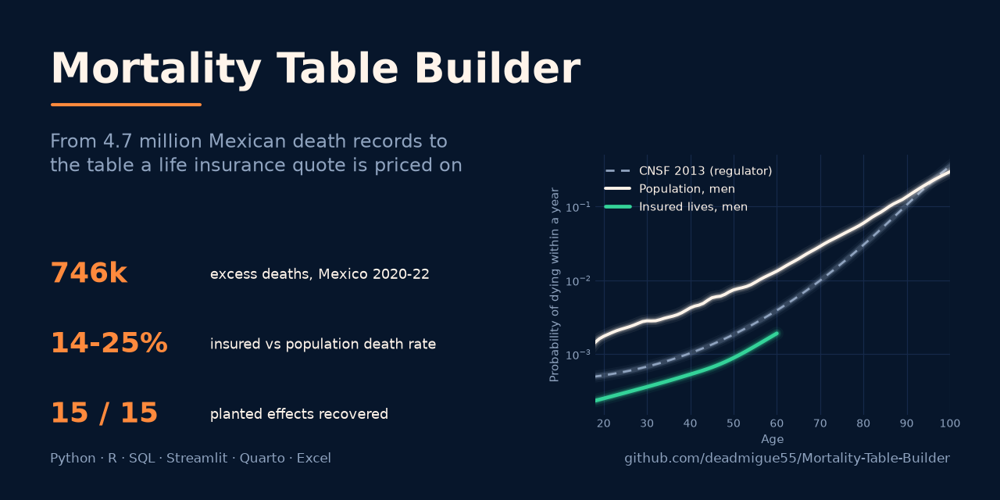
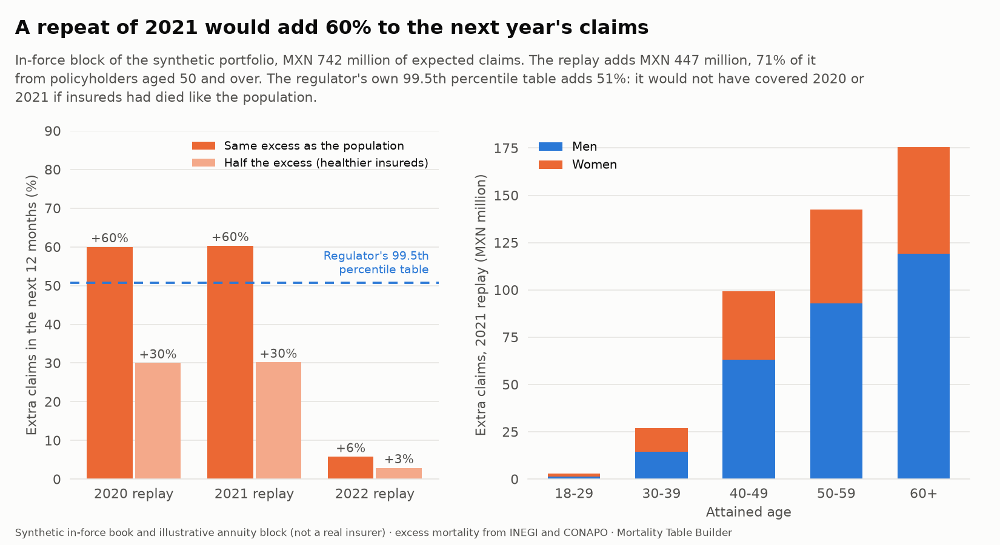
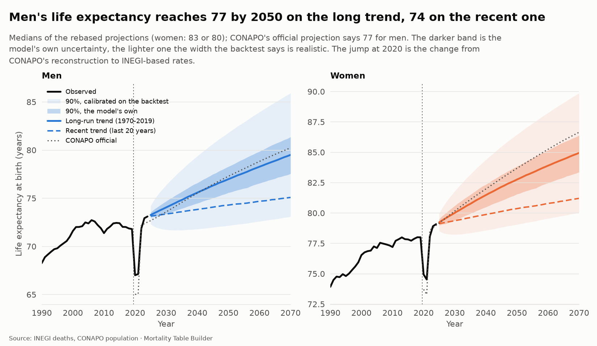
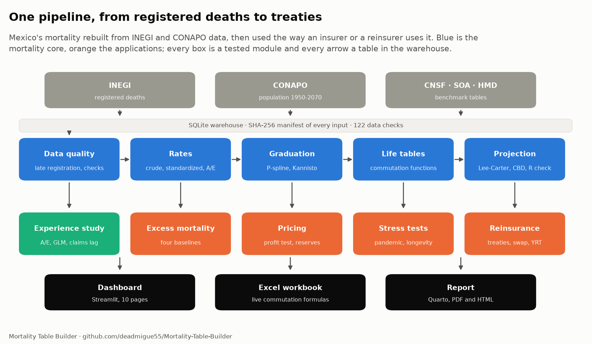

<div align="center">



<br>

**From Mexican death records to the table a life insurance quote is priced on, then to reserves and reinsurance.**<br>
An end-to-end actuarial pipeline where every formula is written out and every number is tested.

[](https://mortality-table-builder.streamlit.app/)
[](https://github.com/deadmigue55/Mortality-Table-Builder/actions/workflows/ci.yml)


[**Live dashboard**](https://mortality-table-builder.streamlit.app/) ·
[**The handbook (the math)**](docs/handbook/README.md) ·
[**Results by step**](docs/results.md) ·
[**Report (PDF)**](reports/methodology.pdf) ·
[**Excel workbook**](reports/Mortality_Table_Builder.xlsx)

</div>

---

## The short version

Life insurers price every policy off a **mortality table**: a list of how likely people of each age and sex are to die within a year. Mexico's regulatory table (CNSF 2013) is more than a decade old and mixes men and women. This project **rebuilds mortality from the raw records** (4.7 million registered deaths from INEGI, population from CONAPO), builds a separate table for the people who actually buy life insurance, and then does with it what an insurer or a reinsurer does: smooths it, projects it, prices a policy, sets reserves, stresses it with a pandemic, and designs reinsurance.

Every step is explained in plain words on this page and in [the results](docs/results.md), and derived in full, with LaTeX, in [the handbook](docs/handbook/README.md).

> [!NOTE]
> The mortality is real, or derived from real data. The **book of policies, the annuity block and the market assumptions** (expenses, commissions, lapses, cost of capital) are **synthetic or illustrative**, and labeled that way wherever they appear. The method is validated by planting known effects in the synthetic book and checking that it finds them.

## Results at a glance

| Finding | The number | In plain words |
|---|---|---|
| **How long Mexicans live** | **72.9** years (men), **78.9** (women), 2023 | Life expectancy at birth ($\mathring{e}_0$) from the rebuilt life table |
| **The population vs the regulator** | Men aged 40 die at **4.1×** the CNSF 2013 rate, women at **1.5×** | The regulatory table prices *insured* lives, who are healthier, so this is a gap to know about, not a flaw |
| **Who buys insurance dies much less** | Insured lives die at **14% to 25%** of the population's rate (ages 20 to 65) | Insured people are wealthier, medically underwritten and mostly urban |
| **What that does to a quote** | A man of 40, 20-year term, net premium per 1,000: **0.85** on the insured table, **1.74** on CNSF 2013, **6.62** on the population | The *net premium* is the price of the risk alone, before expenses and profit |
| **A competitive price** | At the same 10% target return, the insured table prices that policy at **1.57** instead of **2.32** per 1,000 (**-32%**) | The saving a company could pass on to win quotes while staying profitable |
| **The pandemic** | About **746,000 excess deaths** in 2020 to 2022 (range 676,000 to 791,000 over four baselines) | *Excess mortality* is deaths above what would have been expected |
| **The pandemic hit insured lives too** | In 2021 their death rates at ages 45 to 64 were **2.7×** their 2023 level (the population's: 1.7×) | Insured people were not shielded, so the stress test replays 2021 as they lived it |
| **What a repeat would cost** | **+60%** claims in a year on an insured book; the regulator's 99.5th percentile table adds only **51%** | The regulator's own stress would not have covered 2021 |
| **Does the method work?** | It recovers **15 of 15** effects planted in a synthetic portfolio | The test that a method finds what is really there |

<p align="center"></p>

<table>
<tr>
<td width="50%"></td>
<td width="50%"></td>
</tr>
<tr>
<td width="50%"></td>
<td width="50%"></td>
</tr>
</table>

## Pick your path

| I have... | Go to |
|---|---|
| **2 minutes** | Read this page, then the [results by step](docs/results.md) |
| **10 minutes** | Open the **[live dashboard](https://mortality-table-builder.streamlit.app/)**: ten pages, four of them live labs (price a policy, value a pension, design a reinsurance treaty, run an experience study on your own policy extract) |
| **An hour, and I want the method** | The **[handbook](docs/handbook/README.md)**: every method derived in LaTeX, with a worked example you can check by hand |
| **A spreadsheet habit** | The [Excel workbook](reports/Mortality_Table_Builder.xlsx): life tables with live commutation formulas driven by one interest cell |
| **A reviewer's eye** | The [13-page report](reports/methodology.pdf) and the section below on how the work is verified |
| **A laptop and curiosity** | [Quick start](#quick-start) |

## The pipeline

<p align="center"></p>

| # | Step | The question it answers | Results | The math |
|:-:|---|---|---|---|
| 1 | **Ingestion** | Where does every number come from? | [Sources](docs/data-sources.md), [warehouse](docs/warehouse.md) | |
| 2 | **Data quality** | Can the records be trusted, and what is missing? | [Data quality](docs/data-quality.md) | Chapter 2 |
| 3 | **Crude rates** | How big is the gap, and how sure are we? | [Crude rates](docs/crude-rates.md) | Chapter 3 |
| 4 | **Graduation** | How do we smooth the rates without losing the truth? | [Graduation](docs/graduation.md) | Chapter 4 |
| 5 | **Life tables** | How does a death rate become a price? | [Life tables](docs/life-tables.md) | [**Chapter 5**](docs/handbook/05-life-tables.md) |
| 6 | **Projection** | How will mortality change? | [Projection](docs/projection.md) | Chapter 6 |
| 7 | **Experience study** | How does one company's own experience compare? | [Experience study](docs/experience-study.md) | Chapter 7 |
| 8 | **Pricing and reserves** | What should a policy cost? | [Pricing](docs/pricing.md) | Chapter 8 |
| 9 | **Pandemic and stress** | What did COVID-19 cost, and what would a repeat do? | [Excess](docs/excess-mortality.md), [stress](docs/stress-tests.md) | Chapter 9 |
| 10 | **Reinsurance** | How is the risk shared, and what does it cost? | [Reinsurance](docs/reinsurance.md) | Chapter 10 |
| 11 | **Insured lives** | Which table should a quote actually use? | [Insured lives](docs/insured-lives.md) | Chapter 11 |

New to the vocabulary? The [glossary](docs/handbook/00-glossary.md) explains every term in plain words.

## How we know it is right

A model that "looks plausible" is not enough, so each method is checked against something independent of itself:

- **Against published data.** The life-table code reproduces the Human Mortality Database's own life expectancy to **0.007 years**.
- **Against another language.** The projection models are re-fitted in R with `StMoMo` and agree to **0.00002 years**.
- **Against a known truth.** A synthetic policy book has effects planted in it; the experience study recovers **15 of 15**.
- **Against a spreadsheet.** The Excel workbook's formulas are recomputed by an independent formula engine and match the Python code to **1e-9**.
- **Against itself.** More than **440 tests** and **122 data checks** (118 pass, 4 documented warnings) run on every commit, and every identity in the [handbook](docs/handbook/README.md#how-the-handbook-stays-correct) is tested numerically against the code.
- **Against drift.** Every raw file is logged with its SHA-256 checksum; the demo bundle is built from an allow-list, so licensed data can never leak into the repository.

## Quick start

No data download is needed to explore: the repository carries a small bundle of derived tables (no raw data, no licensed data).

```sh
git clone https://github.com/deadmigue55/Mortality-Table-Builder.git
cd Mortality-Table-Builder
uv sync --all-extras && uv run mortality app      # the dashboard at http://localhost:8501
```

Also available: `uv run mortality export-excel` (the workbook) and `quarto render reports/methodology.qmd` (the report). To rebuild everything from the original sources (about 10 minutes), see [Rebuild from the sources](#rebuild-from-the-sources).

## What it does not claim

- **The policy book is synthetic.** Company-level results (an experience study, reinsurance pricing) describe a simulated book, not a real insurer, and the market terms are assumptions.
- **Above about age 60 for term cover, and 83 for whole life, the insured-lives data stop describing insured lives.** The table follows the population there by assumption, and every table and figure flags it.
- **The 2018 to 2020 insured statistics are not used**: their exposure is defined differently, so they are kept apart.
- **INEGI and CONAPO disagree on who dies** (INEGI shows 34% fewer deaths for men aged 15 to 39). The project carries both and says which conclusions depend on the choice.

<details>
<summary><b>Resumen en español</b></summary>

<br>

**Mortality Table Builder** reconstruye las tablas de mortalidad de México a partir de 4.7 millones de defunciones registradas por el INEGI y de la población de CONAPO, y las usa como lo haría una aseguradora o una reaseguradora: graduación y proyección, estudio de experiencia, precio de un seguro temporal, reservas, pruebas de estrés de pandemia y longevidad, reaseguro y un swap de longevidad.

Los hombres de 40 años mueren a 4.1 veces la tasa de la tabla regulatoria CNSF 2013. Entre 2020 y 2022 murieron unas 746,000 personas más de lo esperado. Una repetición de 2021 elevaría los siniestros de una cartera asegurada en 60%, más que el escenario de estrés de la propia CNSF (51%). Con las estadísticas de la CNSF de Vida Individual (2021 a 2025) se construye la tabla que usa quien cotiza un seguro: los asegurados mueren a entre 14% y 25% de la tasa de la población, y un hombre de 40 años en un temporal a 20 años paga una prima neta de 0.85 por millar con la nueva tabla, 1.74 con la CNSF 2013 y 6.62 con la población.

La cartera de pólizas es sintética y los supuestos de mercado son ilustrativos; la mortalidad es real o se deriva de datos reales. El informe completo, con resumen ejecutivo en español, está en [`reports/methodology.pdf`](reports/methodology.pdf).

</details>

## Data sources

All data comes from official or academically recognized sources. Raw data is **not** committed. Download scripts fetch it, and each source keeps its own license and terms ([details and citations](docs/data-sources.md)).

| Source | What we use |
|---|---|
| **INEGI**: registered deaths | Death microdata by age, sex, state, cause and year |
| **CONAPO**: demographic reconciliation and projections | Mid-year population by age, sex and state (the exposure) |
| **CNSF**: regulatory tables and individual life statistics | The CNSF 2013 benchmark, and the industry's insured lives, sums assured and death claims (2018 to 2025) |
| **SOA**: mort.soa.org | US benchmark tables (2017 CSO, 2012 IAM, Pri-2012) |
| **Human Mortality Database** | International comparison countries (free registration; never redistributed here) |

## Rebuild from the sources

Requirements: [uv](https://docs.astral.sh/uv/) (installs Python 3.12 for you) and, for the projection cross-check, [R](https://cran.r-project.org/) 4.3+.

```sh
uv sync --all-extras                # the environment
Rscript r/install_packages.R        # R packages (optional)
cp .env.example .env                # then add your Human Mortality Database login
uv run mortality doctor             # check that everything is ready

uv run mortality ingest inegi --years 2020-2024
uv run mortality ingest conapo
uv run mortality ingest hmd
uv run mortality ingest soa
uv run mortality ingest cnsf
uv run mortality ingest cnsf-vi <folder>        # the CNSF individual life statistics
uv run mortality db build                        # the SQLite warehouse and every data check
uv run mortality app-data && uv run mortality app
```

Development: `uv run pytest`, `uv run ruff check . && uv run ruff format .`, `uv run pre-commit install`, and `node scripts/mathcheck/check.mjs` to check the handbook's formulas.

## Project structure

```
Mortality-Table-Builder/
├── docs/handbook/   # the math: one chapter per step, notation and glossary
├── docs/            # results write-ups, data sources, warehouse catalog, figures
├── src/mortality/   # the package: ingest, quality, rates, graduation, lifetable, projection,
│                    #   experience, excess, pricing, stress, reinsurance, insured*, export, validate
├── app/             # the Streamlit dashboard and its shareable demo bundle
├── reports/         # the Quarto report (PDF) and the Excel workbook
├── r/               # R scripts: StMoMo projections and cross-checks
├── scripts/         # tools, including the handbook's formula checker
└── tests/           # 440+ tests, including headless tests of every dashboard page
```

## Author

**Miguel Vilchis**: Actuarial Science, Facultad de Ciencias UNAM · Pricing & Risk Analytics at SCOR Reinsurance

[Portfolio](https://deadmigue.vercel.app/) · [GitHub](https://github.com/deadmigue55) · [LinkedIn](https://www.linkedin.com/in/deadmigue)

## Citation and license

If you use this work, see [`CITATION.cff`](CITATION.cff). Code is released under the [MIT License](LICENSE). Data belongs to its original publishers and is subject to their terms; see [`docs/data-sources.md`](docs/data-sources.md).
