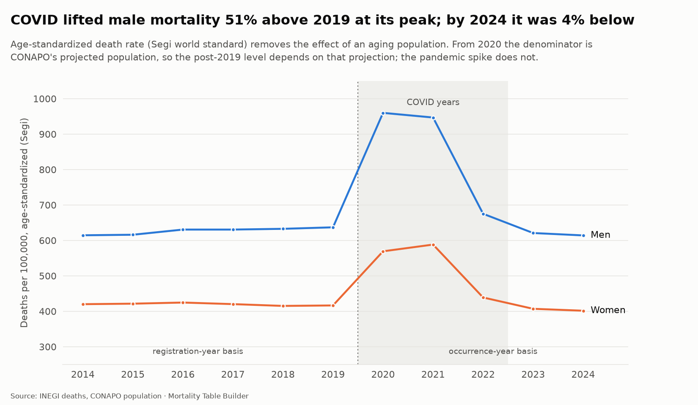
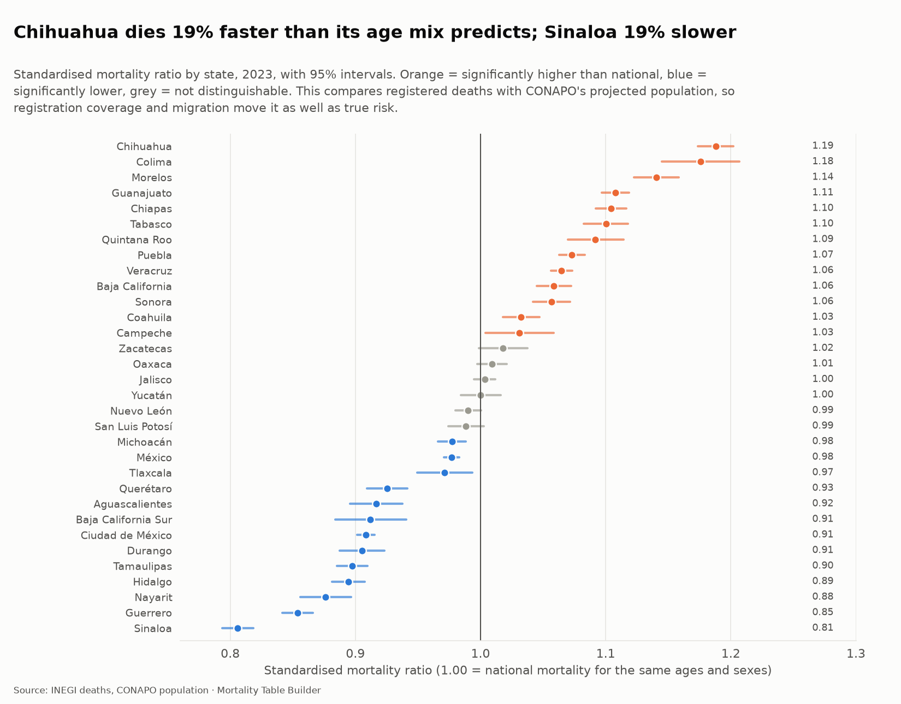
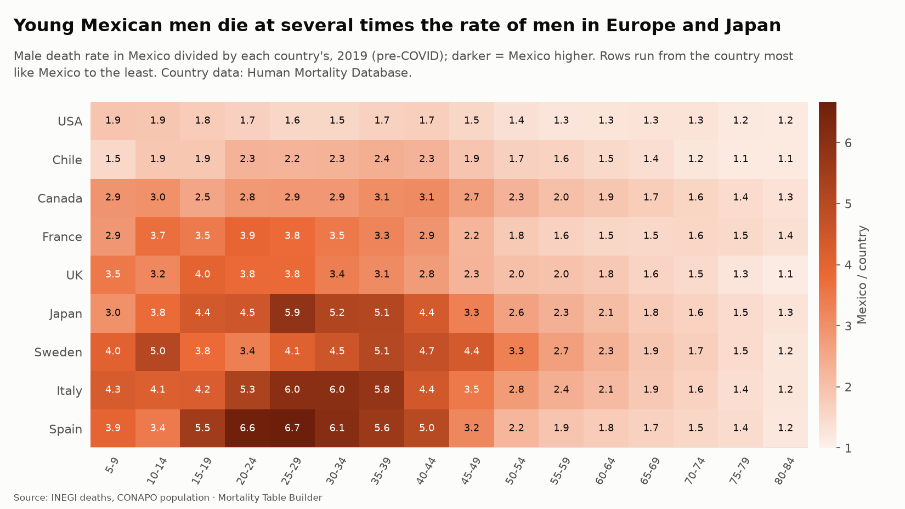

# Crude rates, standardization and first benchmarks (step 4)

This step turns the analysis-ready deaths from [data-quality.md](data-quality.md) into death rates, and uses them for a first look at the questions the rest of the project answers: how heavy is Mexican mortality, how did the pandemic move it, and how does it compare with the tables insurers use?

**The mathematics behind each method is in [handbook chapter 3](handbook/03-crude-rates.md); this page is the results.**

Everything is built by `uv run mortality db build` (tables) and `uv run mortality figures` (the charts below), from the code in `src/mortality/rates.py` and `figures.py`. The statistical functions are plain pandas/NumPy with unit tests in `tests/test_rates.py`.

## Method in brief

**Exposure.** CONAPO's mid-year (1 July) population approximates the person-years lived in a calendar year, so the central death rate is `m = deaths / mid-year population`. Ages 100 and over are pooled on both sides (CONAPO stops at 109), so numerator and denominator always match.

**Two bases.** From 2020 the rates use deaths by year of *occurrence* (late registrations completed, unknowns allocated). Before 2020 only the INEGI interactive tables exist, by year of *registration* in 5-year groups. The two bases are close: registered over occurred deaths is 0.994 to 1.007 in every year 2020 to 2024 (`basis_bridge`), so the 2014 to 2019 rates are a fair baseline. Unknown sex and age in those tables are spread proportionally, as for the microdata.

**Intervals.** Every rate has an exact (Garwood) Poisson 95% interval, in its gamma form so it also works for the fractional adjusted counts. Cells with fewer than 30 deaths are flagged `credible = 0`; none of the 1,010 single-age cells is thin, because the pooling at 100 absorbs the sparse ages.

**q from m.** `q = m / (1 + (1 - a) m)` with `a = 0.5` above age 0 and, for infants, the Preston et al. (2001) relation between `a0` and `m0` (deaths in infancy cluster in the first weeks). This is a bridge to the life tables of step 6, which will replace it with graduated rates.

**Standardization.** The Segi world standard population gives an age-standardized rate with a Fay-Feuer interval, so years can be compared without the effect of aging. States use *indirect* standardization: observed deaths over the deaths their age and sex mix predicts at national rates (the SMR), which is stable for small populations.

**Benchmarks.** Expected deaths for a table are the CONAPO population times the table's central rate; actual-to-expected (A/E) is the ratio, reported by 5-year band for ages 25 to 84.

## Tables added to the warehouse

| Table | Rows | What it holds |
|---|---:|---|
| `crude_rates_single` | 1,010 | Rates by year (2020 to 2024), sex and single age, with intervals, `qx` and a thin-cell flag |
| `crude_rates_grouped` | 627 | Rates by year (2014 to 2024), sex (M, F, T) and 5-year band, with the basis used |
| `age_standardised_rates` | 33 | Segi-standardized and crude rates with intervals, by year and sex |
| `basis_bridge` | 11 | Registered versus occurred deaths by year |
| `state_smr` | 32 | State SMRs for 2023 (latest complete non-COVID year) |
| `benchmark_ae` | 2,574 | A/E against CNSF 2013 and nine SOA Mexican tables, by year, sex and band |
| `benchmark_countries` | 5,358 | Mexico's rate divided by each HMD country's, by year, sex and band |

Eight new data checks guard them (deaths and exposure conserved, intervals bracket their estimates, rates are probabilities, the registration basis stays within 3% of occurrence, state expected deaths add up to observed). See [warehouse.md](warehouse.md).

## What the data says

### Mexican mortality against the regulatory table

At age 40 a Mexican man has a 0.45% chance of dying within the year; the CNSF 2013 base table assumes about 0.10%. The table prices insured lives, which are healthier and selected, so a gap is expected. Its size is what the A/E below measures.

- Mexican men die **3.0 times** as fast as CNSF 2013 predicts over ages 25 to 84 (1.8 times for women), peaking at **4.1 times** at ages 40 to 44.
- Against the *population* table MEX 2000, women are exactly on it in 2019 (A/E 1.00) while men are 17% above. Male mortality is heavier than the year-2000 population table expected; the cause-of-death data in `deaths_by_cause_chapter` can test why, which is left for step 9.
- The Seguro Popular 2008 tables sit well below the population (A/E 0.71 to 0.73): they describe a healthier, enrolled group.
- The A/E intervals are very narrow (the counts are in the hundreds of thousands). They capture random variation only; they say nothing about how well a table fits the *insured* book. That needs company experience, which the later pricing steps model with credibility.

### The pandemic

Age-standardized male mortality stayed between 615 and 637 per 100,000 from 2014 to 2019, jumped to **960 in 2020 (+51%)**, and fell back to 614 by 2024. Women rose from 417 to 588 at the 2021 peak (+41%). Note that the 2023 and 2024 levels sit slightly below 2019 and depend on CONAPO's projected population, which is the denominator from 2020; the spike itself does not.

At the peak, men aged 60 to 64 died at **1.78 times** their 2019 rate (2020). For women the heaviest relative rise was in 2021, across ages 30 to 65. By 2023 almost every age is back at or below 2019.

### States

In 2023, Chihuahua and Colima ran about 18% to 19% above what their age and sex mix predicts, Sinaloa and Guerrero 15% to 19% below. This compares registered deaths with a projected population, so registration coverage and migration move it as well as true risk; treat it as a rating-factor starting point, not a causal finding.

### Other countries

In 2019, men aged 25 to 29 died at 6.7 times the rate of Spanish men, 6.0 times Italian and 5.9 times Japanese; against the USA the ratio is 1.6. The excess shrinks with age and is under 2 from age 65 for every country.

## Known limits

- Single-age rates exist only from 2020 (no row-level INEGI files before). Before that, 5-year bands.
- Exposure from 2020 is CONAPO's projection. The Census-based rebasing of later CONAPO releases would change levels slightly.
- `qx` here is a direct transformation of crude `mx`; it is noisy at the oldest ages and is not a life table until step 5 graduates it.
- The A/E figures use the whole population as the "actual" side. They show how far the country is from each table, not how an insured portfolio would behave.
