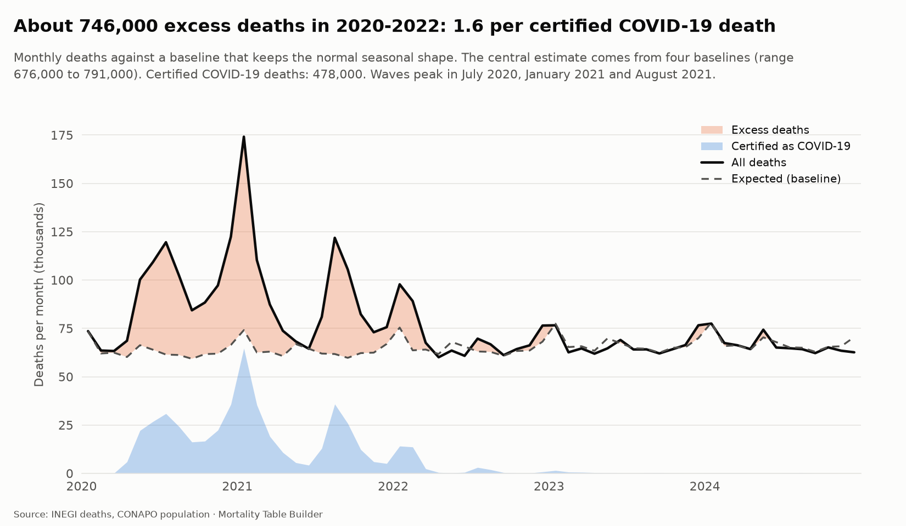
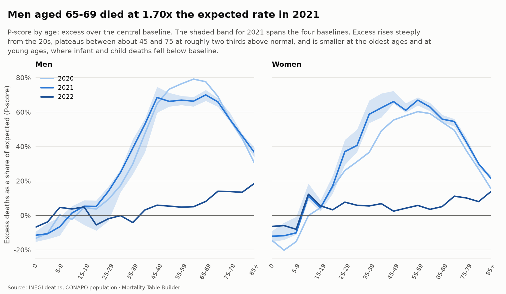
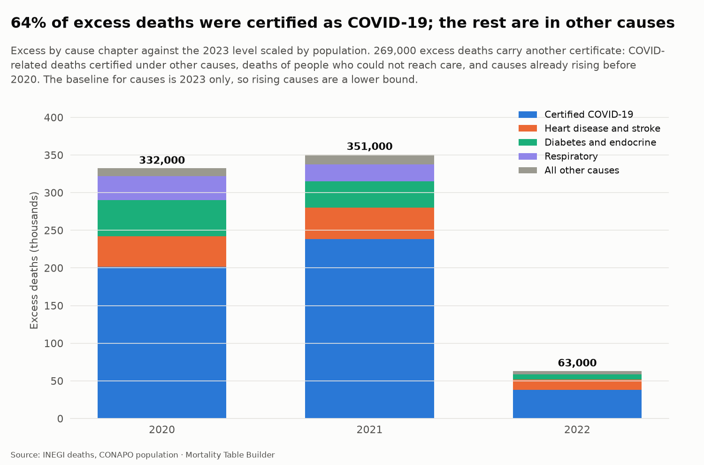
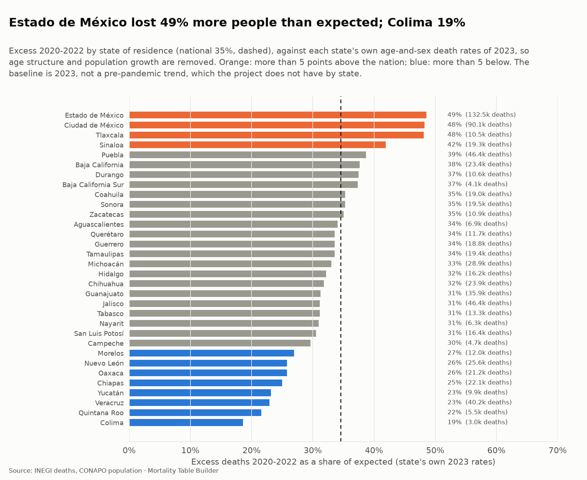

# Excess mortality in the pandemic (step 9a)

How many more people died in Mexico in 2020 to 2022 than would have without the pandemic, who they were, what their death certificates said, and where they lived. This is the project's analysis of record for the pandemic shock that the stress tests (step 9c) replay on insurance books.

Code: `src/mortality/excess.py` (9 unit tests in `tests/test_excess.py`). Charts: `uv run mortality figures`. Everything here is built from real data: INEGI deaths, CONAPO population, and the project's own completed and graduated series.

## The problem is the baseline

"Excess" is observed deaths minus the deaths a baseline expects, and the baseline is a counterfactual nobody observed. One baseline gives one number that looks more certain than it is. This analysis builds **four**, from different assumptions, and reports the range (`excess_baselines`):

| Baseline | Assumption |
|---|---|
| Flat 2019 | every age and sex keeps its 2019 death rate |
| Trend 2014-2019 | a log-linear trend per age band and sex (Poisson regression on six pre-pandemic years), carried forward |
| Interpolation to 2023 | the log rate moves in a straight line from its 2019 value to its observed 2023 value: the recovery is a second anchor |
| Lee-Carter | the pre-pandemic trend of CONAPO's 1970-2019 series (step 7), scaled band by band to the INEGI level of 2019 |

The last step matters. INEGI and CONAPO agree on the total but not on who dies (men aged 15 to 39: 34% fewer INEGI deaths; at 60 and over 10% to 16% more; see [projection.md](projection.md)). A CONAPO baseline against INEGI deaths would invent an age pattern in the excess, so the Lee-Carter baseline is rescaled to the INEGI footing.

Observed deaths are INEGI's by year of occurrence, completed for late registrations (step 3); exposure is CONAPO's mid-year population; everything is by 5-year band and sex. The central estimate is the median of the four baselines; the range runs from the highest to the lowest.

### How far to trust the baselines

Two built-in checks:

- **They agree with each other.** The spread between the highest and lowest baseline is 2.6% of expected deaths in 2020, 5.0% in 2021 and 7.4% in 2022. It keeps widening the farther the baselines are carried (9.7% in 2023, 12.1% in 2024): the counterfactual becomes less certain with time, which is the right behavior.
- **They predict 2023.** After the pandemic, mortality should be back on the baseline. The four baselines are within -3.7% to +2.0% of the 798,055 deaths observed in 2023 (flat 2019 -2.2%, trend -3.7%, Lee-Carter +2.0%; interpolation is anchored there by construction), and the central one is -0.5%. Both are data checks.

## The result

| | 2020 | 2021 | 2022 | 2020-22 |
|---|---:|---:|---:|---:|
| Observed deaths | 1,093,073 | 1,117,650 | 843,757 | 3,054,480 |
| Expected (central) | 760,625 | 766,871 | 780,554 | 2,308,050 |
| **Excess deaths** | **332,448** | **350,778** | **63,203** | **746,429** |
| Range over the baselines | 319,970 to 339,894 | 327,669 to 365,700 | 28,295 to 85,732 | 675,934 to 791,326 |
| P-score (excess / expected) | 43.7% | 45.7% | 8.1% | 32.3% |
| Certified COVID-19 | 201,280 | 238,093 | 38,189 | 477,562 |
| Excess per certified death | 1.65 | 1.47 | 1.65 | 1.56 |

Men account for 462,576 of the excess (62%) and women for 283,853. Excess deaths exceeded certified COVID-19 deaths by a factor of 1.5 to 1.65 every year, with every baseline. The monthly series shows the waves: July 2020 (119,564 deaths in the month), January 2021 (174,143, against about 74,000 expected) and August 2021 (121,845), then a smaller January 2022 (97,791). Monthly deaths are the microdata by month of occurrence against a baseline that keeps the normal seasonal shape of 2023 and 2024, so winter peaks are not mistaken for excess (`excess_monthly`).

## Who died

The profile is steep and then flat (`excess_mortality`):

- Excess is small under 20, and **negative in infants and young children** (P-scores of -10% to -20%), where deaths fell below baseline. That mixes real declines in infant deaths with exposure uncertainty at the youngest ages, and it is not interpreted here.
- It rises through the 20s and 30s, and plateaus between about **45 and 75 at roughly two thirds above normal**: in 2021 men aged 45-49 had a P-score of 68%, aged 65-69 of 70% (**1.70 times the expected rate**), against 66% and 56% for women of the same ages.
- It is smaller at the oldest ages (85 and over: 37% for men, 22% for women), partly because baseline mortality there is already high.
- In 2020 the male peak was later and higher (about 79% at ages 60-64); in 2021 women's excess rose and spread to younger ages (about 59% at 35-39).
- In 2022 the excess was between about 3% and 19% above baseline at adult ages, and by 2023 it is gone.

### Years of life lost

Weighting each age band's excess deaths by the remaining life expectancy of the 2023 life tables ([life-tables.md](life-tables.md)), the excess cost **13.0 million years of life** in 2020 to 2022 (men 8.0 million, women 5.0 million): 17.4 years per excess death, in line with the high share of working-age and early-retirement deaths. By comparison the life-table analysis found that life expectancy at birth fell 5.9 to 6.9 years for men, depending on the source.

## What the certificates said

Certified COVID-19 deaths are **477,687** in the monthly microdata (64% of the excess; the year-level count in the table above, 477,562, differs by 125 deaths from late-registration handling). The remainder, about 269,000 deaths, appears in other causes (`excess_by_cause`), against the 2023 level scaled by population growth:

| Cause chapter | Excess, 2020-22 |
|---|---:|
| Certified COVID-19 | 477,687 |
| Circulatory (heart disease, stroke) | 96,433 |
| Endocrine (diabetes) | 89,834 |
| Respiratory | 53,864 |
| Other | about 29,000 |

There is no pre-pandemic cause-of-death microdata in the project, so the baseline for causes is 2023 alone. That cannot separate three things: COVID-related deaths certified under another cause, deaths of people who could not get care, and causes already rising before 2020 (diabetes and heart disease were). For causes that were rising, the result is a lower bound on pandemic-related excess; it is a statement about where the extra deaths were certified, not about what caused them.

## Where they lived

Excess 2020 to 2022 by state of residence against each state's own age-and-sex death rates of 2023 (`excess_state`), so age structure and population growth are removed. The nation comes to 35%. **Estado de México (49%), Ciudad de México (48%) and Tlaxcala (48%)** are highest, then Sinaloa (42%) and Puebla (39%); **Colima (19%), Quintana Roo (22%), Veracruz (23%), Yucatán (23%) and Chiapas (25%)** are lowest. Estado de México alone had about 132,500 excess deaths and Ciudad de México 90,100.

## Checks

Eight data checks keep this honest (see [warehouse.md](warehouse.md)): observed deaths equal those of the rates tables, the sexes and age bands add up to the totals, the pandemic is clearly positive even on the lowest baseline and above the certified count, the four baselines agree within 15%, they predict 2023 within 5%, the cause chapters cover the completed total within 2%, and the state excess adds up to the national within 15%. A unit test builds a world with a known +40% shock above age 40 in one year, and the analysis recovers it.

## Known limits

- **The counterfactual is an assumption.** The range reflects four reasonable baselines, not every possible one; a baseline that assumed continuing improvement faster than 2014 to 2019 would give more excess, one that assumed the rise in diabetes mortality continued would give less.
- **Exposure is CONAPO's projection** after 2019, and population in the pandemic years is uncertain (migration, undercount, the effect of the pandemic itself). Negative excess at the youngest ages is probably partly exposure.
- **Sources disagree by age**, which the Lee-Carter baseline corrects but the others avoid only because they use INEGI rates throughout.
- **Cause and state analyses use 2023 as the baseline**, because the project has no pre-pandemic cause or state history. 2023 is within a few percent of trend nationally.
- **State deaths** are residents of a known state, by year of occurrence, without the national late-registration completion (2020 to 2022 are complete in the files loaded).
- **Excess is not attribution.** The analysis says how many more died, when, at what age and where, and what was on the certificate. It does not say why.
