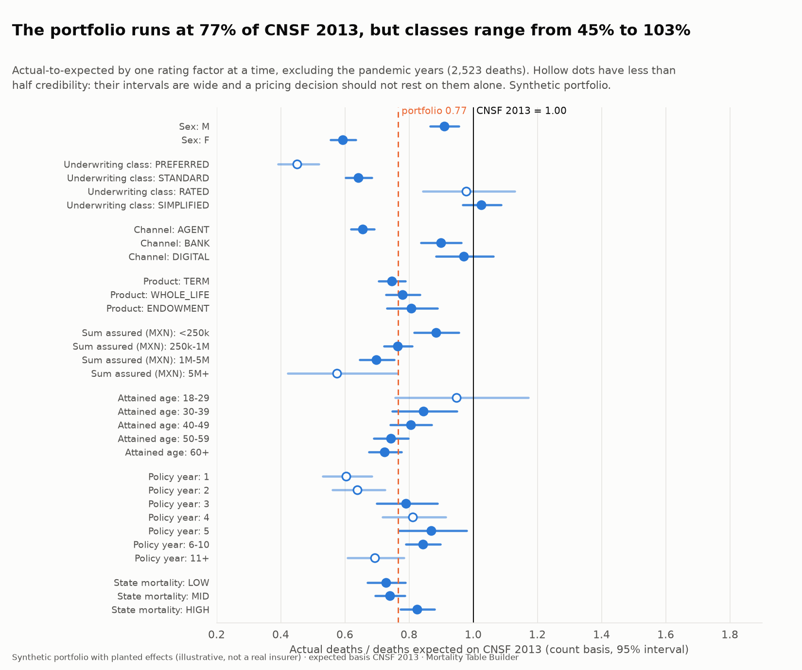
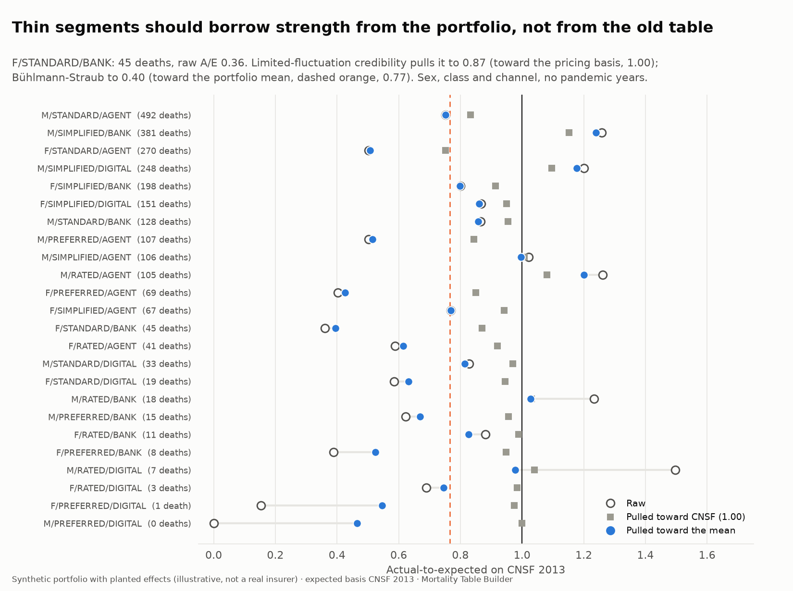
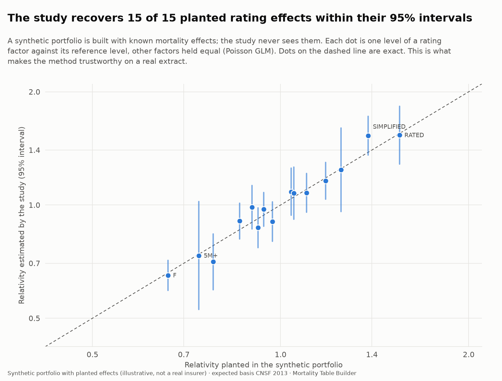
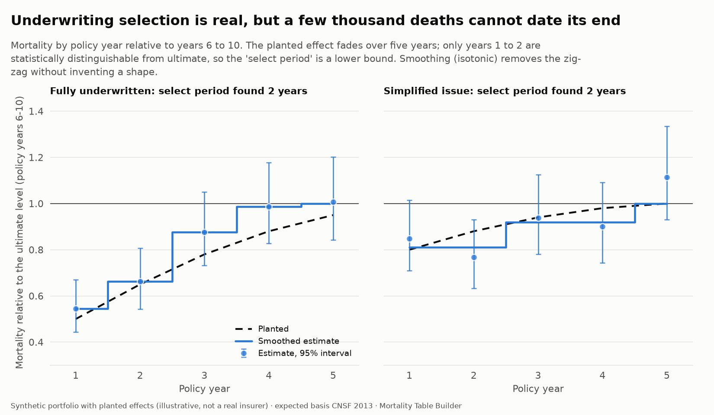
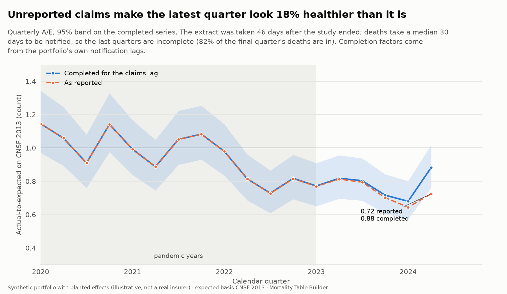
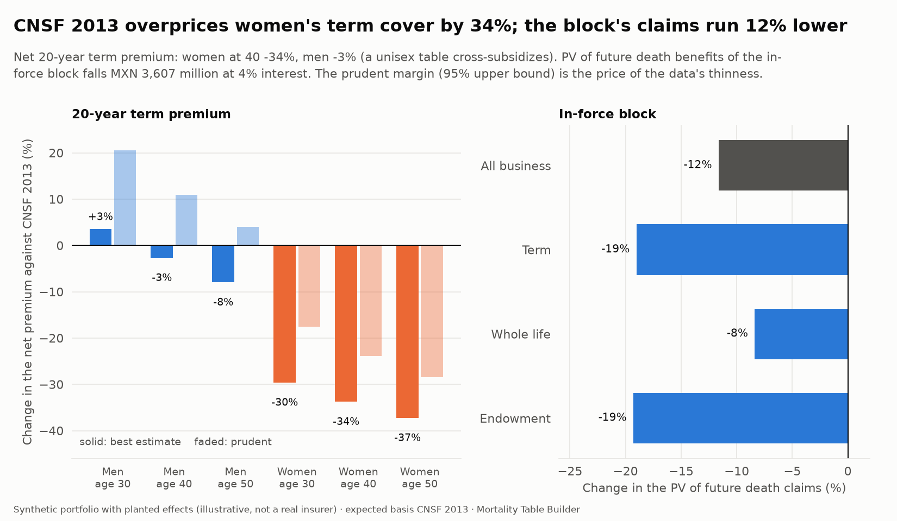

# An insurer-style mortality experience study (step 8)

An experience study answers the question every life insurer asks each year: **how is our own mortality running against the table we price and reserve with, and what should we change?** It is the bridge between a mortality table and a company's actual claims.

This step builds one end to end: from a policy-level administrative extract to validated data, exact exposure, actual-to-expected ratios by count and by amount, credibility, multivariate relativities, select-period and calendar findings, a claims-reporting-lag correction, a derived company basis, and the effect on prices and reserves.

**The mathematics (expected deaths, A/E, credibility, the regression, the select period, the claims lag and the basis) is derived in [handbook chapter 7](handbook/07-experience-study.md); this page is the results.**

Code: `src/mortality/lexis.py` (exposure), `experience.py` (the study), `portfolio.py` (a synthetic portfolio). Tests: `tests/test_lexis.py`, `test_experience.py`, `test_portfolio.py` (43 tests).

## What is real and what is synthetic

**No insurer publishes its policy-level data, so the portfolio here is synthetic.** It is a fictional company with 573,000 policy records. Every effect in it (the level of mortality, the size of the sex difference, how fast underwriting wears off, and so on) is an **illustrative assumption**, listed in `experience_truth`. None of it is an estimate for any Mexican company, and the results are not findings about the Mexican insurance market.

What the synthetic portfolio is for is **method validation**. Effects are planted at known sizes, a realistic extract is produced (lapses, expiries, a claims-reporting lag, data defects), and the study, which never sees the truth, is judged on what it recovers. A method that is correct on data with a known answer can be pointed at a real extract:

```
uv run mortality experience template --out extract.csv
uv run mortality experience run --policies my_extract.csv \
    --study-start 2018-01-01 --study-end 2024-06-30 --extract-date 2024-08-15
```

`run` validates the extract, runs every stage below and writes each result table as CSV. The expected basis defaults to CNSF 2013; `--basis-csv` takes the company's own pricing table (`age,qx`).

### The extract

One row per policy, as any administration system can produce:

| Column | Meaning |
|---|---|
| `policy_id`, `sex` (M/F), `birth_date`, `issue_date` | identification and dates |
| `product` (TERM, WHOLE_LIFE, ENDOWMENT), `term_years` | the contract; empty term for whole life |
| `sum_assured` | amount at risk, MXN |
| `uw_class`, `channel`, `state` | rating factors: underwriting class, distribution channel, INEGI state code |
| `status` (IN_FORCE, DEATH, LAPSE, EXPIRED), `exit_date` | how and when the policy left observation |
| `notification_date` | when a death was reported (for the claims-lag estimate) |

## The synthetic portfolio

The force of mortality of every policy is

> CNSF 2013 q at the attained age, times: a base level (0.88), sex, an age-group shape, underwriting class, sum-assured band, channel, product, a select effect by policy year (different for simplified issue), the state's mortality ratio (from this project's own state analysis), a 1% yearly improvement, and a dampened pandemic effect in 2020 to 2022.

It is held constant inside each **Lexis piece** (below), so deaths are drawn from exactly the model the study assumes. On top of it: lapses (higher in the first years and through banks), term and endowment expiries, policies issued before the study window (so observation starts part-way in), a death-to-notification lag with a long tail (median 30 days), and an extract taken 46 days after the study ends, so recent deaths are missing. Defects of the kinds found in real extracts are injected: duplicates, invalid sex, birth after issue, zero or negative amounts, bad state codes, exits before issue, issue dates after the extract, deaths without a notification date.

## 1. Data validation and reconciliation

Before any rate is computed the extract is checked, and every record is accounted for (`experience_dq_checks`, `experience_dq_reconciliation`).

| Check | Injected | Found |
|---|---:|---:|
| Duplicate records | 573 | 573 |
| Invalid sex | 275 | 275 |
| Birth missing or after issue | 275 | 275 |
| Non-positive sum assured | 275 | 276 |
| Exit before issue | 359 | 393 |
| Issue after the extract date | 115 | 115 |
| Invalid state (repaired to UNKNOWN) | 275 | 275 |
| Death with no notification date (kept) | 44 | 45 |

The few extra are duplicates of already-defective rows. The reconciliation separates duplicate copies from other exclusions, because a duplicated death appears twice in the raw count:

| Step | Records | Deaths |
|---|---:|---:|
| In the extract | 573,082 | 4,353 |
| Duplicate copies dropped | 573 | 3 |
| Excluded for other reasons | 1,298 | 14 |
| **Clean file** | **571,211** | **4,336** |

Against the generator's hidden truth the identity is exact: studied deaths = true deaths − deaths still unreported at the extract − deaths lost to validation (a unit test and a data check).

## 2. Exact exposure

Exposure is computed from dates, not from policy-year counts. Each policy's observation period is cut at every policy anniversary and every 1 January (a **Lexis split**), so every day belongs to exactly one combination of attained age, policy duration and calendar year, and expected deaths are `exposure x rate` with no approximation. The portfolio yields 5.47 million pieces and 2,601,603 policy-years, with 4,336 deaths against 5,184 expected on CNSF 2013 (all years).

The split handles left truncation (policies issued before the study start), 29 February issue dates, anniversaries on 1 January, and exits on any day. The tests include a 4,000-policy randomized property test in which every observed day is counted exactly once and no piece crosses a boundary.

## 3. Actual to expected, by count and by amount



A/E is deaths over expected deaths on CNSF 2013. Count A/E has an exact Poisson interval; amount A/E weights by sum assured and has a compound-Poisson interval, much wider because a few large claims drive it (`experience_ae`).

Excluding the pandemic years (2,523 deaths), the portfolio runs at **0.77** of CNSF 2013 (95% interval 0.74 to 0.80) by count and **0.68** by amount: large policies die less. One-way results:

| | A/E (count) | 95% interval | A/E (amount) |
|---|---:|---|---:|
| Men | 0.91 | 0.87 to 0.96 | 0.81 |
| Women | 0.59 | 0.56 to 0.63 | 0.52 |
| Preferred | 0.45 | 0.39 to 0.52 | 0.39 |
| Standard | 0.64 | 0.60 to 0.68 | 0.56 |
| Rated | 0.98 | 0.84 to 1.13 | 1.04 |
| Simplified issue | 1.03 | 0.97 to 1.09 | 0.90 |
| Under 250k | 0.88 | 0.82 to 0.96 | 0.88 |
| 5M and over | 0.58 | 0.42 to 0.77 | 0.51 |

CNSF 2013 is a unisex table: it fits men at 0.91 and women at 0.59, and the one-way view cannot say how much of the channel or class effect is really mix.

## 4. Credibility



A ratio from 45 deaths is not a mortality assumption. Two standard answers are implemented (`experience_credibility`):

- **Limited-fluctuation** (classical): `Z = sqrt(deaths / 1,082)`, capped at 1, with the pricing basis as the complement.
- **Bühlmann-Straub**: estimates, across segments and years, how much true segment means differ (`v = 0.080`) against the scatter inside a segment (`s² = 0.92`), giving `K = s²/v = 11.5`; a segment with `w` expected deaths gets `Z = w/(w + K)` and is pulled toward the **portfolio** mean (0.77).

The choice of complement matters more than the choice of formula. Female standard-class bancassurance has 45 deaths and a raw A/E of 0.36. Limited-fluctuation credibility pulls it to 0.87, toward the table that the data say does not fit; Bühlmann-Straub pulls it to 0.40, toward the rest of the portfolio. Which is right depends on whether the old table or the rest of the book is the better prior; here the book is.

## 5. Multivariate relativities



One-way tables mislead when factors overlap: a channel that sells mostly simplified-issue business looks bad until class is held equal. The study fits a **Poisson GLM** with log expected deaths as offset (`experience_relativities`); `exp(coefficient)` is a relativity against a reference level, all other factors held equal.

Two details matter:

- **Pandemic years are excluded** from the relativities, because their excess varies by age and would contaminate the age effect.
- **Dispersion** is estimated on bins of about 10 expected deaths, not cell by cell. With 155,000 sparse cells, the usual Pearson statistic is dominated by cells expecting a fraction of a death, where a Poisson count is far from normal, so it is noisy; the binned estimate (1.27 here) rests on cells large enough for the chi-square to hold. On exactly Poisson data both are close to 1. Standard errors are scaled by it (quasi-Poisson).

**The study recovers 15 of 15 planted effects within their 95% intervals** (95% expected), with point estimates close: women 0.65 against 0.66 planted, rated risks 1.53 against 1.55, large policies 0.73 against 0.74. This is the central validation.

## 6. The select period



Underwriting wears off: mortality in the first policy years is below ultimate. The study reads policy-year effects against years 6 to 10, separately for fully underwritten and simplified-issue business (`experience_select`), and smooths them with isotonic regression (pooling adjacent violators), which removes the zig-zag without inventing a shape.

The planted select effect fades over five years. All ten estimates fall inside their intervals and track the planted values (fully underwritten: 0.55, 0.66, 0.88, 0.99, 1.01 against 0.50, 0.65, 0.78, 0.88, 0.95). But only policy years 1 and 2 are statistically distinguishable from ultimate, so a rule like "the select period is the last year that differs significantly" returns 2, not 5. **With a few thousand deaths the select period cannot be dated; the number is a lower bound.** That is the honest reading for a real portfolio too, and it is why the smoothed factors, not the "period", are what a basis should use.

## 7. Calendar years, the pandemic and unreported claims



A/E by calendar year shows the pandemic in the portfolio: 0.76 to 0.83 before 2020, 1.06 in 2020, 1.00 in 2021, then back to 0.83, 0.77 and 0.69 (`experience_ae_covid`, `experience_ae_quarterly`). The last value is misleading.

**The latest quarter looks too good because deaths have not been reported yet.** The extract was taken 46 days after the study ended, and deaths are notified after a median of 32 days (49% within 30 days, 73% within 60, 84% within 90, 95% within 180). For the last quarter only 82% of deaths are in the extract: A/E as reported is 0.72, and 0.88 once completed. The completion factors come from the portfolio's own notification lags, using only deaths old enough that nearly all have been reported.

Against the truth the generator knows (`experience_lag_validation`), the correction works: for the last quarter the completed count is 186 against a true 190, an error of −2.0%, where the raw count is 19.5% short. The quarter before, the raw error is −8.8% and the completed one −3.8%. The practical rule follows: **do not read the last two or three quarters raw, and do not set an assumption on them.**

## 8. A company basis and what it is worth



The study derives a company mortality basis (`experience_basis`): the CNSF 2013 table times a multiplier by sex, age and policy-year group, from a GLM on the non-pandemic years. The overall level and each effect are shrunk toward 1.0 by limited-fluctuation credibility on the deaths behind them, and interpolated between age-group centers so there are no steps. A **prudent** version uses the 95% upper bound of the multiplier from the model's covariance: a margin an actuary can add where a prudent basis is required, and the visible price of thin data.

Applying it (`experience_pricing`, `experience_impact`):

- **Prices.** The net annual premium for a 20-year term at 40 is 34% lower for women than on CNSF 2013 (1.15 against 1.74 per 1,000) and 3% lower for men (1.69). At 30, men's premium is 3% *higher*. A unisex table cross-subsidises; the experience says by how much.
- **Claims.** The present value of future death benefits of the in-force block (392,000 policies, MXN 414 billion of sum assured) is **MXN 27.4 billion on the experience basis against 31.0 billion on CNSF 2013**, 12% lower (term 19%, endowment 19%, whole life 8%). Expected claims in the next 12 months fall 18%, from MXN 904 million to 742 million.
- **The prudent margin** raises men's premium to 1.93 per 1,000 at 40 (+11% on CNSF), the cost of acting on 2,500 deaths.

Premiums here are net (no expenses, profit or lapse), at 4% interest.

## How the method is validated

| Test | Result |
|---|---|
| Validation catches every injected defect, in full | yes, 8 of 8 kinds (data check) |
| Records and deaths reconcile exactly from extract to clean file and to the truth | yes (data check, unit test) |
| Every rating factor splits the same exposure, deaths and expected deaths | yes (data check) |
| Planted rating effects inside the 95% intervals | 15 of 15 (data check requires 80%) |
| Planted select factors inside the intervals | 10 of 10 |
| Claims-lag completion within 12% of the truth for the last two quarters | yes, 2.0% and 3.8% |
| Completion improves the latest quarter | yes, from 19.5% short to 2.0% |
| Basis is a valid table (positive multipliers, q in [0, 1], prudent above best estimate) | yes |

Unit tests use hand-worked policies (exposure, death placement, left truncation, expiry), pure-Poisson data (dispersion), a known Bühlmann K, a known multiplicative model (GLM recovery), a known select pattern, and the full study on a generated portfolio.

## Using it on real data

What an analyst would still decide, and what this study does not do:

- **The expected basis.** CNSF 2013 is the default; most companies would use their pricing table (`--basis-csv`).
- **Which years to exclude.** 2020 to 2022 are excluded from relativities here; a company may exclude only the peak, or model the pandemic explicitly.
- **The credibility standard.** 1,082 deaths (90% probability of being within 5%) is the classical standard; a company may use a different one, and amounts need a higher one (large claims).
- **The margin.** The prudent multiplier is a 95% bound, not a regulatory margin.
- **Not covered:** lapse and anti-selective lapse studies, cause of death, joint lives, riders, multi-decrement analysis, and reinsurance (ceded and retained experience, large-claim analysis, treaty experience rating). The same pipeline applies to a cedant's data by treating the cedant as a segment, which is a natural next step but is not implemented here.

## Known limits

- **The portfolio is synthetic and the effects are assumptions.** The method is validated; no claim is made about any real company.
- **The model that generates the data is multiplicative and the study fits a multiplicative model.** Real portfolios have interactions the study does not model (it handles the select-by-class interaction by fitting underwriting types separately). Recovery on synthetic data proves the machinery, not that real mortality is multiplicative.
- **State is grouped into mortality terciles** from this project's state analysis, so the state effect is an average, not a per-state relativity.
- **Pandemic age effects are dampened and parametric**, not the real pattern of any insurer.
- **Amount-based credibility** uses the count standard; large-claim volatility would need its own.
- **Exposure treats unreported deaths as in force** until the study ends: the small bias is documented, and the count is corrected, but the exposure is not.
