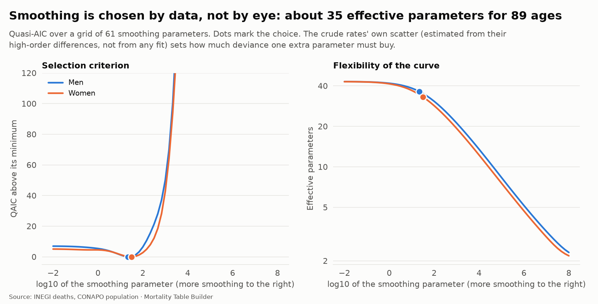
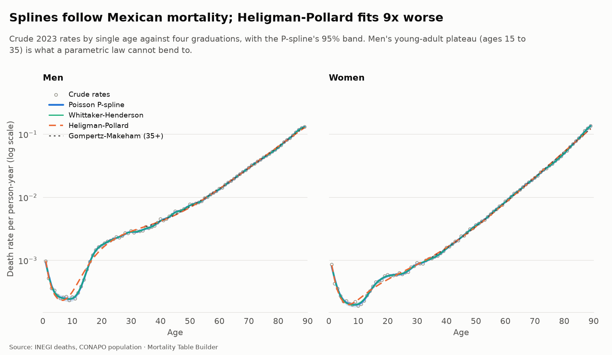
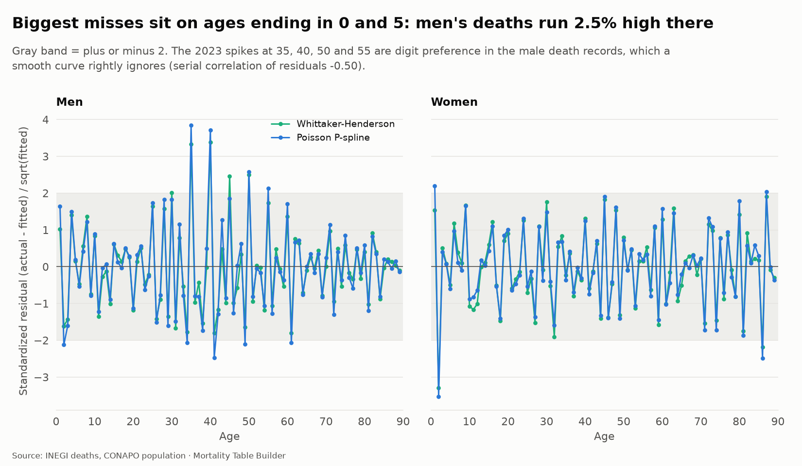
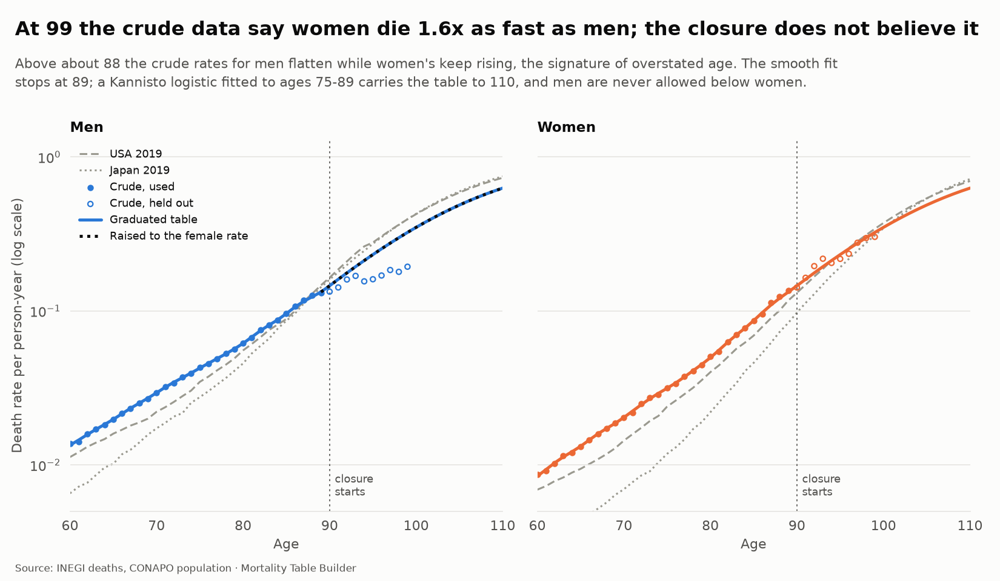
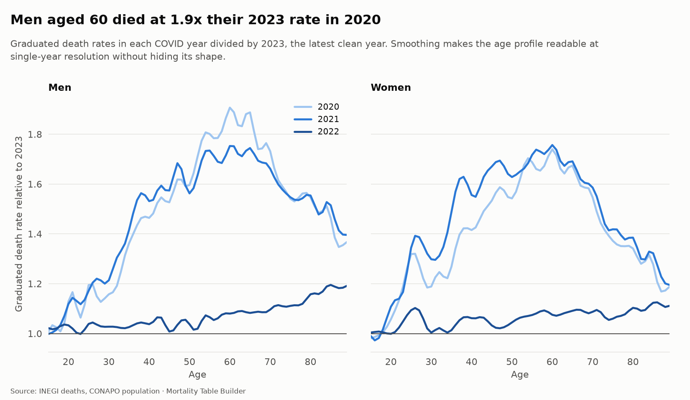

# Graduation (step 5)

Crude death rates are noisy, and at the oldest ages they are wrong in a systematic way. Graduation turns them into smooth, credible rates that a life table can be built on. This step fits four methods to every year (2020 to 2024) and sex, picks the smoothing with a stated criterion, tests every fit, closes the table at age 110, and writes the result to the warehouse as `graduated_qx`.

Code: `src/mortality/graduation.py` (pure NumPy/pandas functions, 22 unit tests in `tests/test_graduation.py` on synthetic data with a known truth). Charts: `uv run mortality figures`.

## The four methods

| Method | What it is | Parameters |
|---|---|---|
| **Poisson P-spline** (Eilers and Marx) | Cubic B-spline curve for log m, 40 knot intervals, penalty on second differences of the coefficients, fitted by penalized maximum likelihood with exposure as offset | 33 to 39 effective |
| **Whittaker-Henderson** | The classic actuarial graduation: weighted least squares on log m, weights equal to deaths, penalty on third differences | 31 to 43 effective |
| **Heligman-Pollard** (1980) | Eight-parameter law for the whole age range: childhood decline, accident hump, Gompertz aging | 8 |
| **Gompertz-Makeham** | `A + B c^x`, fitted from age 35 | 3 |

Ages 1 to 89 are graduated. Age 0 keeps its crude rate (tens of thousands of deaths, and its own shape). Ages 90 and over come from the closure below.

### How the smoothing is chosen

The smoothing parameter is chosen by **quasi-AIC**: `deviance / dispersion + 2 x effective parameters`, minimized over a grid of 61 values.

The dispersion matters. With 100,000s of deaths, a plain AIC follows every irregularity of the crude rates. The dispersion is therefore estimated from the **crude rates' own fourth differences** (for a smooth curve they are mostly noise, with a known Poisson variance), not from any fitted curve. It is stable across difference orders 3 to 5, and it says something real about the data:

- **women:** 1.0 to 1.7 (close to pure Poisson noise);
- **men:** 1.85 to 3.1 (up to three times the scatter that sampling alone explains).

An earlier version estimated the dispersion at the best-AIC fit instead; with an almost-saturated Whittaker-Henderson fit it returned 1.06 and the criterion stopped penalizing complexity. That version is gone, and `test_lambda_selection_*` guards the behavior: exactly-Gompertz data must pick the straight line (2 parameters), and data with a bump must stay flexible.

## Fit

- The two smoothers are almost indistinguishable and follow the crude rates, including men's young-adult plateau.
- **Heligman-Pollard has about nine times the P-spline's deviance in 2023** (8.8 for women, 8.7 for men), and 15 to 17 times on average over the five years (1,159 and 2,052 against 77 and 122). The first fit used a likelihood optimizer that stopped early on the badly scaled childhood parameters; switching to least squares on deviance residuals cut HP's deviance by about a quarter. A search from 60 random starts with the weaker optimizer did *not* reveal this, which is why the test now recovers a known Heligman-Pollard curve from simulated data. The remaining gap is a real property of the law, not a fitting failure.
- Gompertz-Makeham fits only ages 35 and over and is a baseline, not a candidate.

## Tests of the fit

`graduation_fit_tests` stores, per year, sex and method: chi-square and dispersion, signs test, runs test, serial correlation of residuals, cumulative deviation, the share of standardized residuals beyond 2 and a smoothness measure.

With counts this large, the chi-square and runs tests flag *some* lack of fit for every smooth curve. What matters is its size:

| | P-spline | Whittaker-Henderson | Heligman-Pollard | Gompertz-Makeham |
|---|---|---|---|---|
| Residuals beyond 2, women (a perfect fit: 4.6%) | 2.2% to 4.5% | 0% to 2.2% | 44% to 54% | 42% to 82% |
| Residuals beyond 2, men | 5.6% to 13.5% | 1.1% to 13.5% | 48% to 73% | 44% to 60% |

(Ranges are over the five years. Gompertz-Makeham is judged on ages 35 to 89 only.)

The P-spline's fit is within what Poisson noise allows for women and moderately above it for men. The laws are not close.

### A finding: digit preference in men's death records

The standardized residuals spike on **ages ending in 0 and 5**. Measured as excess deaths against the smooth curve over ages 25 to 70 (`graduation_digit_preference`):

| | Excess at ages ending in 0 or 5 | At other ages |
|---|---|---|
| Men, every year 2020 to 2024 | +1.25% to +2.46% | -0.30% to -0.69% |
| Women | -0.38% to +1.04%, no consistent sign | about 0 |

The Whipple index in [data-quality.md](data-quality.md) (98 to 101, "highly accurate") averages over both sexes and a wide range; it cannot see a 2% excess on men alone. The size is small for pricing but it is systematic, it explains the negative serial correlation of the residuals (about -0.45 to -0.49), and it is why a smooth curve is the right tool: it ignores the heaping instead of chasing it.

## The oldest ages

The crude data break down above about age 88. **Women overtake men** (at age 99 the crude female rate is 1.6 times the male one, and 1.8 times at 100+), while in the Human Mortality Database men are higher at every age and country. Men's crude rates also flatten near 0.19 where the USA and Japan keep rising to 0.4 and above. The likeliest cause is **age exaggeration**: the oldest men are recorded as older than they are, which inflates their exposure and so deflates their rate. A new data check (`crude_old_age_sex_order`, 48 violations) records it.

The closure therefore does not trust ages 90 and over:

1. The smoothers are fitted to ages 1 to 89 only.
2. A **Kannisto logistic** `m = a e^(b(x-80)) / (1 + a e^(b(x-80)))` is fitted to ages 75 to 89 and carries the table to 110 (2023: women a = 0.054, b = 0.115; men a = 0.068, b = 0.091). Ages 90 to 99 of the crude data are held out; the chart shows how far they stray.
3. The spline fades into Kannisto over ages 84 to 90 on the log scale, so there is no jump.
4. q at 110 is set to 1.
5. **Men are never allowed below women.** Where the closure leaves men lower (from age 89 in 2023 and 2024, 94 in 2022, 98 in 2020, 101 in 2021), the male rate is raised to the female one and `sex_floor = 1` marks it. This is a floor, not an estimate: it likely still understates male old-age mortality (USA men at 90 are at 0.165 against 0.146 here). Treat male rates above 90 as a lower bound until a better exposure series exists.

## The graduated table

`graduated_qx` has `year, sex, age (0 to 110), mx, mx_lower, mx_upper, qx, source, sex_floor`, where `source` is `crude` (age 0), `pspline`, `blend` or `kannisto`. Intervals exist only for the P-spline ages (up to 84). 2023, the latest clean year, is the reference table:

| Age | Men q | Women q |
|---|---:|---:|
| 30 | 0.00283 | 0.00087 |
| 40 | 0.00424 | 0.00154 |
| 50 | 0.00744 | 0.00358 |
| 60 | 0.01335 | 0.00841 |
| 65 | 0.01957 | 0.01313 |
| 75 | 0.04166 | 0.03100 |
| 90 | 0.13585 | 0.13585 |
| 100 | 0.29727 | 0.29727 |

At age 40 these are 4.1 times (men) and 1.5 times (women) the CNSF 2013 base rate of 0.00103. The 90 and 100 rows are equal because of the sex floor.

### Pandemic profile at single ages

Graduation makes the pandemic's age profile readable at single-year resolution: men aged 60 died at 1.9 times their 2023 rate in 2020, and women's excess is broader (above 1.6 from about age 37 to 67) and highest in 2021.

## What the checks guard

Seven checks (see [warehouse.md](warehouse.md)): the table is complete to 110 and closes with q = 1; q is a probability; q rises with age from 35; men are never below women; the P-spline reproduces total deaths to within 0.1%; fewer than 15% of its residuals pass 2; and the crude old-age sex order is flagged.

## Known limits

- Graduation is per year. There is no pooling or borrowing of strength across years; the 2020 to 2022 tables carry the pandemic and are not reference tables.
- Single ages exist only from 2020, so there is no graduated 2019 baseline.
- The old-age closure rests on ages 75 to 89 and on a sex floor, not on credible data above 90. Exposure above 90 needs better evidence (census age checks, pension records) before it can be believed.
- Intervals for the Kannisto part and for the Heligman-Pollard and Gompertz-Makeham fits are not computed.
- q is derived from m with `a = 0.5` above infancy. The life tables of step 6 can refine this with the graduated shape.
