# Insured lives: a mortality table for pricing quotes (version 2)

Version 1 of this project rebuilt Mexico's mortality from the registered deaths of the whole population. That answers population questions (life expectancy, the pandemic, longevity). It is the wrong table for **pricing a life insurance quote**, because the people who buy life insurance are not a sample of the population: they are wealthier, underwritten and mostly urban. This document builds the table a pricing actuary needs from the industry's own statistics, and explains every choice on the way, with what the alternative would have done to a quote.

<p align="center">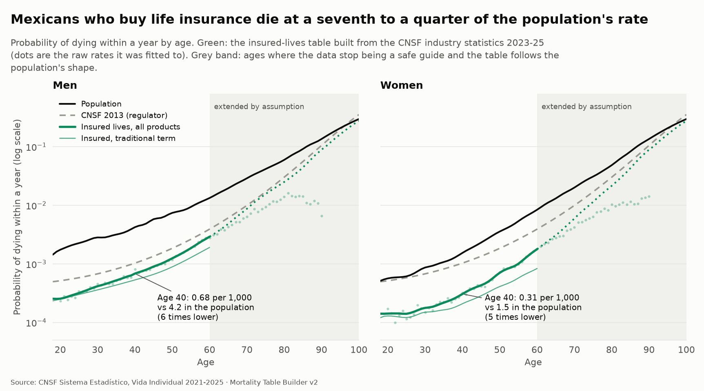</p>

## In one page

| | |
|---|---|
| **Data** | The CNSF's individual life statistics 2021 to 2025: 5 workbooks, about 1.2 million rows a year, 81,000 death claims in the three base years 2023 to 2025 and about 20 million insured lives a year |
| **What it is** | A **family of tables**: traditional term (the standard quote), credit life, and whole life and endowment are graduated on their own; other term modalities are a multiple of traditional term; the market-wide table is an exposure-weighted blend of the products |
| **How far from the population** | Insured lives die at **14% to 25%** of the population's rate between ages 20 and 65 (a US insured life: 44% to 79% of the US national rate) |
| **A quote** | A man of 40, 20-year term, net annual premium per 1,000: **0.85** on the traditional-term table, 1.20 on the market table, 1.74 on CNSF 2013, 2.52 on the US insured table (2017 Unloaded CSO), **6.62** on the population |
| **Margin** | **15%** on mortality, sized from the adverse readings that cannot be ruled out (12.4% in quadrature, rounded up) |
| **What would have gone wrong silently** | Three traps in the data (the ledger, the maturities, the exposure cover), each worth 2% to 25% of the premium; section 3 |
| **Where it is not reliable** | Above about age 60 for term and 83 for whole life the data stop describing insured lives; the table follows the population there by assumption |

## 1. Why the population table is the wrong tool for a quote

The CNSF 2013 regulatory table is built from insurer experience, with margins, more than a decade ago. The population table of version 1 is the whole country. A quote needs the third thing: the mortality of the people who are actually insured, today.

Version 1 showed the population dying at about 3 times the CNSF 2013 rate (4 times for men of 40). The natural suspicion was that the population table was wrong. It was not: the **insured** are a different group. The statistics below measure how different.

## 2. The data

The CNSF publishes one Excel workbook a year (2021 to 2025) with three sheets:

| Sheet | What a row is | We use it for |
|---|---|---|
| `Comisiones` | Insured lives *exposed* during the year, by age, sex, plan, modality, currency, state and channel, with premium and commission | A check on the exposure |
| `Emision` | Insured lives, premium and **sum assured**, by **cover** (death, accidental death, disability, funeral expenses, ...) | **The exposure**: lives holding the death cover; the sum assured |
| `Siniestros` | Claims by cover, with the **text of the cause**, the amounts claimed and paid | **The deaths** |

The statistics for 2018 to 2020 come in a different, older format (Access databases, coded columns, no cause of death). They are read, kept and compared, but not pooled into the table (decision 13).

| Year | Death-claim rows | Lives holding the death cover | Lives, any cover |
|---|---|---|---|
| 2021 | 59,834 | 15.6 million | 18.6 million |
| 2022 | 40,304 | 17.2 million | 18.6 million |
| 2023 | 34,949 | 18.3 million | 19.9 million |
| 2024 | 35,198 | 19.6 million | 22.2 million |
| 2025 | 35,146 | 21.8 million | 23.9 million |

Every number in the workbooks is reconciled: row counts and column totals are summed from the raw cells while reading, independently of the cleaning, and the warehouse checks prove nothing was lost or altered. Cells the cleaning would turn into missing values (an unexpected sex or age label) are counted and reported.

## 3. The three traps

Each of these looks harmless in the raw sheets and would have moved the premium.

### Trap 1: one death-claim row in five is not a death

20.5% of the 2023 death claims have no age, no sex, no plan and no modality. The obvious fixes both fail: dropping them looks like losing a fifth of the deaths; spreading them across the table looks like conservatism. Neither is right, because **they are not deaths**:

<p align="center">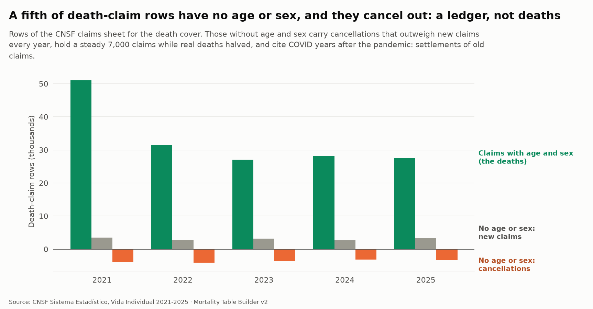</p>

- **Their claimed amounts net to about zero** (-113 million pesos in 2021, -145 million in 2022, +141 million in 2023) while they carry 0.8 to 1.1 billion pesos of payments a year.
- **Cancellations outweigh new claims every year** (net -358, -1,301, -395, -493, 2021 to 2024).
- **Their count stays flat** at 7,200 to 7,800 a year while real deaths fell from 51,000 to 27,000.
- **COVID shows up years late:** in 2023 they are 7.7% COVID-19 against 1.0% of normal claims. They are settling the pandemic's claims.

They are the ledger of payments and cancellations of claims reported in earlier years. They are excluded. The readings that add them back are kept as named sensitivities (+11% and +25% on a quote) so the reader can see what the choice is worth.

### Trap 2: 2,300 "sprained ankles" are endowment maturities

The cause text "LUXACION, ESGUINCE Y TORCEDURA DE ARTICULACIONES Y LIGAMENTOS DEL TOBILLO" appears on 2,328 death claims from 2022 on. They are not accidents:

- **Age:** three quarters of them at ages 60 to 69, with a spread of 4 years against 14 for all claims.
- **Size:** an average claim of 1.37 million pesos, 3.6 times a death claim.
- **Plan:** 46% on endowments (`Dotal Mixto`), the rest on savings-type modalities.

They are endowment maturities booked under the death cover with a placeholder cause. In endowment plans they are a third of the recorded "deaths" at 60 to 69; on all plans, 3.4% of death claims at those ages. They are excluded from the base rule (a scan of every cause for the same fingerprint, a tight age spread and a large amount, found no other).

### Trap 3: deaths and exposure must refer to the same cover

The exposure sheet counts every life with any cover. Deaths are counted under the death cover only. A term policy that carries only a disability or an accident cover is exposed but can never produce a `Fallecimiento` claim. The issue sheet reports lives **by cover**, so the denominator is the lives holding the death cover: 10% fewer than all lives for term business, 27% fewer for endowments, none for whole life. Using the wrong denominator lowers a man's premium by 11%.

## 4. Decision log

| # | Decision | What we did | Why | What the alternative does (man of 40, 20-year term) |
|---|---|---|---|---|
| 1 | **Years** | Pool 2023, 2024 and 2025 | Post-COVID, and three years give enough deaths at most ages. 2021 and 2022 are used only to measure the pandemic | 2023-24 only: +0.8%. 2024-25 only: -5.3% |
| 2 | **What counts as a death** | Cover `Fallecimiento`; age and sex known; claimed amount positive; a cause that can cause a death | Traps 1 and 2. Riders (accidental death, funeral expenses) are separate covers of the same death and would be counted twice | Net of cancelled claims: -2.3%. Plus the positive no-detail rows: +11.1%. Plus all no-detail rows: +24.9%. Keeping the maturities: +2.2% on 2023 deaths, 0 at age 40 |
| 3 | **Exposure** | Lives holding the death cover (issue sheet) | Trap 3: same benefit in numerator and denominator | All lives, any cover: -11.4% (term: 10% more lives) |
| 4 | **Head count, not person-years** | Count the lives as given; allow for turnover as a sensitivity | A policy issued or lapsed during the year counts as one life, so the rate is slightly low. The data give no way to measure the share exposed part of the year | 10% of lives exposed part of the year: +5.3%. 20%: +11.1% |
| 5 | **Several policies per person** | No adjustment | A person with two policies counts twice in the exposure *and* produces two claims, so the rate is not distorted; only the variance is | none |
| 6 | **Claims booked in the year** | Treat the year of booking as the year of death | The lag is not observable (no date of death). Pooling three years and the stable ledger bound the distortion | none measurable |
| 7 | **Products** | A table per product: traditional term, credit life, whole life and endowment; other term as a multiple of traditional | Mortality differs 2 to 3.5 times between products (section 6); a blend answers the wrong question for any one quote | Quoting a traditional term on the market blend: +40.2%. On all term: +14.6% |
| 8 | **Graduation** | A Poisson P-spline of the rate, chosen by quasi-AIC and out-of-sample shape (section 5) | Smooth, no assumed shape, intervals; beats the parametric alternatives by a wide margin | Relational P-spline: -0.1%. Gompertz-Makeham: +0.3%. Brass: +2.6% |
| 9 | **Credible range** | The age where the ratio to the population falls below 85% of its level at ages 40 to 60; one range for both sexes (the shorter) | A term runs out and few, unrepresentative lives remain; dead lives stay in the books. Letting each sex have its own range made women's extension start first and cross men's | n/a |
| 10 | **Old ages** | The ratio to the population rises to 1 by age 105 along an S-curve (the same for every table) | See section 7: an assumption, justified by plausibility | Meeting at 95 or 115: 0.0% for this quote; matters for whole life only |
| 11 | **Ages below 18-26** | The population curve scaled by the insured/population ratio at the first fitted age | The tables are for pricing adults; the youngest ages are kept so a table is complete | none |
| 12 | **Sex** | Separate tables; men floored at women where an extension leaves them below (61 age-cells, all at ages 82 and over) | No population shows women dying faster at these ages | none |
| 13 | **2018-2020 format** | Read, kept, not pooled | Women's share of lives goes 46%, 36%, 37% in three years (50-52% from 2021); rates against the modern level range from 0.7 to 1.6 for men, 1.2 to 2.2 for women, with 2019 30% below 2018; no cause or cover detail | none |
| 14 | **Improvement** | None in the table (it is the 2023-25 level, centred on 2024). Roll forward with the population's projected rates | The insured trend (-5% a year for men, -11% for women) is real but contaminated by new business (freshly underwritten) and cannot be told apart from improvement with three years | Rolling to 2026 at the projected rates: -2.4% |
| 15 | **Amount against count** | Count basis in the table; amount ratio published | Larger policies die more in traditional term (ratio 1.26 to 1.38), less in credit life (0.44 to 0.71): a different measure, not a doubt about this one | By sum assured: +36.9% |
| 16 | **Margin** | 15% on mortality | The adverse readings that cannot be ruled out, in quadrature: sqrt(11.1%² + 5.3%²) = 12.3% (12.4% for women, 12.0% for the 55-year-old man), rounded up to the next 5% | n/a |
| 17 | **Interest and expenses** | Net premium at 4%; no expenses | The table is about mortality; the pricing step adds expenses, lapses and profit | n/a |
| 18 | **Cause of death** | Grouped by keyword from the text | The field mixes underlying and immediate causes (shock, acidosis, arrest); it shows a pattern, not an exact statistic | n/a |

<p align="center">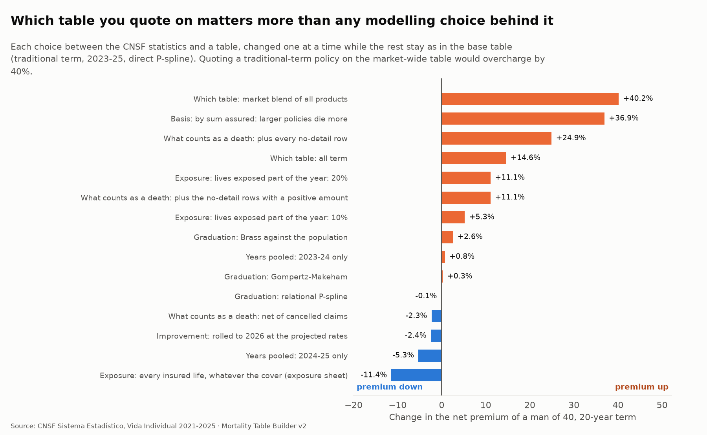</p>

The tornado makes the point of decision 7: **which table you quote on moves a premium by more than every modelling choice behind the table.**

## 5. The table

### Graduation

Four methods are fitted to each product and sex, over the ages where the data are credible, and compared:

| | Description | Parameters |
|---|---|---|
| **Direct P-spline** | Poisson P-spline of the insured rate | 4 to 19 effective |
| **Relational P-spline** | The same, on the *ratio* to the population table, so the population's shape (the young men's hump, the old-age rise) is inherited | 3 to 19 |
| **Gompertz-Makeham** | A three-parameter law | 3 |
| **Brass** | `logit q = a + b logit q_population` | 2 |

The smoothing is chosen by a quasi-AIC, **one dispersion for every method**, estimated from the crude counts' own high-order differences. Taking it from each fit would let a badly fitting method shrink its own penalty: the worse the fit, the larger its dispersion, the smaller `deviance / phi`. A leave-one-year-out test scores each method on the *shape* of a held-out year (rescaled to its level, so a year of improvement does not decide the contest). The rule: the lowest quasi-AIC among the methods whose out-of-sample shape error is within 5% of the best.

Men, traditional term (43 ages): direct P-spline 47.4, relational 48.8, Gompertz-Makeham 50.4, Brass 63.6. Whole life men: direct 69.6 against 209 and 336 for the parametric methods. With enough data the splines win by a lot; where data are thin (women's traditional term) the four are close and the rule picks the one with the fewest effective parameters.

### Fit tests and honesty

With counts this large a chi-square test almost always rejects (the data are not exactly Poisson: reporting varies by insurer). The dispersion says how much: 0.7 to 2.7 across the six selected fits. The share of standardised residuals beyond 2 is 2% to 8% (4.6% expected), and the runs test passes in 5 of the 6 fits (it fails for women's whole life).

### Where the data stop

<p align="center">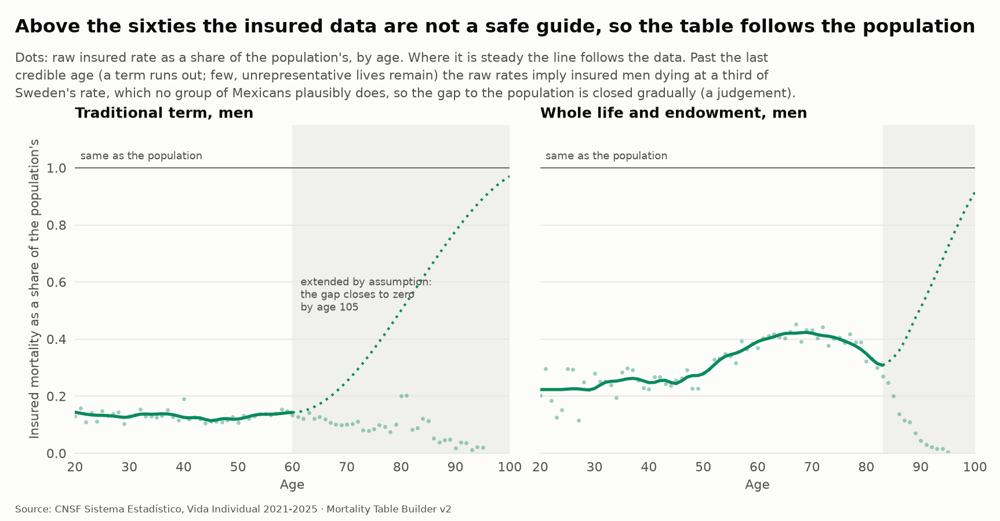</p>

## 6. What the table says

### The gap to the population

<p align="center">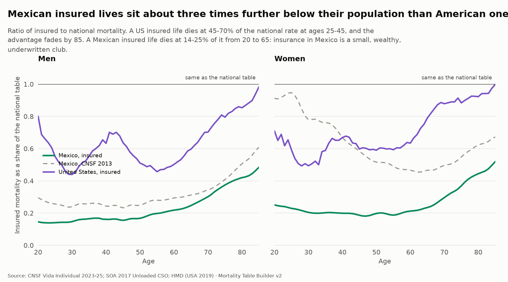</p>

Between ages 25 and 65 the market table is at **14% to 25%** of the population for men and **18% to 24%** for women; traditional term alone is at 11% to 17% for men. The US insured table (2017 Unloaded CSO) is at 44% to 70% (men) and 49% to 79% (women) of the US national table. The CNSF 2013 regulatory table sits at 23% to 31% of the Mexican population for men: version 1's "3 to 4 times" was real. It describes an industry whose clients are a small, wealthy, underwritten club.

### Who do insured Mexicans die like?

<p align="center">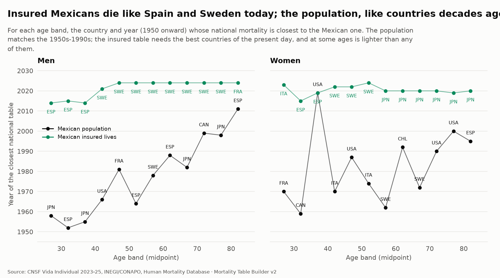</p>

For each age band, the country and year (1950 onward) whose national mortality is closest: **men aged 40 to 44, Sweden in 2021; aged 60 to 64, Sweden in 2024. The population, at the same ages, the United States in 1966 and Spain in 1988.** Women aged 40 to 44, Sweden in 2022. In Brass terms the market table is `a = -0.10, b = 1.32` against the population; CNSF 2013 is `a = -0.38, b = 1.19`.

### What it means for a quote

<p align="center">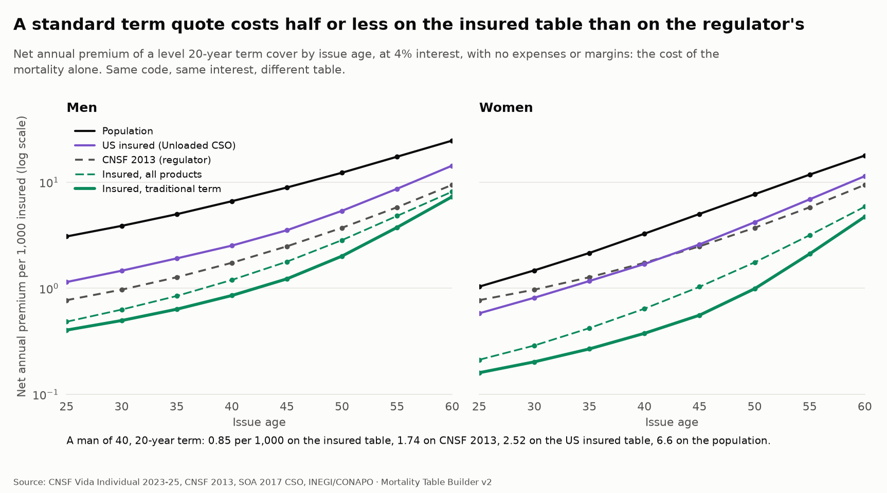</p>

Net annual premium per 1,000 of a 20-year term, at 4% interest:

| Issue age | Insured, traditional term | Insured, market | CNSF 2013 | CNSF 99.5th pct | US insured (Unloaded CSO) | Population |
|---|---|---|---|---|---|---|
| **Men 30** | 0.50 | 0.63 | 0.97 | 1.46 | 1.46 | 3.88 |
| **Men 40** | **0.85** | 1.20 | 1.74 | 2.62 | 2.52 | 6.62 |
| **Men 50** | 2.01 | 2.84 | 3.72 | 5.57 | 5.37 | 12.28 |
| **Women 30** | 0.20 | 0.29 | 0.97 | 1.46 | 0.81 | 1.48 |
| **Women 40** | **0.38** | 0.64 | 1.74 | 2.62 | 1.69 | 3.27 |
| **Women 50** | 0.99 | 1.76 | 3.72 | 5.57 | 4.20 | 7.70 |

The regulator's table is unisex, so for women it is **4.6 times** the insured premium at 40. Using it overstates a woman's cost; using the population table overstates a man's by 7.8 times.

<p align="center">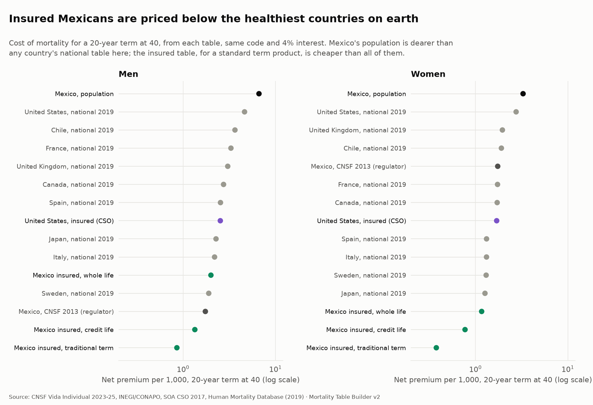</p>

### Products and sizes

<p align="center">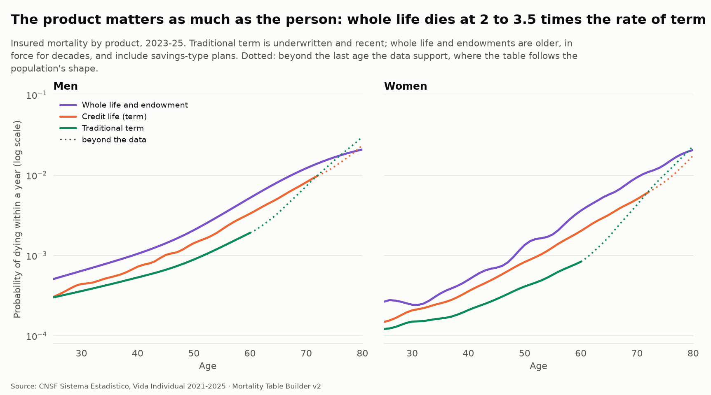</p>
<p align="center">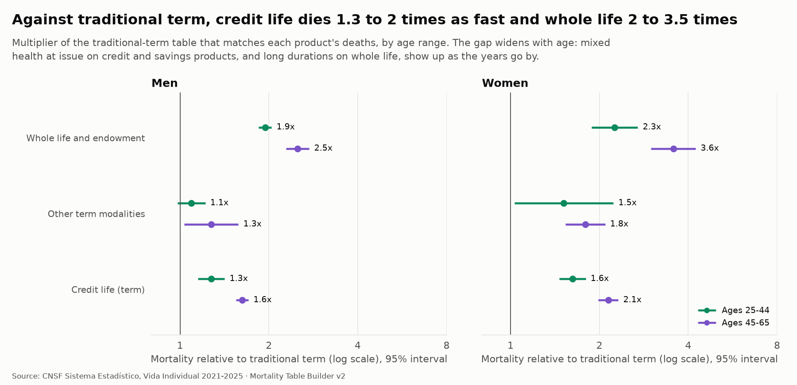</p>

Against traditional term, **credit life** dies 1.3 to 1.6 times as fast at 25 to 44 and 1.6 to 2.1 times at 45 to 65; **whole life and endowments** 1.9 to 2.3 times at 25 to 44 and 2.5 to 3.6 at 45 to 65. Other term modalities (flexible, joint, micro) are 1.1 to 1.5 times at 25 to 44. The gap widens with age.

<p align="center">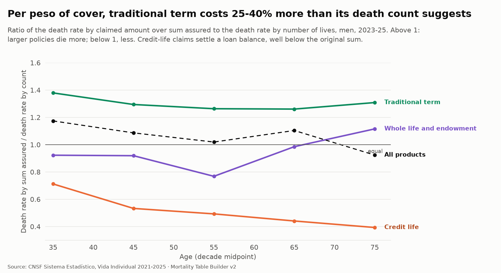</p>

By sum assured the picture changes: **traditional term dies at 1.26 to 1.38 times its count rate** (larger policies die more), credit life at 0.44 to 0.71 (its claims settle a loan balance, well below the original sum), whole life at 0.77 to 0.99. Per peso of cover a traditional term policy costs a quarter to a third more than its death count suggests.

### The pandemic

<p align="center">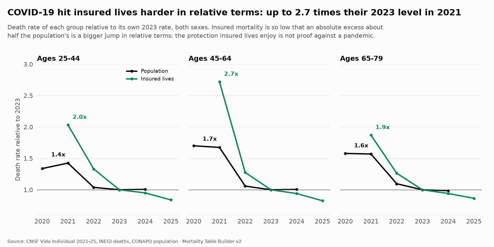</p>

Insured lives were **not** shielded. Relative to their own 2023 rate, insured death rates in 2021 were 2.0 times (ages 25-44), **2.7 times (45-64)** and 1.9 times (65-79), against 1.4, 1.7 and 1.6 for the population. The insured excess in absolute terms was about half the population's, but their baseline is so low that it is a bigger relative jump. Version 1's stress test assumed insured lives were exposed at 100% or 50% of the population's excess; both understate what happened. The stress step now replays 2021 *as insured lives lived it* (see `docs/stress-tests.md`).

### What it changes downstream

**In pricing** ([`docs/pricing.md`](pricing.md)). The same level-term product, with the same illustrative expenses, commission and lapses, priced for a 10% return, with the premium solved on the insured traditional-term table (rolled to 2026, plus the 15% margin) and the statutory reserve still on CNSF 2013, as the regulation requires:

| Policy (20-year term) | Gross premium per 1,000 on the insured table | On CNSF 2013 | Saving |
|---|---|---|---|
| Man of 30 | 1.13 | 1.54 | 27% |
| **Man of 40** | **1.57** | 2.32 | **32%** |
| Man of 50 | 2.86 | 4.30 | 33% |
| Woman of 30 | 0.77 | 1.54 | 50% |
| **Woman of 40** | **1.04** | 2.32 | **55%** |
| Woman of 50 | 1.83 | 4.30 | 57% |

If mortality turns out to be the best estimate (no margin), the same premium earns 14.6% (a man of 40) and 11.7% (a woman of 40) instead of 10%: the margin is what it says it is. A premium priced on CNSF 2013 and then hit with insured mortality earns a margin of 30% of premium (a man of 40) and 46% (a woman): in a market that charges the regulator's table, the profit is in the table.

**In the stress test** ([`docs/stress-tests.md`](stress-tests.md)). Version 1 replayed the population's excess mortality on an insured book, assuming insured lives were exposed at 100% or 50% of it. The observed insured data replace the assumption: replaying 2021 *as insured lives lived it* adds **133%** to the next year's claims, against 60% for the 100% replay, 30% for the 50% replay and **51% for the regulator's own 99.5th percentile table**. The regulator's stress would not have covered 2021 on an insured book.

### Causes

<p align="center">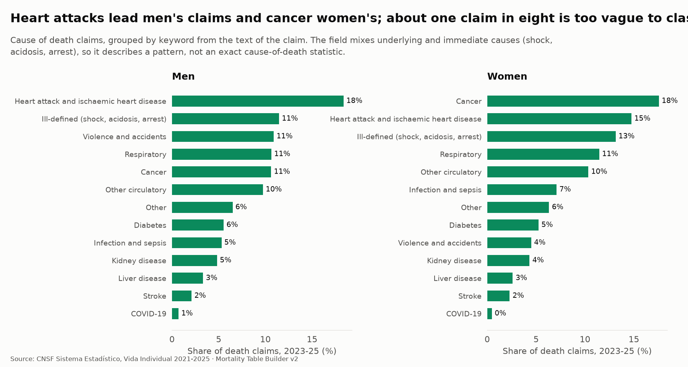</p>

### The trend

Age-standardised insured death rates fell 9% (men) and 21% (women) between 2023 and 2025 on the market blend: about -4.7% and -11.4% a year in the fitted model, with intervals of -8.2 to -1.1% and -15.2 to -7.5%. That is not improvement: the book grew 20% in two years, new business is freshly underwritten (the select period), and three years cannot separate the two. The table is the 2023-25 level; the improvement assumption comes from the population's projection (decision 14).

## 7. The old ages: a judgement

For ages above the credible range the table is not read from the data. The reasons, in the order they were found:

1. **Above about 85 the insured data break in every product.** Rates fall with age (men aged 90 to 94: 7.3 per 1,000, half of age 80 to 84's 14.7), which no mortality curve does. Lives who died stay in the books, and their deaths are never reported.
2. **Before that, the term data thin out.** A term policy ends; the lives that remain at 60 and over are few and unrepresentative. The ratio to the population drifts down for traditional term from the early sixties.
3. **The raw rates imply a result no group plausibly shows.** Insured men at 75 to 84 would die at about a third of Sweden's national rate. Selection effects in every known insured group *shrink* with age (US men: the insured rate is 63% of the national rate at 40, 50% at 60 and 98% at 85).

So from the last credible age the ratio of the insured to the population rate rises to 1 at age 105 along an S-curve. The pace is of the order of the US's (the US insured advantage closes over about 45 years of age, from 40 to 85; here over 45 years from age 60). It is an assumption, flagged in every table (`source = extended`) and in every figure. It does not move a standard quote (a 20-year term at 40 uses ages 40 to 59, all inside the data; convergence at 95 or 115 changes it by 0.0%), but it does move whole life, annuities and any quote past about 45.

## 8. Validation

| Test | Result |
|---|---|
| Totals reconcile to the raw cells | Every row count and column total, 15 sheets, to 1e-7 |
| Recovers a known truth | Simulated data from a planted insured curve: the intervals cover the truth, and the median error is under 5% |
| Ignores the ledger | The planted ledger rows never reach the table; the planted maturities are excluded (a regression test: the real data once reached the table with the cause column missing, so the rule now refuses to run without it) |
| Chooses the right method | When the truth is not a Brass curve, a spline wins by quasi-AIC and out of sample |
| Finds where data stop | A planted collapse of the old-age data is found within one age |
| Out of sample | Leave-one-year-out shape errors for every method (section 5) |
| Internal consistency | 20 data checks on the CNSF statistics and the tables: totals reconcile, complete, probabilities, old ages rise, never above the population, the market blend lies between its products, the four products hold 95-100% of deaths, premiums rise with age, insured lives were not shielded in the stress test |
| Independent code | The same life-table and commutation code that reproduces HMD's published life expectancy to 0.007 years |

## 9. What this table is not

- **Not a select table.** The statistics have no policy duration. Term business is dominated by recent, freshly underwritten policies, so the term tables mix select and ultimate mortality, and the recent insured trend is contaminated. A select-ultimate table needs an insurer's own policy-level data (the experience-study code of step 8 does that).
- **Not a company table.** It is the industry average. A company's A/E against it is what an experience study measures.
- **Not reliable above the credible range**, as above.
- **Not free of reporting differences between insurers.** Some report cause, state and size better than others.
- **Not for the youngest ages.** Below 18 to 26 the table is the population curve scaled; those ages are not priced.
- **The products can cross at the oldest ages**, because each is extended independently from its own last credible age.

## 10. How a pricing actuary should use it

1. **Pick the table by product, not by market.** Traditional term: the traditional-term table. Credit life: its own. Whole life and endowment: the permanent table. The market table is for comparing with the market, not for pricing a product.
2. **Add the margin.** 15% on mortality, derived above, before expenses and profit.
3. **Roll to the pricing year** with the improvement rates in `insured_improvement` (about 0.7% to 2.7% a year by age).
4. **Check the size.** For traditional term, count-based rates understate the claims cost per peso by 26% to 38%; price by size band if the product allows it, or load.
5. **Keep CNSF 2013 for the statutory reserve**, as the regulation requires, and measure the premium's adequacy against it.
6. **Read the intervals.** Each table has 95% bands on the ages where the data speak; the extension has none.

## 11. Reproduce it

```sh
uv run mortality ingest cnsf-vi "<folder with the CNSF downloads>"   # 2021-25 Excel, 2018-20 Access
uv run mortality db build                                            # tables and 122 data checks
uv run mortality figures                                             # the figures of this page
uv run mortality app                                                 # the "Insured lives" page
```

The code is in `src/mortality/`: `ingest/cnsf_vi.py` (reading), `insured.py` (rules, graduation, tables), `insured_compare.py` (comparisons), `insured_analysis.py` (improvement, pandemic, amount, causes, 2018-2020), `insured_causes.py`, `insured_sensitivity.py` (the tornado and the margin), `figures_insured.py`.

## Sources

CNSF, *Sistema Estadístico del Subramo de Vida Individual*, 2018 to 2025. CNSF, *CUSF Annex 5.3.3-a* (CNSF 2013). SOA, 2017 CSO tables (mort.soa.org). INEGI and CONAPO (the population, version 1 of this project). Human Mortality Database (national tables; used for analysis, never redistributed).
