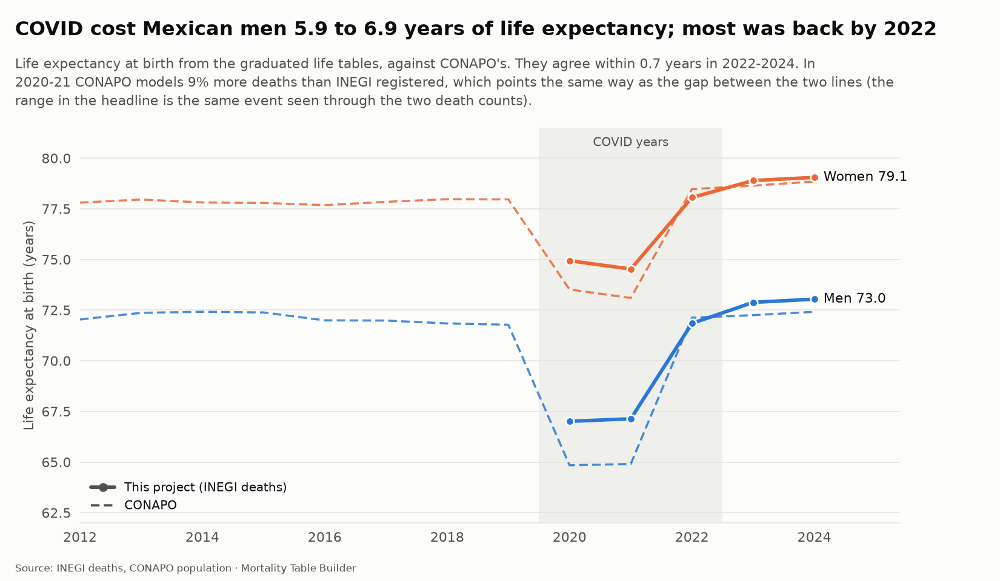
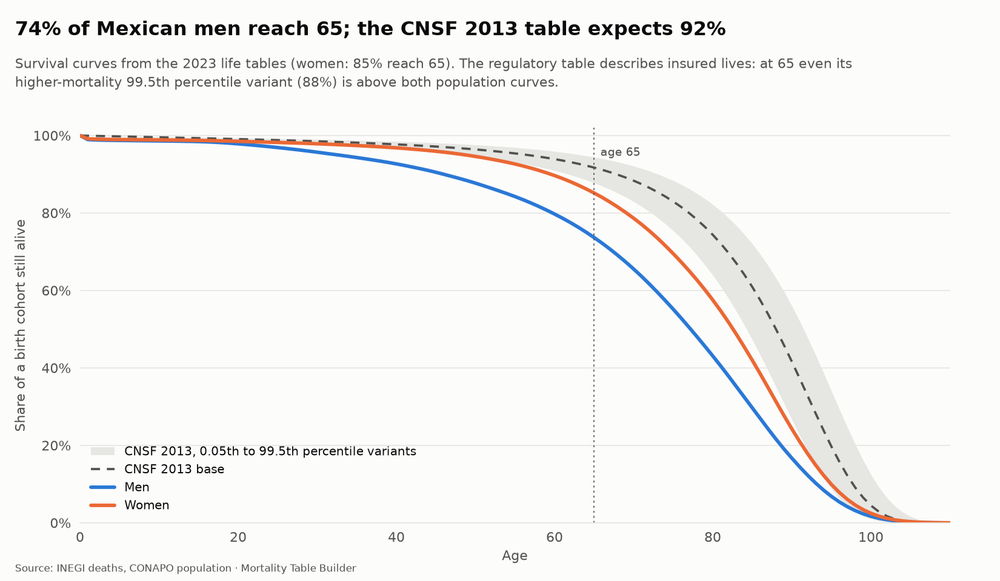
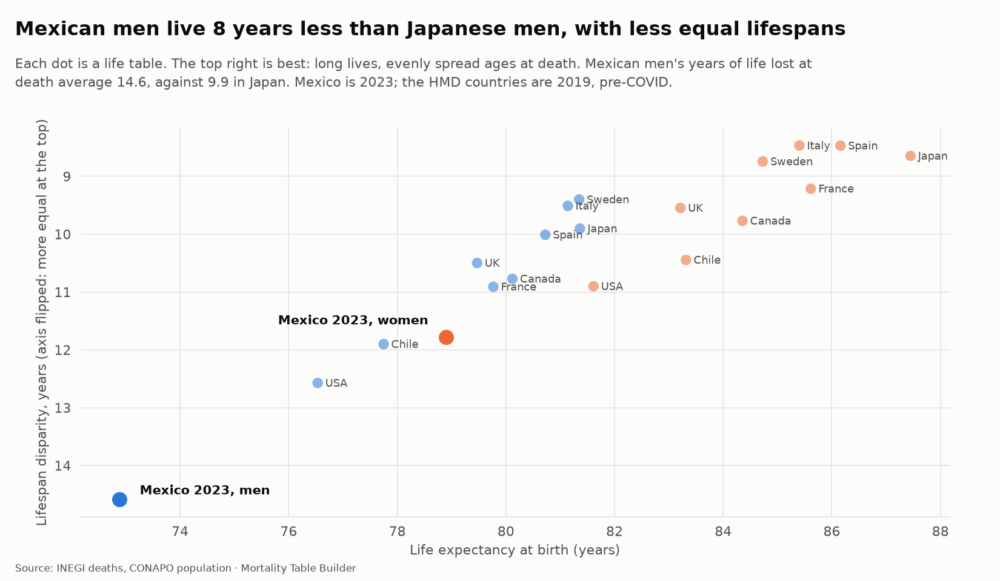

# Life tables and actuarial functions (step 6)

The graduated rates of [graduation.md](graduation.md) become complete life tables, and the life tables become the functions an actuary prices with: insurance and annuity values, net premiums and reserves. The same code then builds the same measures from the CNSF, SOA and HMD tables, so every comparison uses one method.

Code: `src/mortality/lifetable.py` (pure NumPy/pandas, 18 unit tests in `tests/test_lifetable.py`). Charts: `uv run mortality figures`.

## The life table

For every year (2020 to 2024) and for men (`M`), women (`F`) and both sexes (`T`), `life_tables` holds ages 0 to 110 with `qx, px, mx, ax, lx, dx`, `person_years` (L) and `total_person_years` (T), `ex`. The radix is 100,000.

- **a(x)**, the share of the year lived by those who die in it, is *recovered from the graduated m and q* (`a = 1 - (m/q - 1)/m`), so the table reproduces them exactly. It is 0.5 above infancy and about 0.07 at age 0, where deaths cluster in the first weeks.
- The last age is an open interval: `L(110) = l(110) / m(110)`, so `e(110) = 1/m(110)`.
- **Both sexes** mixes the male and female *rates* with the male share of the population at each age (CONAPO), not the two tables, which keeps q and m consistent.
- A table does not have to start at age 0. The SOA tables start at 12 and are closed at their last age, so annuity and insurance values from 25 upward are exact.

### Summary measures

`life_summary` has life expectancy at 0, 1, 15, 40, 65 and 80, `5q0`, `45q15` (WHO adult mortality), survival to 65 and 80, the median and modal age at death and **lifespan disparity** (e-dagger, the average years of life lost at death: how unequal lifespans are). 2023:

| | Men | Women | Both |
|---|---:|---:|---:|
| Life expectancy at birth | 72.9 | 78.9 | 75.9 |
| Life expectancy at 65 | 17.3 | 19.2 | 18.3 |
| Probability of dying between 15 and 60 (45q15) | 19.0% | 9.2% | 14.0% |
| Share of a cohort reaching 65 | 73.7% | 85.2% | 79.5% |
| Median age at death | 77.2 | 82.6 | 80.1 |
| Modal age at death (adult) | 83 | 87 | 86 |
| Lifespan disparity (years) | 14.6 | 11.8 | 13.3 |

## Two independent checks that the code is right

1. **It reproduces HMD.** Life tables built here from HMD's own q and a for nine countries and three sexes (27 tables) give life expectancy at birth within **0.007 years** of HMD's published figure, and at 65 within 0.004. This is a data check in the warehouse (`hmd_life_expectancy_reproduced`), so it re-runs on every build.
2. **It agrees with CONAPO.** In 2022 to 2024, life expectancy at birth is within 0.7 years of CONAPO's for both sexes (2023 men 72.9 against 72.3; women 78.9 against 78.6). Both start from INEGI deaths and CONAPO population, so this tests the graduation and life-table steps rather than the data.

In the COVID years the two differ by 1.5 to 2.2 years, in the direction expected: CONAPO's modelled deaths are 1,194,524 (2020) and 1,219,005 (2021), 9% above the 1,093,073 and 1,117,650 that INEGI registered and the quality step completed. In 2022 the relationship reverses (CONAPO 788,552 against 843,757). Which count is closer to the truth is the question of the excess-mortality step; this project carries both.



(Men's life expectancy at birth falls 5.9 years from 2023 to the 2020 low in these tables, 6.9 years from CONAPO's 2019 to its 2020 low.)

## Survival and inequality



Three quarters of Mexican men reach 65; the CNSF 2013 base table expects 92% of its lives to. Even its higher-mortality (99.5th percentile) variant sits above both population curves at 65. That is not a flaw in CNSF: it prices insured lives, who are selected and healthier. It does fix how far a company can lean on it.



Mexican men's years of life lost at death average 14.6, against 12.6 for US men and 9.9 for Japanese men (2019). Women's 11.8 is above all nine HMD countries (the USA is 10.9). The 45q15 above (19% of men die between 15 and 60) is consistent with this: many die far younger than the average. The cause-of-death data can test why.

## Actuarial functions

`Commutation.from_table(table, interest)` builds the columns `Dx = v^x lx`, `Cx = v^(x+1) dx`, and their running sums `Nx`, `Sx`, `Mx`, `Rx` (stored at 4% in `commutation_columns`). Every value is a ratio of those columns:

| Function | Formula |
|---|---|
| `pure_endowment(x, n)` | `D(x+n) / D(x)` |
| `whole_life_insurance(x)` | `M(x) / D(x)` |
| `term_insurance(x, n)`, `deferred_insurance(x, n)` | `(M(x) - M(x+n)) / D(x)`, `M(x+n) / D(x)` |
| `endowment_insurance(x, n)` | term + pure endowment |
| `increasing_whole_life(x)` | `R(x) / D(x)` |
| `annuity_due(x)`, `annuity_immediate(x)` | `N(x) / D(x)`, that minus 1 |
| `temporary_annuity_due(x, n)`, `deferred_annuity_due(x, n)` | `(N(x) - N(x+n)) / D(x)`, `N(x+n) / D(x)` |
| `annuity_due_monthly(x, m)` | `a-due(x) - (m-1)/(2m)` (Woolhouse, first order) |
| `whole_life_premium`, `term_premium`, `endowment_premium` | insurance value over the matching annuity (equivalence principle) |
| `whole_life_reserve(x, t)` | `A(x+t) - P(x) a-due(x+t)` (prospective net premium reserve) |
| `udd_factor(m)` | `i / i(m)`, for payment at the moment of death under uniform deaths |

Ages below the table are undefined (NaN); above it nothing is left to pay (0). The tests check the identities exactly: `A = 1 - d a-due`, premium times annuity equals the insurance value, term plus deferred equals whole life, `a-due = temporary + deferred`, a zero-interest annuity counts expected payments, and a reserve that starts at zero.

`actuarial_values` stores the standard set at 3%, 4% and 5% interest for every year, sex and age. To use the tables directly:

```python
import pandas as pd
from mortality import lifetable, warehouse

con = warehouse.connect()
table = pd.read_sql(
    "SELECT age, qx, mx, ax, lx, dx, person_years AS Lx, total_person_years AS Tx, ex "
    "FROM life_tables WHERE year = 2023 AND sex = 'M' ORDER BY age",
    con,
)
c = lifetable.Commutation.from_table(table, interest=0.04)
float(c.annuity_due(65))  # 12.214
1000 * float(c.term_premium(40, 20))  # 6.62 per 1,000
```

## What it means for pricing

`life_table_comparison` builds the same measures for 42 tables: the Mexican population, CNSF 2013 (base and the two percentile variants), nine SOA Mexican tables, and nine HMD countries. At 4% interest:


- A pension annuity at 65 is worth **14.94** per unit on the CNSF 2013 base table, **12.21** for Mexican men and **13.21** for women: valuing a population of pensioners on CNSF 2013 overstates the cost by 22% (men) and 13% (women). The low-mortality (0.05th percentile) variant, CNSF's longevity stress for private pensions, gives 16.10.
- Life expectancy at 65 is 22.8 on CNSF 2013 and 17.3 (men) and 19.2 (women) in the population. The MEX 2000 population table gave 16.0 for men: Mexican men at 65 have gained 1.3 years in 23 years, and at birth their life expectancy (72.9) is still 1.9 years below what MEX 2000 described (74.8); for women the two agree (78.9 against 78.5).


- A 20-year term policy at 40 has a net annual premium of **6.62 per 1,000** for a man on population mortality, 3.27 for a woman, and 1.74 on CNSF 2013 (2.62 on its higher-mortality variant). Women's population premium passes the higher-mortality variant from about age 30.

These are net premiums at 4%: no expenses, profit, or underwriting. They are not claims about any company's experience. They show how much the choice of table moves a price, which is the starting point of the pricing step.

## Known limits

- Life tables exist only for 2020 to 2024. There is no 2019 table because single ages exist only from 2020, so pre-pandemic life expectancy comes from CONAPO.
- Above age 90 the rates rest on the closure, with men floored at women (see [graduation.md](graduation.md)). Annuity values depend on those ages; the male values are a lower bound on mortality and so an upper bound on annuity cost at the oldest ages.
- Both-sexes tables weight by CONAPO population, which has the same old-age exposure problem.
- Interest rates are inputs, not forecasts. 4% is a reference rate, not the CNSF technical rate.
- Joint-life and last-survivor functions, and continuous (force-of-mortality) formulas, are not implemented.
