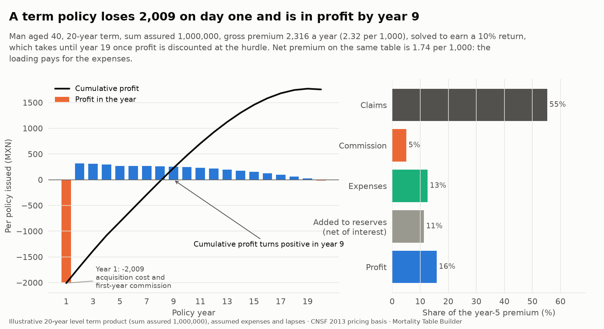
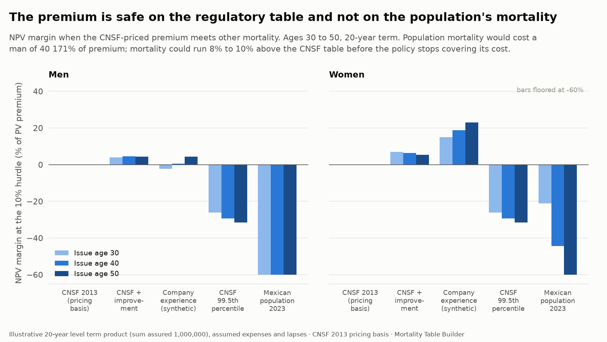
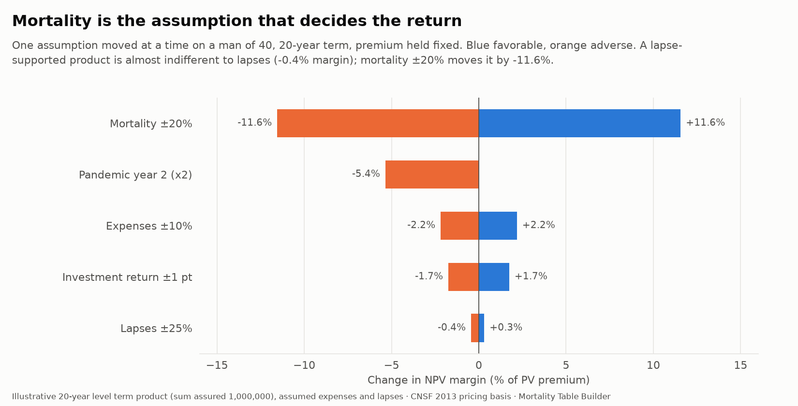
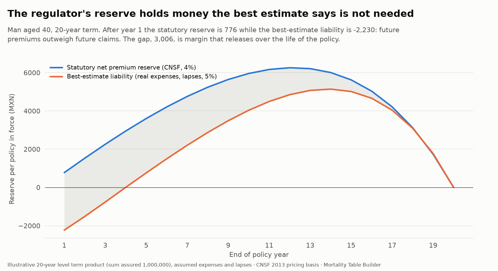

# Pricing, profit testing and reserves (step 9b)

What the mortality work is worth to an insurer: the premium of a term life policy, whether that premium earns its target return, which assumption puts the return at risk, and how much money the regulator makes the company hold against it. Every number comes from the project's own tables (CNSF 2013, the company experience of step 8, the population mortality of step 5, the improvement of step 7).

**The mathematics (net premium and reserve, the profit test and its two identities, the best-estimate liability and the mortality cushion) is derived in [handbook chapter 8](handbook/08-pricing.md); this page is the results.**

Code: `src/mortality/pricing.py` (13 unit tests in `tests/test_pricing.py`), six data checks in `validate.py`. Charts: `uv run mortality figures`. Tables: `pricing_premiums`, `pricing_adequacy`, `pricing_profit_test`, `pricing_sensitivity`, `pricing_reserves`.

> **What is real and what is assumed.** The mortality is real or derived from real data. The *product* (a level term policy), its expenses, commissions, lapses and the 10% hurdle are **illustrative assumptions** chosen to be typical of a Mexican individual term product; a company would replace them with its own. The company-experience basis comes from the synthetic portfolio of step 8.

## The product and its assumptions

A level-premium term policy, annual premium paid in advance, sum assured 1,000,000 MXN, paid at the end of the year of death. `Assumptions` in `pricing.py` holds every parameter:

| Assumption | Value |
|---|---|
| Acquisition | 35% of first-year premium + 600 |
| Commission | 40% first year, 5% renewal |
| Maintenance | 250 a year, inflating 4% |
| Claim expense | 1,500 per claim |
| Investment return (best estimate) | 5% |
| Valuation interest (statutory) | 4% |
| Lapses by year | 11%, 8%, 6.5%, 5.5%, 4% then flat |
| Surrender value | none (a lapse-supported product) |
| Hurdle | 10% internal rate of return |

## The profit test

The profit of policy year *t*, per policy in force at the start of the year, is

```
profit(t) = (V(t-1) + P - E(t)) (1 + i)  -  q (S + claim expense)  -  (1 - q)(1 - w) V(t)
```

premium *P* and expenses *E* in at the start of the year, interest *i* earned on the reserve and the net cash, death claims at the end, and the reserve *V(t)* set up for the survivors who do not lapse. Weighting by the probability the policy is still in force gives the profit per policy *issued*, and the IRR and NPV are computed on that stream.

A test that has to hold: with no expenses, no lapses, the same interest rate in the pricing and the reserve, and the *net* premium, the profit is exactly zero every year. It is in the unit tests, and it is how the profit test is known to be wired correctly: if it is not zero the reserve recursion or the cash flow is wrong.

The gross premium is **solved**, not assumed: bisection finds the premium at which the IRR equals the 10% hurdle (the IRR itself is found by scanning the cash flows for sign changes and taking the root nearest the hurdle, because a policy that loses money early and makes it back late can have more than one).

## The premium



Gross premium for a 20-year term on the CNSF 2013 table, per 1,000 of sum assured (`pricing_premiums`; the CNSF table is unisex in this model, so men and women are priced alike):

| Issue age | Net | Gross | Loading over net | Year-1 profit (MXN) |
|---:|---:|---:|---:|---:|
| 30 | 0.97 | 1.54 | 58% | -1,463 |
| 40 | 1.74 | 2.32 | 33% | -2,009 |
| 50 | 3.72 | 4.30 | 16% | -3,412 |
| 60 | 9.44 | 9.93 | 5% | -7,460 |

What the numbers say:

- **The loading over the net premium shrinks with age** (58% at 30, 5% at 60): expenses are a fixed amount plus a percentage, so they weigh most on small premiums.
- **Every policy loses money in year 1**, by 75% to 95% of its premium at ages 30 to 60: acquisition and the 40% commission arrive before any premium has been earned. It takes until year 8 or 9 for the cumulative profit to turn positive, and until **year 19** once profit is discounted at the 10% hurdle. That is the real cost of selling term business, and the reason lapses and the claims lag matter.
- In policy year 5, a man of 40's premium is spent on claims (55%), expenses (13%), commission (5%), additions to reserves (11%) and profit (16%).

## Is the premium adequate?



The premium is fixed on CNSF 2013 and the policy is then run on another mortality basis (`pricing_adequacy`). The NPV margin is the NPV at the 10% hurdle as a share of the present value of premiums: 0 means the policy earns exactly its hurdle.

| Basis | Men 30 | Men 40 | Men 50 | Women 30 | Women 40 | Women 50 |
|---|---:|---:|---:|---:|---:|---:|
| CNSF 2013 (pricing basis) | 0% | 0% | 0% | 0% | 0% | 0% |
| CNSF with projected improvement | +3.9% | +4.6% | +4.3% | +7.0% | +6.3% | +5.4% |
| Company experience (synthetic) | -2.2% | +0.4% | +4.4% | +15.0% | +18.8% | +23.1% |
| CNSF 99.5th percentile | -26% | -29% | -32% | -26% | -29% | -32% |
| Mexican population 2023 | -154% | -171% | -157% | -21% | -44% | -66% |

- On the regulatory table the premium earns its hurdle by construction. With projected improvement it earns a little more: term business benefits from people living longer.
- **The company-experience basis splits by sex.** The synthetic book's women die far below CNSF (IRR 31% to 41% at the same premium) and its men barely below (6% to 16%). A unisex premium subsidises men with women's profit: the experience study of step 8 is what finds that, and this is what it is worth.
- **The population's mortality is a different risk.** Men of 40 in the Mexican population die at almost four times the CNSF rate (the break-even multiple of 0.28 against 1.08) (the IRR is undefined: the policy never recovers its year-1 loss). An insured population is not the population, and the underwriting that makes the difference is not free: this shows how much it is worth.
- **Mortality cushion**: the multiple of CNSF mortality at which the policy just breaks even over its life, undiscounted. It is 1.08 to 1.09 for men and women on CNSF: mortality can run 8% to 9% above the pricing basis before the policy stops covering its cost. The 99.5th percentile variant, a regulatory stress, is well outside it (margin -26% to -32%).

## Which assumption matters



One assumption moved at a time, premium held fixed, man of 40, 20-year term (`pricing_sensitivity`):

| Scenario | NPV margin | IRR |
|---|---:|---:|
| Mortality -20% / +20% | +11.6% / -11.6% | 25.7% / undefined |
| Mortality -10% / +10% | +5.8% / -5.8% | 18.1% / undefined |
| Expenses -10% / +10% | +2.2% / -2.2% | 13.6% / 6.7% |
| Investment return +1 pt / -1 pt | +1.7% / -1.7% | 12.6% / 7.0% |
| Lapses +25% / -25% | +0.3% / -0.4% | 10.5% / 9.2% |
| Pandemic in year 2, mortality x1.5 | -2.7% | 6.3% |
| Pandemic in year 2, mortality x2 | -5.4% | 3.5% |

Mortality of ±20% moves the margin about five times as much as expenses of ±10%. **A single year of doubled mortality** (year 2 of the policy) costs 6.5 points of IRR, nearly two thirds of the target return, because the early years are those with the most policies in force and the least reserve. Lapses barely matter: with no surrender value, a lapse takes away both a premium and the liability to pay a claim, and the two offset. The step 9c stress tests build on this with the actual 2020 to 2022 age profile of [excess mortality](excess-mortality.md).

The IRR is reported as undefined, not zero, when the cash flows never turn positive; the margin is always defined, so it is the measure that the tornado and the adequacy chart use.

## Reserves



The statutory **net premium reserve** uses the valuation table (CNSF 2013), 4% interest and the net premium, with no expenses and no lapses, and it is what the regulator makes the company hold. The **best-estimate liability** (BEL) is the present value of the real expected outgo less the real premium, with real expenses, lapses and 5% (`pricing_reserves`).

For a man of 40 with a 20-year term:

| End of year | Statutory reserve | Best-estimate liability |
|---:|---:|---:|
| 1 | 776 | **-2,230** |
| 4 | 2,951 | 6 |
| 10 | 5,957 | 4,034 |
| 15 | 5,623 | 5,015 |
| 20 | 0 | 0 |

- **The BEL is negative at first**: the expected future premiums are worth more than the expected future claims and expenses, so the business is an asset. The statutory reserve is positive from year 1. The difference, about 3,000 per policy at the start, is margin held for prudence and released over the life of the policy: it is the reason the regulator's requirement is conservative and the economic one is not.
- The two meet near expiry, where little is left to be uncertain about.
- The negative BEL is an artifact of the level premium and the loaded first-year cost, not a free lunch: it is the same year-1 strain seen from the liabilities side.

## Validation

Six checks in `validate.py` run against the warehouse (`uv run mortality db check`): the solved premium of every product earns the 10% target; the gross premium is above the net premium and rises with age; heavier mortality lowers the margin (99.5th percentile and population); projected improvement raises it; the statutory reserve is positive after year 1, never negative and zero at expiry; and the sensitivities point the right way. Unit tests cover the zero-profit identity, the IRR by hand, a solved premium that earns its target, the ordering of the scenario grid and the lapse-supported property.

## Limits

- Only level term is priced; no whole life, no savings component, no policyholder options.
- One interest rate and one expense scale for all scenarios, flat in time: there is no stochastic interest or inflation.
- Reserves are per policy in force and net of reinsurance; reinsurance arrives in step 9d.
- A mortality **cushion** is not a capital requirement: solvency capital under the CNSF's rules is beyond the scope of the project.

## Reproduce

```
uv run mortality db build      # prices the product on the warehouse's tables
uv run mortality figures       # writes docs/img/pricing_*.png
```

```python
from mortality.pricing import Assumptions, solve_premium, profit_test, summarise

a = Assumptions()
q = ...  # 20 annual death probabilities for the policy
premium = solve_premium(q, a)
summarise(profit_test(q, premium, a), a.hurdle)
```

## Version 2: priced on the insured-lives table

Everything above prices the product on the regulator's table, the way an insurer without its own experience would. Version 2 adds what the industry's own statistics say about the people who buy it ([insured lives](insured-lives.md)). `pricing_insured` solves the same product's premium on the **insured traditional-term table**, rolled to 2026 at the projected improvement and loaded with the **15% margin** for adverse deviation, while the **statutory reserve stays on CNSF 2013**, as the regulation requires. The expenses, commission, lapses and the 10% hurdle are unchanged, so the only thing that moves is the mortality.

| Policy (20-year term) | Gross per 1,000, insured table | Gross per 1,000, CNSF 2013 | Saving |
|---|---|---|---|
| Man of 30 | 1.13 | 1.54 | 27% |
| Man of 40 | 1.57 | 2.32 | 32% |
| Man of 50 | 2.86 | 4.30 | 33% |
| Woman of 30 | 0.77 | 1.54 | 50% |
| Woman of 40 | 1.04 | 2.32 | 55% |
| Woman of 50 | 1.83 | 4.30 | 57% |

- **The women's saving is larger** because the regulator's table is unisex: it prices a woman as the average of both sexes.
- **The margin is real.** If mortality is the best estimate, the same premium earns 14.6% (a man of 40) and 11.7% (a woman of 40) instead of 10%.
- **The other direction.** A premium priced on CNSF 2013 and then experiencing insured mortality earns a margin of 30% of premium (a man of 40) and 46% (a woman); experiencing the population's mortality it loses 171% (a man) and 44% (a woman). `pricing_adequacy` has two new bases, `insured` and `insured_prudent`.
- **The statutory reserve is the cost of using the heavier table**: the reserve held on CNSF 2013 is larger than the insured basis needs, which is a strain in the first years.
- Two new data checks: the premium earns the hurdle, and it is below the CNSF-priced one.
