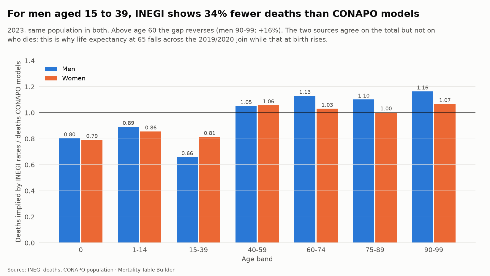
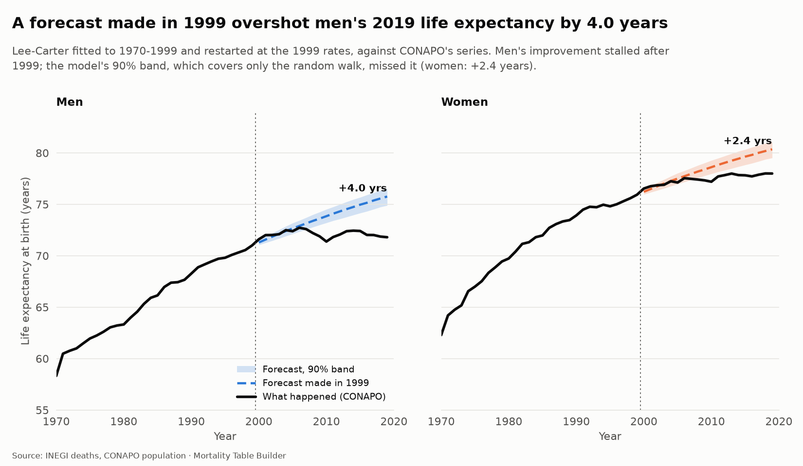
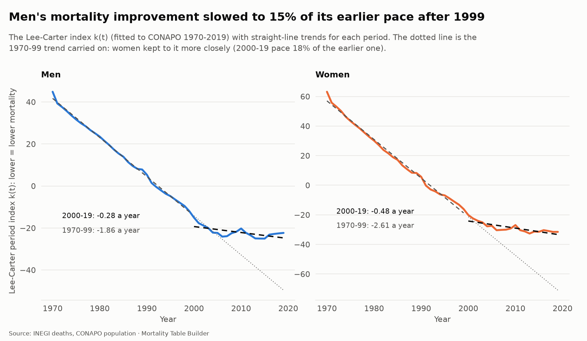
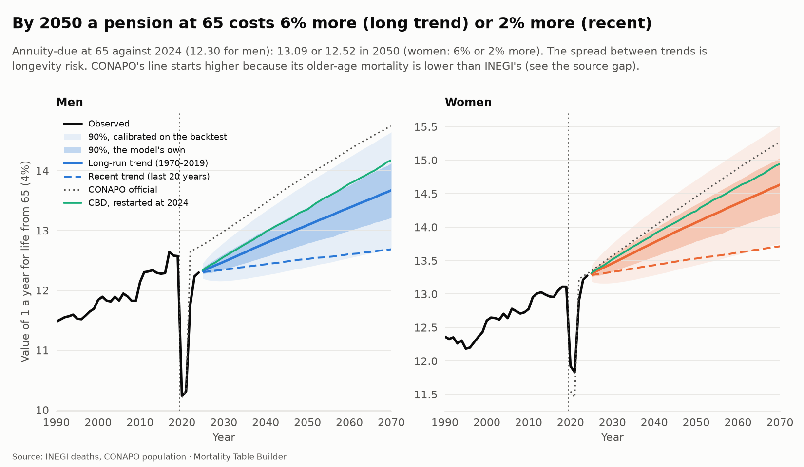
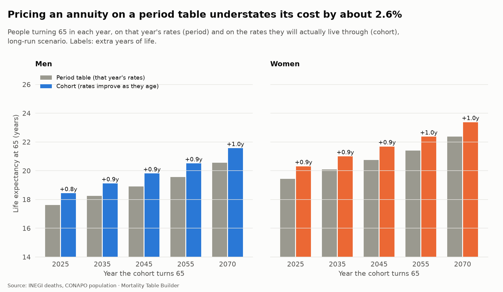

# Mortality projection (step 7)

Life tables describe the past. Pricing a pension or a 30-year policy needs the future, and the future of mortality is uncertain. This step fits two stochastic models, tests them on history, projects to 2070 under several scenarios with honest uncertainty, and turns the projection into cohort tables and a longevity-risk measure.

Code: `src/mortality/projection.py` (19 unit tests in `tests/test_projection.py` on synthetic data with a known truth) and `r/projection_stmomo.R`. Charts: `uv run mortality figures`.

## The data problem, and what it forces

A trend needs a long series. This project's own graduated rates cover only 2020 to 2024, and the 2014 to 2019 INEGI tables are 5-year groups. The only long, single-age series is **CONAPO's**: deaths and mid-year population from 1950 to 2019, national, by sex and age. It is a demographic *reconstruction* (smooth, model-based), not raw registration, so:

- the models are fitted to **CONAPO 1970 to 2019**;
- this project's graduated 2020 to 2024 rates are used as *observed* out-of-sample years and as the **restart point** of the projection;
- CONAPO's official projection (2020 to 2070) is a benchmark, not an input.

### A finding: the two sources disagree on who dies

Where the series join (2019 to 2020), life expectancy at 65 for men falls from 18.16 to 17.55 while life expectancy at birth rises from 71.8 to 73.1. A real change in mortality would not do that. The cause is the age pattern of the two sources. Comparing deaths on the same population in 2023 (`source_gap`):

For men aged 15 to 39, INEGI-based rates imply **34% fewer deaths** than CONAPO models (62,267 against 94,421); at 60 and over they imply 10% to 16% **more**. The totals agree within 1%. So everything this project calls observed from 2020 sits on a different footing from the CONAPO history by age. Which source is closer to the truth is open (young adult male deaths are where unregistered or reclassified deaths would matter most); the projection simply carries both explicitly. It is also why the scenarios restart at the observed 2024 rates instead of at CONAPO's 2019 level.

## The models

**Lee-Carter** (1992): `ln m(x,t) = a(x) + b(x) k(t)`. Fitted by Poisson maximum likelihood (Brouhns, Denuit and Vermunt) so each age is weighted by its exposure; `k(t)` is forecast as a random walk with drift.

**Cairns-Blake-Dowd, M5** (2006): `logit q(x,t) = k1(t) + k2(t)(x - mean age)` for ages 60 to 99; the pair `(k1, k2)` is a bivariate random walk with drift. It is built for the ages pensions care about.

**Uncertainty has two parts**, and both are simulated (2,000 paths): the random innovations of the walk, and the uncertainty of the drift itself (estimated from a short, trending series, so each path draws its own drift). Ignoring the second makes long-run intervals too narrow.

**Closing the table.** Every projected year is closed to age 110 as in [graduation.md](graduation.md): ages 90 and over come from a logistic fitted to ages 75 to 89 (here in its closed least-squares form, so thousands of paths can be closed at once), men are never below women from age 84, and q = 1 at 110.

### Independent check in R

The same Lee-Carter and CBD models are fitted with **StMoMo** in R (a different fitting routine) and compared (`projection_r_crosscheck`, re-run on every build):

| | Python against StMoMo |
|---|---|
| Lee-Carter k(t) | largest difference 0.0001 |
| Lee-Carter b(x) | identical |
| Lee-Carter e0 and e65 forecasts (2030, 2069) | differ by less than 0.00002 years |
| CBD kappa1 / kappa2 | differ by up to 0.053 / 0.004 (least squares here, binomial likelihood in StMoMo) |
| CBD e65 forecasts | differ by 0.013 to 0.038 years |

## The backtest

For each sex, fitting window and origin (1979, 1989, 1999, 2009) the models are fitted to the years up to the origin and forecast 10 and 20 years ahead, against CONAPO's reconstruction (`projection_backtest`).

- **Men's improvement stalled.** Lee-Carter fitted to 1970-1999 and restarted at the 1999 rates overshoots men's 2019 life expectancy at birth by **4.0 years** (women: 2.4). The period index shows why:

  Men's k(t) fell 1.86 a year to 1999 and 0.28 a year after, **15%** of the earlier pace (women: 2.61 to 0.48, 18%).
- **Life expectancy at 65 is forecast far better than at birth.** For the recommended model (restarted at the last observed rates, fitted from 1970) the mean absolute error in e65 is 0.52 years for men and 0.35 for women, and 1.8% and 1.5% in the annuity value at 65, even where e0 is 3.9 years off. The e0 error comes from ages under 65; for pensions the model is much better behaved than the headline number.
- **The 1970 window beats 1950** (e65 error 0.52 against 0.66 years for men, 0.35 against 0.83 for women): the 1950s were a different regime. 1970 is the fitting window used throughout.
- **Restarting at the last observed rates** instead of the fitted ones helps for the 1950 window and is neutral for 1970.
- **CBD** is slightly worse than Lee-Carter on e65 here (0.56 and 0.58 years) but its intervals are wider.
- **The model's own fan is too narrow.** The actual e65 fell inside the model's 90% band in only 40% (men) and 60% (women) of the five backtests of the recommended model. The sample is small, so read this as indicative, but it is why a warning is recorded (`projection_fan_covers_the_backtest`) and why the projection carries a second, empirical band.

### Calibration

The backtest errors of the recommended model are fitted to `error = c sqrt(horizon)`, how a random walk's error grows (`projection_calibration`). For men `c` is 0.57 years for e0, 0.20 for e65 and 0.64% for the annuity value at 65 (women: 0.44, 0.12, 0.54%). The "calibrated" bands in the charts are the median plus or minus 1.645 c sqrt(h) with h the years since 2024. For men's e0 in 2050 that is plus or minus 4.8 years, against the model's own 75.6 to 78.3.

## Scenarios

All restart at the observed 2024 rates (`projection_scenarios`):

| Scenario | What it assumes |
|---|---|
| Long run | Lee-Carter drift from 1970 to 2019 |
| Recent | Drift of the last 20 years only: the stagnation of men continues |
| CBD | Cairns-Blake-Dowd restarted at 2024, ages 60 and over |
| Pre-COVID trend | Lee-Carter from CONAPO's 2019 level, as if there had been no pandemic |
| CONAPO official | CONAPO's own projection, same measuring code |

Life expectancy at birth, medians:

| | 2024 | 2030 | 2050 | 2070 |
|---|---:|---:|---:|---:|
| Men, long run | 73.1 (obs.) | 74.1 | 77.0 | 79.5 |
| Men, recent | | 73.4 | 74.3 | 75.1 |
| Men, CONAPO official | 72.5 | 73.6 | 77.3 | 80.2 |
| Women, long run | 79.1 (obs.) | 80.0 | 82.8 | 85.0 |
| Women, recent | | 79.4 | 80.4 | 81.2 |
| Women, CONAPO official | 79.0 | 80.2 | 83.7 | 86.7 |

The long-run scenario lands close to CONAPO's official projection. The recent-trend scenario is the one that takes the stagnation seriously: it gives men 74.3 in 2050, 2.7 years below. The gap between them, not the width of either band, is the main uncertainty.

## Longevity risk

The annuity-due at 65 (4% interest) is 12.30 for men and 13.27 for women in 2024. By 2050 it is **13.09 (+6%)** on the long trend and **12.52 (+2%)** on the recent one for men, 14.07 and 13.53 for women; CBD gives 13.35 and 14.24. A pension annuity written today is exposed to that spread for decades, which is the longevity risk a reinsurer prices.

CONAPO's official line starts higher (12.73 for men in 2024, against 12.30 observed) because its older-age mortality is lower than INEGI's, as the source gap shows.

## Cohort versus period

A person who turns 65 in year Y lives through the rates of Y at 65, Y + 1 at 66, and so on. A period table applies Y's rates to every age. When mortality is improving, the period table understates longevity: in the long-run scenario men turning 65 in 2025 live **0.8 years longer** than a period table says (18.43 against 17.61), and by 2070 1.0 year longer; an annuity priced on a period table understates its cost by **2.6%** for men and about 2.5% for women (`cohort_tables`).

## Using the projection

`projected_qx` is the central long-run projection by year (2025 to 2070), sex and age 0 to 110: the mortality-improvement table for pricing and reserving. `projection_parameters` holds the fitted `a(x)`, `b(x)`, `k(t)` and CBD factors.

## Known limits

- **The history is a reconstruction.** CONAPO's 1970 to 2019 rates are smooth and model-based, so fitted uncertainty is understated; the backtest and the calibrated band partly correct for it.
- **The source break at 2020** (above) means the observed series is not one consistent measurement. Scenarios restart at the INEGI-based 2024 rates, which is right for this project but not the same level as CONAPO's.
- **Five backtests per sex** is a small sample. The 90% coverage figures and the calibration constants are indicative.
- **COVID is excluded from the fit** (2020 to 2022 are not in the 1970 to 2019 window) and treated as a level shock that the restart absorbs. The scenarios do not model repeat shocks.
- **Linear trends in log mortality cannot slow down on their own.** The long-run scenario will eventually overstate improvement at the youngest ages; that is why the recent-trend scenario is shown beside it.
- **No cause-of-death structure.** Violence, diabetes and COVID are not modelled separately; the stagnation of men is observed, not explained.
- **Old ages** rest on the closure described in [graduation.md](graduation.md).
