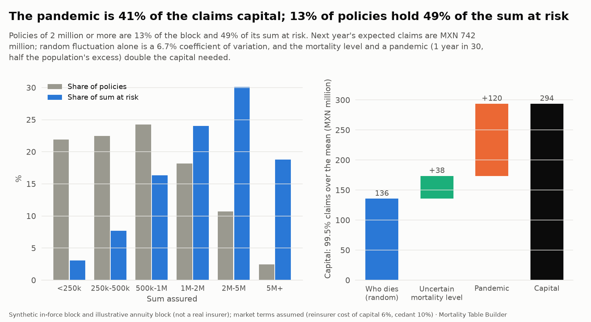
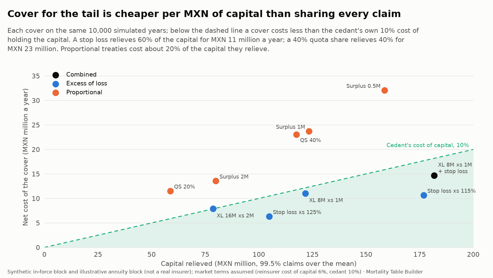
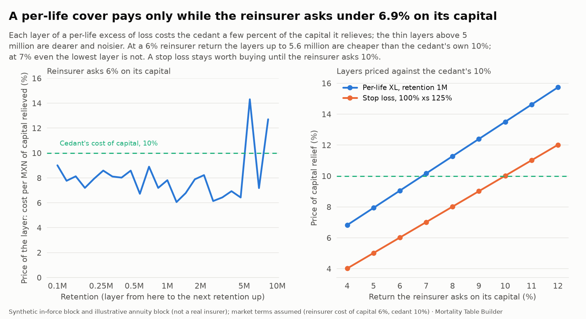
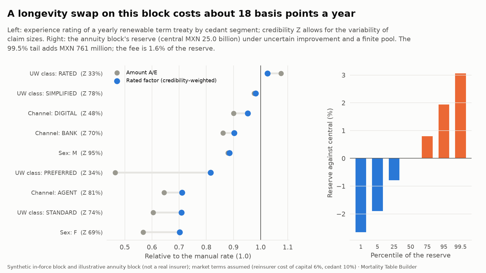

# Reinsurance (step 9d)

What a cedant buys, what it costs, and what a reinsurer sees. The analysis takes the same in-force block and annuity block as the [stress tests](stress-tests.md) and asks the four questions a reinsurance desk asks: **where is the risk, which cover relieves it most cheaply, how should the treaty be rated by cedant, and what does it cost to take longevity off an annuity book?**

Code: `src/mortality/reinsurance.py` (15 unit tests in `tests/test_reinsurance.py`), nine data checks in `validate.py`. Charts: `uv run mortality figures`. Tables: `reinsurance_concentration`, `reinsurance_aggregate`, `reinsurance_structures`, `reinsurance_frontier`, `reinsurance_price_sensitivity`, `reinsurance_yrt_rating`, `reinsurance_longevity_swap`, `reinsurance_longevity_distribution`.

> **What is real and what is assumed.** The mortality, the pandemic profile and the improvement scenarios are the project's own, from real data. The books are synthetic (the portfolio of [step 8](experience-study.md), the annuity block of step 9c). The market terms are **assumptions**, listed below, chosen to be plausible and to be changed: a reinsurer's cost of capital of 6%, a cedant's of 10%, a pandemic once in 30 years at half the population's excess, a 65% loss ratio and a 30% ceding commission. Conclusions that depend on them say so.

| Assumption | Value |
|---|---|
| Simulated years | 10,000 |
| Uncertainty of the mortality level | lognormal, standard deviation 5% |
| Pandemic | probability 1 in 30; the 2021 excess profile at 50% dampening |
| Capital | 99.5% value-at-risk of annual claims, above the mean |
| Reinsurer's return on its capital | 6%, plus 1% of expected recoveries for expenses |
| Cedant's cost of capital | 10% |
| Proportional treaties | loss ratio 65%, ceding commission 30% |

## Where is the risk?



**Concentration** (`reinsurance_concentration`). The block has 392,274 policies and MXN 414 billion of sum assured. Policies of 2 million or more are 13% of the policies and **49% of the sum at risk**: 9,669 policies of 5 million or more hold 19% of the sum on their own. The expected claims have exactly the same shares, because the probability of dying does not depend on the sum assured here.

**Aggregate claims** (`reinsurance_aggregate`). Next year's claims are simulated with three sources of uncertainty, added one at a time:

| Source | Standard deviation (MXN million) | 99.5% claims | Capital (over the mean) |
|---|---:|---:|---:|
| Who dies (random fluctuation) | 49 | 877 | 136 |
| + uncertain mortality level | 62 | 915 | 174 |
| + pandemic (1 in 30) | 74 | 1,042 | **294** |

Expected claims are MXN 742 million: random fluctuation alone is a coefficient of variation of 6.7%, and the pandemic accounts for **41% of the capital** while adding a hundredth to the mean. The tail is a pandemic tail, not a large-claim tail, and that drives what works.

## Which cover relieves it most cheaply?



Each cover is applied to the same 10,000 years (`reinsurance_structures`). *Capital relief* is the fall in the 99.5% capital; *cost* is the premium less expected recoveries; *price* is the cost per MXN of capital relieved, to be compared with the cedant's own 10%.

| Cover | Capital relieved (MXN million) | Net cost (MXN million) | Price of relief |
|---|---:|---:|---:|
| Quota share 20% | 59 (20%) | 11.5 | 19.6% |
| Quota share 40% | 117 (40%) | 23.0 | 19.6% |
| Surplus, retention 0.5M, 9 lines | 159 (54%) | 32.1 | 20.2% |
| Surplus, retention 1M, 9 lines | 123 (42%) | 23.7 | 19.2% |
| Surplus, retention 2M, 9 lines | 80 (27%) | 13.6 | 17.0% |
| Per-life XL 8M xs 1M | 122 (41%) | 11.0 | **9.1%** |
| Per-life XL 16M xs 2M | 79 (27%) | 7.9 | 10.1% |
| Stop loss 100% xs 115% of expected claims | **177 (60%)** | 10.7 | **6.0%** |
| Stop loss 100% xs 125% of expected claims | 105 (36%) | 6.3 | 6.0% |
| Per-life XL 8M xs 1M + stop loss on what is left | 182 (62%) | 14.7 | 8.1% |

- **Proportional treaties are the expensive way to buy capital**: about 20 cents per peso of capital relieved, double the cedant's own cost. They also do other things (finance acquisition costs, share expenses, give the reinsurer's underwriting support) that this analysis does not value; they are bought for those reasons, not for capital.
- **A stop loss on the aggregate is the cheapest relief by far** because the tail is a pandemic tail: attaching at 115% of expected claims relieves 60% of the capital for MXN 11 million a year, because it pays out rarely (MXN 4.6 million in expectation). It is also the cover that depends most on the assumption of the pandemic's probability and size, which a reinsurer would price on its own view.
- **A per-life excess of loss** relieves a large part of the capital (41%) because large policies are a large part of the sum at risk, at a price a little under the cedant's 10%. The same cover with a higher retention and a higher limit (16M xs 2M) is no longer worth it.
- **The surplus treaty reduces claims exactly like an excess of loss.** A death claim on a policy of sum assured S recovers `min(max(S − R, 0), lines × R)`, identical to an excess of loss of `lines × R xs R`. The difference between them is the price: the surplus reinsurer takes a proportional share of premium net of a commission, so it costs the cedant 17% to 20% of the capital relieved against 9% for the same layer as non-proportional. Which is right for the cedant depends on what else it asks the reinsurer to do.
- Combining a per-life cover and a stop loss relieves 62% of the capital for MXN 14.7 million: the two address different tails (big policies, the pandemic).



### What is a layer worth, and what does it depend on?

Taking the per-life retention down adds a layer. The price of each layer (`reinsurance_frontier`, column `marginal_price`) is the extra cost over the extra capital relieved. At a 6% reinsurer return the layers cost 6% to 9% of the capital they relieve up to about 5 million, above which the thin layers (a few claims in 10,000 years) are dearer and noisier. How much of it is worth buying depends on the **reinsurer's required return**, because the cedant compares it with its own 10% (`reinsurance_price_sensitivity`):

- A per-life cover with a 1 million retention costs 9.1% of the capital relieved at a 6% reinsurer return and **crosses the cedant's 10% at 6.9%**. At 6% the layers up to 5.6 million are worth buying (a net benefit of MXN 6.1 million a year); at 7% or more not even the lowest one is.
- A stop loss costs about the reinsurer's own return per peso of capital relieved (6.0% at 6%), so it is worth buying until the reinsurer asks the cedant's 10%.

The retention is therefore not a number to optimize in the abstract: it is the point where the reinsurer's price, the cedant's cost of capital and the claim distribution meet, and moving the price by a point or two moves it from worth buying to not.

## How should the treaty be rated by cedant?



A **yearly renewable term (YRT)** treaty charges a rate per 1,000 of sum at risk, from the reinsurer's table loaded for expenses and margin (15% over expected claims here). **Experience rating** adjusts it by the cedant's own experience: the amount A/E weighted with a credibility Z against the manual rate, `factor = Z × A/E + (1 − Z) × 1` (`reinsurance_yrt_rating`, from the segments of the experience study).

The point that distinguishes a reinsurance desk from a count-based study: **claim amounts need more experience than claim counts to be credible**, because claim sizes vary. Full credibility on counts takes 1,082 deaths; with the squared coefficient of variation of the claim sizes (about 1.6 to 2.1 in this book) the standard becomes `1,082 × (1 + cv²)`, about 3,000 deaths. The credibility is `Z = min(1, sqrt(deaths / (1,082 × (1 + cv²))))`.

| Segment | Deaths | Amount A/E | Credibility | Rated factor |
|---|---:|---:|---:|---:|
| Underwriting: PREFERRED | 365 | 0.465 | 34% | 0.816 |
| Underwriting: RATED | 331 | 1.075 | 33% | 1.025 |
| Underwriting: STANDARD | 1,687 | 0.605 | 74% | 0.708 |
| Channel: AGENT | 2,166 | 0.644 | 81% | 0.710 |
| Channel: BANK | 1,397 | 0.862 | 70% | 0.903 |
| Channel: DIGITAL | 773 | 0.900 | 48% | 0.952 |
| Sex: F | 1,524 | 0.568 | 69% | 0.702 |
| Sex: M | 2,812 | 0.879 | 95% | 0.886 |

A cedant with few deaths and a good result (preferred risks, A/E 0.47 on 365 deaths) gets a partial credit: its factor is 0.82, not 0.47. A cedant with many deaths (the agent channel, 2,166) gets nearly what its experience says. The rated rate for the agent channel is 29% under the manual rate, and for the rated underwriting class 2.5% over it. The loss ratio of the reinsurer at the manual rate (`loss_ratio_at_manual`) is the check on the other side: 0.56 for agents, 0.93 for rated risks.

## What does a longevity swap cost?

The right panel above. In a **longevity swap** the cedant pays a fixed schedule of pensions (on the swap basis) and the reinsurer pays the pensions actually due: the reinsurer takes the longevity risk and the cedant keeps the investment and credit risk. The annuity block is the one of [step 9c](stress-tests.md): 20,000 pensioners aged 60 to 95, central reserve MXN 25.0 billion (`reinsurance_longevity_swap`).

Two risks sit with the reinsurer:

- **Trend**: the improvement of mortality. It is a multiple *s* of the central log improvement, normal around 1 with a standard deviation of 0.5, truncated at -0.5 and 3, so that "none" and "double" of step 9c are about the two-sigma range. The reserve is valued on a grid of *s* and interpolated.
- **Pool risk**: the chance variation of a finite block. Its variance is that of the present value of each life's pensions, summed over the block: 6.9% of the total variance.

| | MXN million |
|---|---:|
| Central reserve | 24,992 |
| Standard deviation of the reserve | 291 (1.2%) |
| of which pool risk | 77 |
| Risk capital (99.5% over the mean) | 761 (3.0% of the reserve) |
| Reserve at the 99.5th percentile | +3.1% over central |

The reinsurer holds capital in proportion to the run-off of the reserve (8.9 "reserve-years" for this block) and asks 6% on it: a fee of **MXN 405 million in present value, 1.6% of the reserve, about 18 basis points a year**. Most of it is trend risk, which is why the pool size matters little here and the model of improvement matters a lot. Longevity swaps in the market are priced in the same order of magnitude; this number is not a market quote, it is what this model's assumptions imply.

## Limits

- **One-year, static block.** No lapses, no new business, no reinstatements of the cover, no multi-year treaties.
- **Simulation noise.** 10,000 years leave visible noise in the layer prices (the curve in the left panel above wobbles by a few points) and much more in the thin top layers: the marginal prices above 5 million are not conclusions.
- **The market terms are assumptions.** Results that hinge on the gap between the reinsurer's and the cedant's cost of capital, or on the pandemic's probability, are shown against them (`reinsurance_price_sensitivity`) and should be recomputed on real quotes.
- **No credit risk, no basis risk.** The reinsurer always pays, and the recoveries follow the cedant's own claims.
- **Pricing by cost of capital** is the cedant's approach to what the reinsurer should ask, not a reinsurer's pricing model, which would also carry the profit margin, the diversification across its other treaties and the cost of uncertainty in the parameters.
- **The longevity swap has no basis risk and no reinsurer default**, and the trend distribution is one normal around the central projection, not the stochastic fan of step 7.

## Validation

Nine checks in `validate.py` run against the warehouse (`uv run mortality db check`): the size bands partition the policies, sum at risk and expected claims; each source of risk widens the claims distribution; the simulated mean claims are within 2% of the expected claims; no cover has negative recoveries or cost or leaves the cedant worse off; a higher retention costs less and relieves less capital; a higher return on the reinsurer's capital raises every price; non-proportional covers are cheaper per capital than a quota share (as a warning); credibility lies in [0, 1] with the experience factor between the manual rate and the A/E; and the swap's central reserve equals the stress tests' central reserve, with positive capital and a positive fee. Unit tests cover the surplus equivalence with a limited excess of loss, the recoveries bounds, the quota share relieving its own share of capital, the layer prices adding up to the overall price, the claim-size variability formula, the credibility of a YRT rating, and the variance of an annuity on a two-year life against the hand calculation.

## Reproduce

```
uv run mortality db build      # simulates the claims and prices the covers
uv run mortality figures       # writes docs/img/reinsurance_*.png
```

```python
from mortality import reinsurance as re

terms = re.Terms(reinsurer_coc=0.07)
sim = re.simulate_claims(sa, q, q_pandemic, terms)  # sums assured, q and pandemic q per policy
re.structure_table(sim, terms)
```
