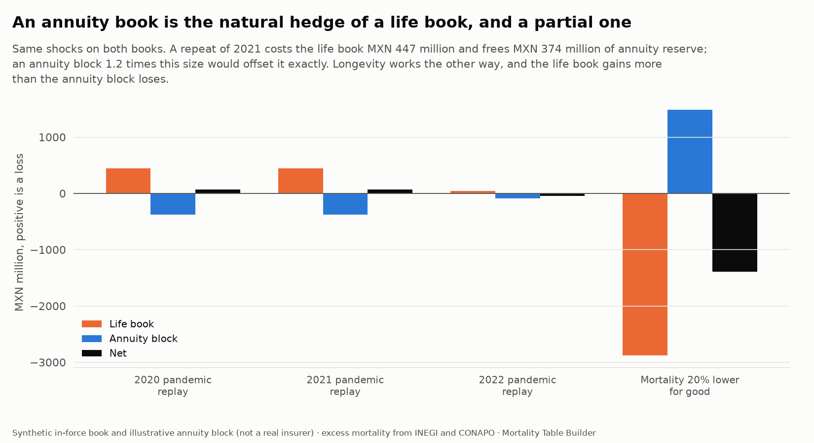

# Pandemic and longevity stress tests (step 9c)

Two risks that look like opposites, and the question an insurer's risk committee asks about them: **how much would a repeat of 2021 cost our life book, how much would an unexpected rise in longevity cost our annuity book, and does one book protect the other?** Each is measured on its own book, and then the two are put together.

Code: `src/mortality/stress.py` (11 unit tests in `tests/test_stress.py`), six data checks in `validate.py`. Charts: `uv run mortality figures`. Tables: `stress_pandemic_book`, `stress_pandemic_age`, `stress_longevity`, `stress_hedge`.

> **What is real and what is assumed.** The *shocks* are real: the pandemic profile is Mexico's own 2020 to 2022 excess mortality by age and sex ([step 9a](excess-mortality.md)); the improvement scenarios come from the projection of [step 7](projection.md). The *books* are illustrative: the in-force block is the synthetic 573,000-policy portfolio of [step 8](experience-study.md) (392,274 policies in force, sum assured MXN 414 billion, mean age 46), and the annuity block is a made-up one (20,000 pensioners aged 60 to 95, pension 120,000 a year, 60% men). Nothing here describes a real company; the method runs on a real one by pointing it at a real extract.

## Pandemic: replay 2020 to 2022 on the life book


The method is deliberately simple, so it can be defended in front of a committee. Each policy in force has a probability of dying in the next twelve months, taken on the company's own basis from the experience study (the CNSF table times the derived multipliers). The replay raises that probability by the **P-score of the policy's age band and sex** in the chosen year, the excess over expected deaths measured in step 9a. A negative P-score is set to zero: a stress test gets no credit for the bands where deaths fell below the baseline. Two knobs:

- **Dampening** scales the P-score for an insured population, which is healthier than the general one: 100% takes the population's excess, 50% half of it.
- **Severity** is a multiple of the observed profile (a worse pandemic).

On the 392,274 policies in force, expected claims for the next twelve months are MXN 742 million (`stress_pandemic_book`):

| Scenario | Extra claims (MXN million) | Change in claims |
|---|---:|---:|
| 2020 replay, population excess | 445 | +60.0% |
| 2021 replay, population excess | 447 | +60.3% |
| 2022 replay, population excess | 43 | +5.8% |
| 2020 or 2021 replay, half the excess | 223 / 224 | +30% |
| 2020 profile x1.5 / x2 | 668 / 890 | +90% / +120% |
| **CNSF 99.5th percentile table** | 376 | **+50.7%** |

- **A repeat of 2021 would raise the next year's claims by 60%.** That is MXN 447 million on a block that expects 742 million.
- **The regulator's own stress does not cover it.** The CNSF 99.5th percentile table, the shock a company is expected to withstand, is 51% heavier than the base table on this book. A year like 2020 or 2021 with the population's excess would exceed it; with half the excess (insureds healthier than the population), it would not. Which of the two applies is the actuarial judgment the analysis cannot make for a company; it shows where the line is.
- **The cost is not in the young.** The replay adds MXN 447 million, and 71% of it comes from policyholders aged 50 and over (`stress_pandemic_age`): the pandemic's excess was steep in age, and the book's sums at risk are large in the same ages. Men account for 65% of it (62% of the population's excess deaths).
- **It is a one-year shock.** By 2022 the replay is +6%, and by 2023 mortality was back on trend (step 9a): a pandemic is a liquidity and earnings event for a life insurer, not a permanent change of the basis. Pricing a pandemic into a premium would be wrong; reinsuring it is what step 9d looks at.

## Longevity: an annuity block on eight bases


The annuity block is valued as an annuity-due at 4% on each basis (`stress_longevity`), with the lives followed along their own cohort through the projected table (a life aged 60 in 2025 meets the mortality of 2026 at 61, and so on). The central reserve, on the projection of step 7, is MXN 25.0 billion.

| Basis | Reserve against central | Annuity at 65 (men / women) |
|---|---:|---:|
| CNSF 2013, pensions variant | **+16.0%** | 16.10 / 16.10 |
| CNSF 2013 | +7.8% | 14.94 / 14.94 |
| Central interest 1 point lower | +8.1% | 13.80 / 15.00 |
| Central, mortality 20% lower for good | +5.9% | 13.55 / 14.48 |
| Projection with double the improvement | +2.3% | 12.94 / 14.00 |
| **Central projection (step 7)** | 0 | 12.62 / 13.65 |
| Projection with no improvement after 2025 | -2.2% | 12.31 / 13.31 |
| Mexican population, 2023 period table | -2.9% | 12.21 / 13.21 |
| Central, interest 1 point higher | -7.0% | 11.61 / 12.50 |

- **Interest matters more than the trend.** One point less interest adds 8.1%, more than a permanent 20% fall in mortality (5.9%) and three and a half times the effect of doubling the projected improvement (2.3%). Longevity is a slow risk; the rate at which the pensions are discounted is the quick one.
- **The regulatory pensions table is conservative, with room to spare.** It holds 16% more than the central projection of this population: the annuity at 65 is 16.1 on CNSF's pensions variant against 12.6 for Mexican men and 13.6 for women ([step 6](life-tables.md) found the same gap for the population, 22% for men). The CNSF table is unisex and mixed-sex, so it is far lighter than the Mexican population's own mortality, and that difference is the prudence it carries.
- **Improvement is a modest risk over this horizon**: the projection's improvement is slow (men improved at 15% of their earlier pace after 1999, step 7), so doubling it moves the reserve by only 2.3%.
- The permanent 20% fall is the classic regulatory longevity shock (Solvency II uses 20%); the base for comparison here is the project's central projection, so it is comparable but not the same as that regime's calibrated number.

## The hedge: does one book protect the other?



The same shocks on both books (`stress_hedge`; a positive change is a loss):

| Shock | Life book (MXN million) | Annuity block (MXN million) | Net |
|---|---:|---:|---:|
| 2020 pandemic replay | +445 | -372 | +73 |
| 2021 pandemic replay | +447 | -374 | +74 |
| 2022 pandemic replay | +43 | -86 | -43 |
| Mortality 20% lower for good | -2,878 | +1,487 | -1,391 |

- **A pandemic costs the life book and releases annuity reserve.** Each extra annuitant death frees the present value of the pensions that will not be paid. With the 2021 profile the annuity block (reserve 25 billion) releases 374 million, 84% of what the life book (PV of death benefits 27.4 billion) loses. An annuity block **1.2 times the size** would offset it exactly.
- **Longevity is the other way round, and the life book gains more.** A permanent 20% fall in mortality adds 1.5 billion to the annuity reserve and takes 2.9 billion off the life book's death benefits (their *timing* moves later; whole life and endowment pay eventually). The net is a gain: of the two risks, the life book is the more exposed to a pandemic and the annuity block to longevity, and a company that writes both is partly protected against each.
- **The hedge is natural, not complete.** It lasts one year for a pandemic and is permanent for longevity, it acts through different ages and sums, and it needs the two blocks to be in the same legal entity and the same capital pool. That is why reinsurers write both and why the CNSF's capital requirement, like Solvency II, recognizes the diversification partly and not wholly.

## Limits

- **One-year shock on a static block.** The pandemic replay applies one year of excess to the book as it stands. It has no lapse reaction, no anti-selection, no change in sums at risk, no multi-wave scenario, and ignores that the survivors of a wave have lower mortality afterwards (harvesting).
- **Dampening is an assumption, not an estimate.** 100% and 50% bracket it. A company with real experience for 2020 to 2021 would calibrate it from its own A/E for those years (step 8 provides the machinery and flags the pandemic years in its study).
- **The annuity block is invented**, and its age distribution is the survivors of a cohort from age 60; a real block has its own, and its own pension indexation, joint-life and guarantee features, none of which are modeled.
- **No capital.** The shocks are measured as changes in claims and reserves, not as a solvency capital requirement under the CNSF's rules, which would also carry the probability of each shock and the diversification between them.
- **Stochastic longevity is not used.** The scenarios are deterministic: no improvement, central, doubled; step 7's fan chart gives their probabilistic counterpart.

## Validation

Six checks in `validate.py` run against the warehouse (`uv run mortality db check`): every replay adds claims and a 50% dampening halves them; four times the severity gives four times the extra claims; the age-band table adds up to the scenario total; less improvement lowers the annuity reserve while more improvement, lower mortality or lower interest raise it; the pandemic costs the life book and releases annuity reserve while longevity does the opposite; and (as a warning) the regulatory pensions table holds more than the central projection. Unit tests cover the P-score spreading, the multiplier lookup, the linearity of the stress in dampening and severity, the annuity value of a constant-mortality life against the geometric-series formula, the improvement scaling of cohort paths and the proportionality of the annuity release.

## Reproduce

```
uv run mortality db build      # runs the stress tests on the warehouse's tables
uv run mortality figures       # writes docs/img/stress_*.png
```

## Version 2: the pandemic as insured lives lived it

The replays above assume insured lives suffer the population's excess mortality scaled by a **dampening** (1.0: the same; 0.5: half), because an insured population is healthier. Version 2 has the data to replace the assumption: the insured lives' own death rates by age band ([insured lives](insured-lives.md), the pandemic section). `insured_pscores` turns each band's rate relative to 2023 into a P-score, and `pandemic_scenarios` replays it on the same in-force book as the new kind `observed`.

| Scenario for 2021 | Extra claims in the next twelve months |
|---|---|
| The population's excess, insured at 50% (dampening 0.5) | +30% |
| The population's excess, insured at 100% | +60% |
| The regulator's 99.5th percentile table | +51% |
| **As insured lives lived it** | **+133%** |

Insured lives were **not** shielded: their death rates in 2021 were 2.0 times their 2023 level at ages 25 to 44, 2.7 times at 45 to 64 and 1.9 times at 65 to 79, against 1.4, 1.7 and 1.6 for the population. The absolute excess was about half the population's, but the baseline is so low that the relative jump is larger. **The regulator's own stress would not have covered 2021 on an insured book.** A data check (`stress_insured_lives_were_not_shielded`) keeps the finding visible.

The book is still the synthetic one of step 8, so the 133% is the effect on *that* age mix; the point is the comparison between the scenarios, which share the same book.
