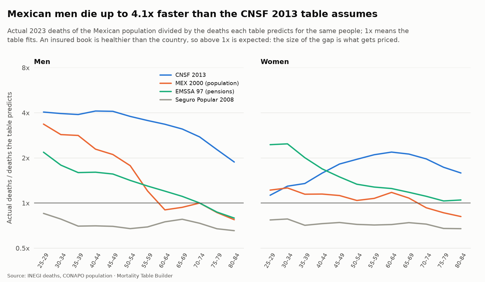

```{python}
#| label: setup
import sqlite3
from pathlib import Path

import numpy as np
import pandas as pd

DB = Path("../app/data/demo.sqlite")
con = sqlite3.connect(DB)
q = lambda sql: pd.read_sql(sql, con)
n = {}  # every number quoted in the text is computed here, from the data bundle

ls = q("SELECT * FROM life_summary WHERE year = 2023").set_index("sex")
n["e0_M"], n["e0_F"] = f"{ls.e0['M']:.1f}", f"{ls.e0['F']:.1f}"
n["e65_M"], n["e65_F"] = f"{ls.e65['M']:.1f}", f"{ls.e65['F']:.1f}"
n["disp_M"] = f"{ls.lifespan_disparity['M']:.1f}"

cnsf = q("SELECT age, qx FROM cnsf_rates WHERE \"table\" = 'CNSF M 2013' AND variant = 'base'").set_index("age")["qx"]
grad = q("SELECT sex, age, qx FROM graduated_qx WHERE year = 2023")
for s in ("M", "F"):
    g = grad[grad.sex == s].set_index("age")["qx"]
    n[f"ratio40_{s}"] = f"{g[40] / cnsf[40]:.1f}"
    n[f"ratio_med_{s}"] = f"{(g.loc[18:90] / cnsf.loc[18:90]).median():.1f}"

ex = q("SELECT * FROM excess_summary WHERE sex = 'T' AND year BETWEEN 2020 AND 2022")
n["excess"] = f"{ex.excess.sum():,.0f}"
n["excess_lo"], n["excess_hi"] = f"{ex.excess_low.sum():,.0f}", f"{ex.excess_high.sum():,.0f}"
n["excess_covid"] = f"{ex.excess.sum() / ex.covid_coded.sum():.2f}"
n["yll"] = f"{ex.years_lost.sum() / 1e6:.1f}"
n["p2021"] = f"{ex.set_index('year').p_score[2021]:.0%}"

pp = q("SELECT * FROM pricing_premiums WHERE sex = 'M' AND issue_age = 40 AND term = 20").iloc[0]
n["gross40"], n["net40"] = f"{pp.gross_premium_per_1000:.2f}", f"{pp.net_premium_per_1000:.2f}"
n["gross40_mxn"] = f"{pp.gross_premium:,.0f}"
n["year1"] = f"{-pp.year_1_profit / pp.gross_premium:.0%}"
n["load40"] = f"{pp.loading_over_net:.0%}"
ad = q("SELECT * FROM pricing_adequacy WHERE sex = 'M' AND issue_age = 40").set_index("basis")
n["pop_margin"] = f"{-ad.margin['population']:.0%}"
sens = q("SELECT * FROM pricing_sensitivity WHERE sex = 'M'").set_index("scenario")
n["mort20"] = f"{sens.margin['mortality +20%']:.1%}".replace("-", "")
n["pand2x_irr"] = f"{(sens.irr['base case'] - sens.irr['pandemic: year 2 mortality x2']) * 100:.1f}"

st = q("SELECT * FROM stress_pandemic_book")
n["replay"] = f"{st[(st.kind == 'replay') & (st.year == 2021) & (st.dampening == 1)].extra_pct.iloc[0]:.0%}"
n["replay_half"] = f"{st[(st.kind == 'replay') & (st.year == 2021) & (st.dampening == 0.5)].extra_pct.iloc[0]:.0%}"
n["regulator"] = f"{st[st.kind == 'regulatory'].extra_pct.iloc[0]:.0%}"
n["base_claims"] = f"{st.base_claims.iloc[0] / 1e6:,.0f}"
n["replay_mxn"] = f"{st[(st.kind == 'replay') & (st.year == 2021) & (st.dampening == 1)].extra_claims.iloc[0] / 1e6:,.0f}"
lg = q("SELECT * FROM stress_longevity").set_index("scenario")
n["int1"] = f"{lg.change_vs_central['interest_minus_1']:+.1%}"
n["x2"] = f"{lg.change_vs_central['improvement_x2']:+.1%}"
n["pens"] = f"{lg.change_vs_central['cnsf_pensions']:+.0%}"
hd = q("SELECT * FROM stress_hedge WHERE shock LIKE '%2021%'").iloc[0]
n["hedge_ratio"] = f"{hd.annuity_block_to_offset / hd.annuity_reserve:.1f}"

ag = q("SELECT * FROM reinsurance_aggregate")
n["pand_share"] = f"{(ag.capital.iloc[2] - ag.capital.iloc[1]) / ag.capital.iloc[2]:.0%}"
rs = q("SELECT * FROM reinsurance_structures").set_index("structure")
n["qs_price"] = f"{rs.price_of_relief['Quota share 40%']:.0%}"
n["xl_price"] = f"{rs.price_of_relief['Per-life XL 8M xs 1M']:.0%}"
n["sl_price"] = f"{rs.price_of_relief['Stop loss, 100% xs 115% of expected claims']:.0%}"
n["sl_relief"] = f"{rs.relief_share['Stop loss, 100% xs 115% of expected claims']:.0%}"
sw = q("SELECT * FROM reinsurance_longevity_swap").iloc[0]
n["swap_bp"] = f"{sw.fee_bps_per_year:.0f}"
n["swap_cap"] = f"{sw.capital_ratio:.1%}"
conc = q("SELECT * FROM reinsurance_concentration")
big = conc[conc.band.isin(["2M-5M", "5M+"])]
n["big_sar"] = f"{big.share_of_sum_at_risk.sum():.0%}"
n["big_pol"] = f"{big.share_of_policies.sum():.0%}"

rec = q("SELECT * FROM experience_recovery")
n["recovered"], n["planted"] = f"{int(rec.inside_interval.sum())}", f"{len(rec)}"
ov = q("SELECT * FROM experience_overview").iloc[0]
n["policies"] = f"{ov.policies:,.0f}"
n["deaths"] = f"{ov.deaths:,.0f}"
ci = q("SELECT * FROM cohort_tables WHERE sex = 'M'").iloc[0]
n["cohort_gap"] = f"{ci.annuity_understated_pct:.1%}"

# insured lives (version 2)
ip = q("SELECT * FROM insured_premiums WHERE term = 20 AND issue_age = 40")
def prem(table, sex):
    return float(ip[(ip["table"] == table) & (ip.sex == sex)].premium_per_1000.iloc[0])
for s in ("M", "F"):
    n[f"ins40_{s}"] = f"{prem('Mexico insured: Term, traditional', s):.2f}"
    n[f"mkt40_{s}"] = f"{prem('Mexico insured: All individual life', s):.2f}"
    n[f"pop40_{s}"] = f"{prem('Mexico population 2023', s):.2f}"
    n[f"cnsf40_{s}"] = f"{prem('CNSF 2013', s):.2f}"
n["us40_M"] = f"{prem('US 2017 Unloaded CSO composite male ALB', 'M'):.2f}"
n["ratio_cnsf_F"] = f"{prem('CNSF 2013', 'F') / prem('Mexico insured: Term, traditional', 'F'):.1f}"
ig = q("SELECT MIN(ratio_population) lo, MAX(ratio_population) hi FROM insured_table WHERE segment = 'all' AND age BETWEEN 25 AND 65").iloc[0]
n["gap_lo"], n["gap_hi"] = f"{ig.lo:.0%}", f"{ig.hi:.0%}"
pooled = q("SELECT segment, SUM(deaths) d, SUM(exposure) / 3 e FROM insured_pooled GROUP BY segment").set_index("segment")
n["ins_deaths"] = f"{pooled.d['all']:,.0f}"
n["ins_lives"] = f"{pooled.e['all'] / 1e6:.0f}"
ipn = q("SELECT * FROM insured_pandemic")
g = ipn.groupby(["source", "year", "band"])[["deaths", "exposure"]].sum().reset_index()
g["rate"] = g.deaths / g.exposure
b23 = g[g.year == 2023].set_index(["source", "band"]).rate
g["idx"] = [r.rate / b23[(r.source, r.band)] for r in g.itertuples()]
n["pan_ins"] = f"{g[(g.source == 'insured') & (g.year == 2021)].idx.max():.1f}"
n["pan_pop"] = f"{g[(g.source == 'population') & (g.year == 2021)].idx.max():.1f}"
mg = q("SELECT recommended_margin m, MAX(quadrature_margin) qm FROM insured_margin").iloc[0]
n["margin"], n["margin_q"] = f"{mg.m:.0%}", f"{mg.qm:.1%}"
si = q("SELECT * FROM pricing_insured WHERE term = 20 AND issue_age = 40").set_index("sex")
n["gi_M"], n["gc_M"], n["sv_M"] = f"{si.gross_premium_per_1000['M']:.2f}", f"{si.gross_premium_cnsf_per_1000['M']:.2f}", f"{si.saving_vs_cnsf['M']:.0%}"
n["gi_F"], n["sv_F"] = f"{si.gross_premium_per_1000['F']:.2f}", f"{si.saving_vs_cnsf['F']:.0%}"
n["observed"] = f"{st[(st.kind == 'observed') & (st.year == 2021)].extra_pct.iloc[0]:.0%}"
sx = q("SELECT * FROM insured_sensitivity WHERE sex = 'M' AND issue_age = 40 AND term = 20").set_index("alternative")
n["blend_over"] = f"{sx.change_vs_base['market blend of all products']:.0%}"
rel = q("SELECT * FROM insured_relativities WHERE segment = 'permanent' AND ages IN ('25-44', '45-65')")
n["rel_lo"], n["rel_hi"] = f"{rel.k.min():.1f}", f"{rel.k.max():.1f}"
lg_ = q("SELECT * FROM insured_ledger WHERE year = 2023")
n["ledger_share"] = f"{lg_[lg_.block == 'no_detail'].claims.sum() / lg_.claims.sum():.0%}"

vr = q("SELECT status, COUNT(*) c FROM validation_results GROUP BY status").set_index("status").c
n["checks"], n["pass"], n["warn"] = f"{vr.sum()}", f"{vr.get('PASS', 0)}", f"{vr.get('WARN', 0)}"
n["tables"] = f"{q('SELECT COUNT(*) c FROM table_docs').c.iloc[0]}"
```

# Executive summary {.unnumbered}

Mexico has no up-to-date mortality table that an actuary can use for the population as it is today, and none for the people an insurer actually quotes. The regulatory table in force (CNSF 2013) is more than a decade old and mixes both sexes; the insured-lives tables are older still. This project **rebuilds the table from the raw data** (INEGI registered deaths, CONAPO population) and then does with it what an insurer or a reinsurer does: prices a policy, reserves it, stresses it with the pandemic and with longevity, structures a reinsurance treaty and prices a longevity swap.

Version 2 adds the table a quote is priced on, built from the industry's own insured-lives statistics. The work is a pipeline with `{python} n['checks']` automated data checks, over four hundred unit tests and a one-command rebuild, so that every number in this report is computed from the data when the report is rendered. The book of policies used in the applications is **synthetic** and every market assumption is labeled illustrative; the mortality is real or derived from real data.

| What it found | Result |
|:--------------------|:----------------------------------|
| Life expectancy at birth, Mexico 2023 | `{python} n['e0_F']` years for women, `{python} n['e0_M']` for men |
| Mortality against the regulatory table, age 40 | men `{python} n['ratio40_M']` times, women `{python} n['ratio40_F']` times |
| Excess deaths 2020 to 2022 | `{python} n['excess']` (range `{python} n['excess_lo']` to `{python} n['excess_hi']` over four baselines); `{python} n['excess_covid']` per certified COVID-19 death |
| A repeat of 2021 on an insured book | `{python} n['replay']` more claims in a year, against `{python} n['regulator']` for the regulator's own stress |
| Annuity reserve | one point of interest (`{python} n['int1']`) matters more than doubling mortality improvement (`{python} n['x2']`) |
| Insured lives against the population (version 2) | they die at `{python} n['gap_lo']` to `{python} n['gap_hi']` of the population's rate between ages 25 and 65 |
| A quote: man of 40, 20-year term, net premium per 1,000 | `{python} n['ins40_M']` on the insured table, `{python} n['cnsf40_M']` on CNSF 2013, `{python} n['us40_M']` on the US insured table, `{python} n['pop40_M']` on the population |
| The pandemic, as insured lives lived it | up to `{python} n['pan_ins']` times their 2023 death rate in 2021 (the population: `{python} n['pan_pop']`); `{python} n['observed']` more claims on an insured book |
| Reinsurance | the pandemic is `{python} n['pand_share']` of the claims capital; a stop loss relieves `{python} n['sl_relief']` of it at a price of `{python} n['sl_price']` per peso of capital, a quota share `{python} n['qs_price']` |
| Experience study | `{python} n['recovered']` of `{python} n['planted']` planted effects recovered inside the 95% interval |

: Headline results {tbl-colwidths="[38,62]"}

## Resumen ejecutivo {.unnumbered}

**Mortality Table Builder** reconstruye las tablas de mortalidad de México a partir de los microdatos de defunciones del INEGI y de la población de CONAPO, y las utiliza como lo haría una aseguradora o una reaseguradora: precio de un seguro temporal para un rendimiento objetivo, reservas, pruebas de estrés de pandemia y longevidad, estructuras de reaseguro y un swap de longevidad.

La esperanza de vida al nacer en 2023 fue de `{python} n['e0_F']` años para las mujeres y `{python} n['e0_M']` para los hombres. Los hombres de 40 años mueren a `{python} n['ratio40_M']` veces la tasa de la tabla regulatoria CNSF 2013. Entre 2020 y 2022 murieron aproximadamente `{python} n['excess']` personas más de lo esperado (rango `{python} n['excess_lo']` a `{python} n['excess_hi']` según cuatro líneas base independientes). Una repetición de 2021 elevaría los siniestros de una cartera asegurada en `{python} n['replay']`; el escenario de estrés de la propia CNSF (percentil 99.5) solo contempla `{python} n['regulator']`.

**Versión 2: tabla de vida asegurada.** Con las estadísticas de la CNSF de Vida Individual (2021 a 2025) se construye la tabla con la que se cotiza un seguro. Los asegurados mexicanos mueren a entre `{python} n['gap_lo']` y `{python} n['gap_hi']` de la tasa de la población. Un hombre de 40 años, temporal a 20 años, paga una prima neta de `{python} n['ins40_M']` por millar con la nueva tabla, `{python} n['cnsf40_M']` con CNSF 2013 y `{python} n['pop40_M']` con la población. Los asegurados no estuvieron protegidos de la pandemia: en 2021 sus tasas de muerte llegaron a `{python} n['pan_ins']` veces las de 2023.

El proyecto incluye `{python} n['checks']` controles automáticos de datos, más de 400 pruebas unitarias y un procedimiento reproducible con un solo comando. La cartera de pólizas es **sintética** y los supuestos de mercado (gastos, comisiones, costo de capital) son ilustrativos.

# The problem and the approach

A mortality table is the input of every price, reserve and capital figure in life insurance and pensions. Three problems make the Mexican case interesting.

1. **The official table is old and generic.** CNSF 2013 is a mixed-sex table; Mexican men die at `{python} n['ratio_med_M']` times its median rate between ages 18 and 90, women at `{python} n['ratio_med_F']` times (graduated 2023 rates over the CNSF table).
2. **The data are good but not ready.** INEGI publishes every registered death, but deaths are registered late, ages are rounded, the 2020 to 2022 pandemic breaks every trend, and single-year-of-age deaths exist only from 2020. CONAPO's population disagrees with INEGI on who dies.
3. **Rates are not the end.** An actuary needs the rates smoothed, extended to old age, projected, turned into premiums and reserves, stressed, and reinsured. Each step has its own failure modes.

The approach is to build the whole chain and to **test every link**: each stage has data checks that fail loudly, each method is validated against something independent (a published table, an independent implementation in R, a planted truth), and every figure is traceable to a named table in the warehouse.

{width=95%}

# Data and its quality

| Source | Used for |
|:----------------------------|:----------------------------------------|
| INEGI registered deaths (microdata 2020 to 2024; interactive tables 2014 to 2019) | observed deaths by age, sex, state, cause |
| CONAPO population and projections, 1950 to 2070 | exposure, long history, official benchmark |
| CNSF 2013 regulatory tables (CUSF Annex 5.3.3-a, nine tables with their stress variants) | expected basis and pricing |
| SOA mort.soa.org (29 tables, 13 Mexican) | benchmark tables |
| Human Mortality Database (9 countries) | international comparison; used in the pipeline, never redistributed |

: Sources {tbl-colwidths="[55,45]"}

Every downloaded file is logged with its URL, date and SHA-256, and a data check recomputes the checksums. **Late registration** is the main bias: deaths registered after the file closes appear in the next year's file. A chain-ladder completion by age band adds them, bringing 2024 to 814,221 deaths against CONAPO's 820,400. **Age heaping** is absent in the registered deaths (Whipple index 98 to 101), but graduation later finds a 1.3% to 2.5% excess at ages ending in 0 and 5 among men.

The warehouse holds `{python} n['tables']` tables, each with a one-line description; `{python} n['checks']` automated checks run on it (`{python} n['pass']` pass, `{python} n['warn']` warn). The four warnings are known gaps of the data, documented and corrected downstream, not hidden.

# From deaths to rates

Crude death rates are deaths over exposure, with exact Poisson confidence intervals. Age-standardized rates (Segi weights) make states and years comparable; standardized mortality ratios rank the states. The rates are benchmarked against every Mexican table in use with an actual-to-expected (A/E) ratio.

{width=85%}

Two findings shape everything that follows. First, **Mexican men aged 40 die at `{python} n['ratio40_M']` times the CNSF rate**, women at `{python} n['ratio40_F']` times: the unisex regulatory table is far too light for the male population and much closer for women. Second, the tables built from insured lives (CNSF 2000-I, Experiencia Mexicana) lie well below the population, which is the selection that underwriting is supposed to produce.

# Graduation

Rates at single ages are noisy, and at old ages unreliable. Four graduation methods are fitted per year and sex: a penalized spline (P-spline, with the smoothing parameter chosen by an information criterion corrected for over-dispersion), Whittaker-Henderson, Heligman-Pollard and Gompertz-Makeham. The dispersion is estimated from the crude rates' own fourth differences (1.0 to 3.1), which determines how much smoothing the data support.

{width=85%}

Above age 89 a **Kannisto** logistic is fitted on ages 75 to 89 and extended to 110 with q(110) = 1, and the men's rates are floored at the women's. The crude data show a sex crossover from about age 88 (women appearing to die faster than men), a classical sign of age exaggeration, which the closure corrects. The parametric Heligman-Pollard model fits about nine times worse than the spline in 2023: kept as a comparison, not used.

# Life tables and commutation functions

The graduated rates become life tables (lx, dx, Lx, ex, with the fraction of the year lived by those who die) and commutation columns (Dx, Nx, Cx, Mx) at 3%, 4% and 5%. The tables are validated against independent sources: they reproduce the Human Mortality Database's published life expectancy to 0.007 years when fed HMD data, and agree with CONAPO's own life expectancy within 0.7 years in 2022 to 2024.

In 2023 life expectancy at birth was `{python} n['e0_F']` years for women and `{python} n['e0_M']` for men; at 65, `{python} n['e65_F']` and `{python} n['e65_M']`. Mexican men's **lifespan disparity** (the dispersion of ages at death) is `{python} n['disp_M']` years, against 9.9 in Japan: at the same average, Mexican deaths are much less predictable, which is a reserving problem as much as a public-health one.

{width=85%}

# Projection

Mortality improves, and the improvement slows and stops. Two classical models are fitted to the CONAPO reconstruction of 1970 to 2019: **Lee-Carter** (Poisson likelihood, random walk with drift on the period index) and **Cairns-Blake-Dowd** (a two-factor model for older ages). Scenarios restart at the observed 2024 rates, so the pandemic does not contaminate the jump-off.

{width=85%}

Three things make the projection trustworthy rather than merely sophisticated.

- **Cross-check.** The same models are fitted in R with StMoMo, an independent implementation; the two agree to 2 x 10^-5^ years in life expectancy.
- **Backtest.** Models are refitted from past dates and scored 10 and 20 years ahead. Men's improvement slowed to about 15% of its earlier pace after 1999, so a forecast made in 1999 overshoots the 2019 male life expectancy by 3.9 years (women 2.3). The model's own prediction interval covers only 40% to 60% of the outcomes, so an **empirical, square-root-of-horizon band** calibrated on these errors is added.
- **Honest scenarios.** The long-run trend puts male life expectancy in 2050 at 77.0 years, the recent trend at 74.3, CONAPO's official projection at 77.3. Which one an actuary believes is the largest uncertainty of any Mexican longevity price.

An annuity priced on this year's period table understates its cost by `{python} n['cohort_gap']` against the cohort that actually retires, because the buyer lives their old age in the future.

# The insurer experience study

Population mortality is not an insurer's mortality. The experience study answers the question a company's actuary asks: how do **our** policyholders die against the table? It is built to work on any policy extract (`mortality experience run`) and validated on a synthetic portfolio.

The method, in the order a real study runs:

1. **Validation with reconciliation**: every record is checked (duplicates, impossible dates, invalid codes) and the study reports exactly how many records and deaths each rule removed, reconciling from the extract to the clean file to the record and the death.
2. **Exact exposure** by Lexis piece (anniversaries and calendar years), with left truncation.
3. **A/E by count and amount**, with Poisson intervals and credibility (limited-fluctuation and Bühlmann-Straub).
4. **Rating relativities** from a Poisson regression with a dispersion estimated on binned residuals.
5. **Select period** with isotonic smoothing.
6. **Claims-lag completion**: the reporting delay is estimated from mature quarters and used to complete the recent ones, so the latest quarter does not look better than it is.
7. **A derived company basis** with a prudent margin, and its effect on prices and on the in-force block.

**How do we know it is right?** The portfolio is synthetic, so the truth is known: 15 rating effects, 10 select factors and a reporting-lag curve were *planted* and the study never sees them. It recovers `{python} n['recovered']` of `{python} n['planted']` effects inside their 95% intervals (about 14 or 15 expected by chance), the select factors 10 of 10, and completes the latest quarter to within 2% of the truth (it reads 19.5% short without the correction).

{width=80%}

# The insured-lives table (version 2)

The population table answers population questions and is the wrong tool for a quote: people who buy life insurance are wealthier, underwritten and mostly urban. Version 2 builds the table from the CNSF's own individual life statistics for 2021 to 2025: `{python} n['ins_deaths']` death claims and about `{python} n['ins_lives']` million insured lives a year in the three base years 2023 to 2025. Every column total is reconciled to the raw spreadsheet cells.

**Three traps in the data would each have moved the premium.** About `{python} n['ledger_share']` of the death claims have no age or sex, and they are not deaths but an adjustment ledger (cancellations outweigh new claims every year, the count stays flat while real deaths halve, and COVID causes appear years after the pandemic). About 2,300 claims blamed on a sprained ankle are endowment maturities booked under the death cover (ages 60 to 69, 3.6 times a normal claim). And deaths must be counted against the lives holding the death cover, not every insured life.

**A table family, not a table.** Whole life and endowments die at up to `{python} n['rel_hi']` times traditional term, so traditional term, credit life and whole life are graduated on their own (Poisson P-splines chosen by one common dispersion and by out-of-sample shape, against Gompertz-Makeham and Brass), thin segments are multiples of traditional term, and the market-wide table is an exposure-weighted blend. Quoting a traditional-term policy on the market-wide table would overcharge by `{python} n['blend_over']`.

| Net premium per 1,000, 20-year term at 40 | Men | Women |
|:----------------------------------|----------:|----------:|
| Insured, traditional term | `{python} n['ins40_M']` | `{python} n['ins40_F']` |
| Insured, market-wide | `{python} n['mkt40_M']` | `{python} n['mkt40_F']` |
| CNSF 2013 (unisex) | `{python} n['cnsf40_M']` | `{python} n['cnsf40_F']` |
| Mexican population | `{python} n['pop40_M']` | `{python} n['pop40_F']` |

: What the table changes in a quote {tbl-colwidths="[56,22,22]"}

{width=95%}

**Where it is not reliable.** Above about age 60 for term and 83 for whole life the insured data stop describing insured lives (a term runs out; lives who died stay in the books), so the table follows the population's shape and the gap closes to zero by 105: an assumption, flagged in every table and figure. A standard 20-year term at 40 uses only ages 40 to 59, inside the data.

**What it changes downstream.** A margin of `{python} n['margin']` on mortality is sized from the adverse readings that cannot be ruled out (`{python} n['margin_q']` in quadrature). Priced on the insured table against the CNSF 2013 statutory reserve, the 20-year term of a man of 40 needs a gross premium of `{python} n['gi_M']` per 1,000 against `{python} n['gc_M']` on CNSF 2013 (`{python} n['sv_M']` lower); a woman's is `{python} n['sv_F']` lower. Replaying 2021 as insured lives lived it adds `{python} n['observed']` to a year's claims.

{width=85%}

# Applications

## Excess mortality in the pandemic

Excess deaths are observed deaths less a counterfactual nobody observed, so one baseline gives a number that looks more certain than it is. Four baselines on different assumptions are built (flat 2019 rates, a 2014 to 2019 trend, interpolation to the observed 2023, Lee-Carter rescaled to the INEGI level) and the range is reported.

**About `{python} n['excess']` more people died in 2020 to 2022 than would have** (range `{python} n['excess_lo']` to `{python} n['excess_hi']`), `{python} n['excess_covid']` for each death certified as COVID-19, costing `{python} n['yll']` million years of life. The baselines agree within 2.6% to 7.4% and predict 2023 to within 4%, so mortality did return to trend. The excess is steep in age: men aged 65 to 69 died at 1.70 times the expected rate in 2021.

{width=85%}

## Pricing, profit testing and reserves

A level-term policy is priced by solving for the premium that earns a 10% return in a profit test with acquisition cost, commission, expenses, lapses and a statutory reserve. The test has an identity that must hold, and does (with no expenses or lapses, the same interest and the net premium, the profit is exactly zero every year).

For a man of 40, 20-year term, sum assured 1,000,000 on CNSF 2013, the gross premium is `{python} n['gross40']` per 1,000 (net `{python} n['net40']`, a loading of `{python} n['load40']`). The policy **loses `{python} n['year1']` of its first premium** on day one and pays back in year 19 once discounted at the target. Fixed on the regulatory table, the same premium would cost `{python} n['pop_margin']` of premium if the buyer died like the Mexican population: underwriting is what makes the product viable. A 20% change in mortality moves the margin by `{python} n['mort20']`; a single year of doubled mortality costs `{python} n['pand2x_irr']` points of IRR, two thirds of the target return.

{width=85%}

## Pandemic and longevity stress tests

The pandemic profile (the P-score of each age band and sex in 2021) is replayed on the in-force block of the synthetic portfolio (392,274 policies, MXN 414 billion of sum assured). Expected claims for the next year are MXN `{python} n['base_claims']` million; a repeat of 2021 **adds `{python} n['replay']`** (MXN `{python} n['replay_mxn']` million), or `{python} n['replay_half']` if insureds are healthier than the population. The regulator's own 99.5th percentile table adds `{python} n['regulator']`: it would not have covered 2021 if insured lives had died like the population. The insured statistics of version 2 confirm it and go further: replaying 2021 *as insured lives lived it* adds `{python} n['observed']`.

On an illustrative annuity block, one point less interest adds `{python} n['int1']` to the reserve, more than doubling the projected improvement (`{python} n['x2']`); the regulatory pensions table holds `{python} n['pens']` over the central projection. A pandemic and longevity are natural hedges: an annuity block `{python} n['hedge_ratio']` times the size of the life book would offset a repeat of 2021 exactly.

{width=85%}

## Reinsurance

On a simulated year of claims with three sources of uncertainty (who dies, the level of mortality, a pandemic one year in thirty), the **pandemic is `{python} n['pand_share']` of the capital**, while policies of 2 million or more are `{python} n['big_pol']` of the policies and `{python} n['big_sar']` of the sum at risk. Covers are compared by the price of the capital they relieve against the cedant's own cost of capital: proportional treaties cost about `{python} n['qs_price']` of the capital they relieve, a per-life excess of loss `{python} n['xl_price']`, a stop loss `{python} n['sl_price']`. The per-life cover stays worth buying only while the reinsurer asks under about 7% on its own capital.

A longevity swap on the annuity block needs risk capital of `{python} n['swap_cap']` of the reserve and a fee of about `{python} n['swap_bp']` basis points a year. Yearly renewable term treaties are experience-rated by cedant segment with a credibility that allows for the variability of claim sizes: amounts need about 3,000 deaths for full credibility, not the 1,082 of counts.

{width=85%}

# Validation and reproducibility

| Layer | What |
|:--------------|:-------------------------------------------|
| Data checks | `{python} n['checks']` rules on the warehouse: identities that must hold (FAIL) and known gaps (WARN) |
| Unit tests | over 400, including property tests (exposure splitting), identities (zero profit) and recovery tests (planted effects) |
| Independent checks | HMD life expectancy to 0.007 years; StMoMo in R to 2 x 10^-5^ years; the Excel workbook recomputed by a separate formula engine to 10^-9^ |
| Provenance | SHA-256 manifest of every input; each table described in the catalog |
| Rebuild | `uv sync`, then `mortality db build`: the warehouse, the checks and the figures from the sources |
| Continuous integration | lint, formatting, tests and dashboard tests on every commit |

: How the work is checked {tbl-colwidths="[22,78]"}

The dashboard (`mortality app`) and an **Excel workbook with live commutation formulas** (`mortality export-excel`) are the two ways to use the results without code. The workbook writes lx, dx, Dx, Nx, Cx and Mx as Excel formulas driven by one interest cell, with a premium calculator on top, so an actuary can audit every number.

# Limitations

- **The books are synthetic and the market terms are assumptions.** Expenses, commissions, lapses, the 10% hurdle, the reinsurer's 6% cost of capital and the pandemic's probability are illustrative; the conclusions that hinge on them say so.
- **Data limits.** Single-year-of-age deaths exist only from 2020; the long projection history is CONAPO's reconstruction, and INEGI and CONAPO disagree on the age pattern of deaths (men 15 to 39: 34% fewer deaths in INEGI), which breaks life expectancy at 65 across the 2019/2020 join.
- **Method limits.** The stress tests are one-year shocks on a static block; the reinsurance analysis has no credit or basis risk; the layer prices in the thin tail carry simulation noise; the longevity swap uses a single normal around the central projection, not the stochastic fan.
- **Insured lives.** The CNSF statistics are aggregated industry data: no policy duration (so no select table), a head count of lives instead of person-years, claims counted in the year they are booked, and reporting that differs between insurers. The 2018 to 2020 format is not pooled (the share of women moves by ten points in a year). Above the credible range the table is the population's shape by assumption.
- **Scope.** This is not a pricing basis for a regulated product, a reserve certification, or a substitute for a company's own experience. It is a worked, tested demonstration of the method, which can be pointed at a real extract.

# References {.unnumbered}

- Cairns, A., Blake, D., Dowd, K. (2006). A two-factor model for stochastic mortality with parameter uncertainty. *Journal of Risk and Insurance* 73(4).
- Eilers, P., Marx, B. (1996). Flexible smoothing with B-splines and penalties. *Statistical Science* 11(2).
- Heligman, L., Pollard, J. (1980). The age pattern of mortality. *Journal of the Institute of Actuaries* 107.
- Kannisto, V. (1994). *Development of Oldest-Old Mortality, 1950-1990*. Odense University Press.
- Lee, R., Carter, L. (1992). Modeling and forecasting U.S. mortality. *Journal of the American Statistical Association* 87.
- Villegas, A., Millossovich, P., Kaishev, V. (2018). StMoMo: an R package for stochastic mortality modeling. *Journal of Statistical Software* 84(3).
- Human Mortality Database. University of California, Berkeley, and Max Planck Institute for Demographic Research. www.mortality.org.
- INEGI, *Estadísticas de defunciones registradas*; CONAPO, *Proyecciones de la población de México y de las entidades federativas*; CNSF, *Circular Única de Seguros y Fianzas*, Anexo 5.3.3-a.
- Society of Actuaries, mort.soa.org, *Mortality and Other Rate Tables*.

Code, data lineage and the full write-up of every step: <https://github.com/deadmigue55/Mortality-Table-Builder>.
